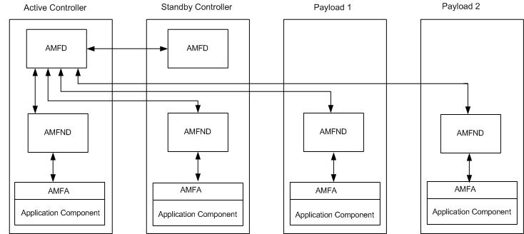

# OpenSAF Availability Management Framework (AMF)

**Release:** Release 5.20.08 Programmer's Reference  
**Date:** August 2020  
**Copyright:** © OpenSAF, 2008  

> [!NOTE]
> For OpenSAF architecture overview, SAF AIS compliance, and document conventions, see the [OpenSAF Overview](OpenSAF_Overview_PR.md) and centralized [GLOSSARY.md](GLOSSARY.md).

---

# Overview

## Availability Management Framework Overview

The OpenSAF Availability Management Framework (AMF is the core service
of the OpenSAF software. It provides service availability to
applications by coordinating the redundant resources in a cluster to
provide a system with no single point of failure. It provides
high-availability mechanisms to the application software it manages.
These include life-cycle management of application software, fault
detection, fault isolation, escalation, recovery, and repair.

The AMF functionality is a compliant implementation of Service
Availability Forum’s Application Interface Specification of Availability
Management Framework (SAI-AIS-AMF-B.04.01 and OI implementation
according to SAI-AIS-IMM-A.03.01).

The Availability Management Framework (AMF) provides the following
functionality:

  - Leverage the SAF "System Description and Conceptual Model"
  - Honor the “Availability Management Framework" API.
  - Depends on CLM service and honors CLM track callbacks and takes
    appropriates actions for nodes leaving/joining the cluster.
  - As OI implements all the classes defined in UML model of
    SAI-AIS-B.04.01 specification.

The AMF maintains a software system model database which captures
SAF-described logical entities and their relationships to each other.
The software system model database is initially configured from data
contained in the System Description file. Through time the system model
will modify due to changing system realities and administrative actions.

The SAF logical entities related in the system model include components
which normalize the view of physical resources such as processes,
drivers or devices. Components are grouped into Service Units according
to fault dependencies that exist among them. Service Units of the same
type are grouped into Service Groups (SG) which exhibit particular
redundancy modeling characteristics. Service Units within a SG are
assigned with Service Instances (SI) and given a High Availability state
of active and standby on behalf of SI.

Further functionality provided by AMF includes:

  - Automatic and administrative means to instantiate, terminate and
    restart resources
  - Automatic and administrative means to manage or reflect Service
    Group, Service Unit,  
    Service Instance and Resource state
  - To perform admin operations on the objects(logical entities) manged
    by AMF
  - Health-check services to probe and prevent system trauma that lead
    to faults
  - Fault recovery mechanisms to fail-over SIs which maintain service
    availability in case of system trauma
  - Fault repair mechanisms to restore failed components

The AMF itself cannot be a single-point of failure. It provides its own
internal scheme and mechanisms to protect itself from its own failure.

## Models and Concepts

This chapter provides information on:

  - Service Structure and architecture
  - Compliance to SAF standard
  - Service Dependencies
  - References to SAF documents which provide details about the service
    functionality
  - Service Extensions
  - Implementation Notes
  - Configuration

### Service Structure Overview

Availability Management Framework is made up of the following
distributed sub-parts:

  - Availability Management Framework Director
  - Availability Management Framework Node Director
  - Availability Management Framework Agent
  - Availability Management Framework Watchdog

Figure 1 Availability Management Framework - Sub-parts

#### Availability Management Framework Director

The Availability Director (AMFD) maintains the entire system model,
consisting of nodes, the Service Groups (SG), their constituent Service
Units (SUs), their constituent components, and their corresponding
component service instance (CSI) and service instances (SIs) that are in
the system. There is an active and a standby instance of the AMFD in a
system. The AMFD runs on the system controller node.

Its main tasks include fault detection, isolation and recovery
procedures as defined in the SAF AMF. Any problems and failures on a
component that cannot be handled locally, are prompted to the
Availability Director which controls and triggers the isolation of the
affected component and, if possible, the activation of a stand-by
component.

#### Availability Management Framework Node Director

The Availability Node Director (AMFND) resides on each system node and
its main task is to maintain the node-scoped part of the software system
model described above.

The AMFND coordinates local fault identification and repair of
components and furthermore facilitates any wishes it receives from the
Availability Director.

The AMFND watches for components arriving or leaving the system and
summarizes this information in a Service Unit (SU) presence state, and
keeps the AMFD informed about the current status and changes. The AMFND
is capable of disengaging, restarting and destroying any component
within its scope. This may occur according to AMFD instructions or as a
result of an administrative action or automatically triggered by
policies.

#### Availability Management Framework Agent

The Availability Management Framework Agent (AMFA) is the linkable
library that provides a means for the AMF to exchange information with
system components overseen by the process in which this library is
planted. It does not run as a separate thread.

The AMFA implements the SAF Availability Management Framework API and
provides the entry-point for accessing AMF functionality.

#### Availability Management Framework Watchdog

The AMF Watchdog is a component that guarantees the high availability of
the AMF node director by monitoring its health at regular intervals
through AMF invoked health check.

### Compliance Report

Availability Management Framework conforms to the Application Interface
specifications mentioned in the following SAF documents:

  - Availability Management Framework (SAI-AIS-AMF-B.04.01).
  - Cluster Membership Service (SAF-AIS-CLM-B.04.01)
  - Information Model Management Service (SAI-AIS-IMM-A.03.01)
  - Notification Service (SAI-AIS-NTF-A.03.01)

Table 1 Compliance Table - Availability Management
Framework(SAI-AIS-AMF-B.04.01)

<table>
<tbody>
<tr class="odd">
<td>1</td>
<td>Document Introduction</td>
<td>NA</td>
<td>Informational</td>
</tr>
<tr class="even">
<td>2</td>
<td>Overview</td>
<td>NA</td>
<td>Informational</td>
</tr>
<tr class="odd">
<td>3</td>
<td>System Description and System Model</td>
<td>Yes</td>
<td></td>
</tr>
<tr class="even">
<td>3.1</td>
<td>Logical Entities</td>
<td>Yes, partly</td>
<td>Constituent sub-sections that are only partially supported or not supported are mentioned below. Note that the rest of the sub-sections are fully supported.</td>
</tr>
<tr class="odd">
<td>3.1.2.1.1</td>
<td>Container and Contained Components</td>
<td>No</td>
<td></td>
</tr>
<tr class="even">
<td>3.1.2.3</td>
<td>Proxy and Proxied Components</td>
<td>Yes, partly</td>
<td>External Components, internode proxy-proxied feature not supported. Also proxy-proxied feature is supported as per AMF B1.1 Specification.</td>
</tr>
<tr class="odd">
<td>3.2</td>
<td>State Models</td>
<td>Yes</td>
<td></td>
</tr>
<tr class="even">
<td>3.3</td>
<td>Fail-over and Switch-over</td>
<td>Yes</td>
<td></td>
</tr>
<tr class="odd">
<td>3.4</td>
<td>Possible Combination of States for Service Units</td>
<td>Yes</td>
<td></td>
</tr>
<tr class="even">
<td>3.5</td>
<td>Component Capability Model</td>
<td>Yes, partly</td>
<td>
SU having Components configured with multiple capability models with different maxActCSI, maxStandbyCSI is not supported.

If there is configuration, which has mismatch of number of components in SU with that of number of CSIs in assigned SI to that SU, then this feature is not well tested in NpM, NWay, NWayAct and NoRed Model.
</td>
</tr>
<tr class="odd">
<td>3.6</td>
<td>Service Group Redundancy Model</td>
<td>Yes, partly</td>
<td>Constituent sub-sections that are only partially supported or not supported are mentioned below. Note that the rest of the sub-sections are fully supported.</td>
</tr>
<tr class="even">
<td>3.6.1</td>
<td>Common Characteristics</td>
<td>Yes, partly</td>
<td>
AMF currently does not support the failback option.

Ordered list of service units for a service group: Uninstantiation of SUs in an SG wrt Lock_In operation on SG will be reverse of instantiation order. However, this is not supported wrt Lock_In operation on Node and on other AMF entities higher than SG and Node.
</td>
</tr>
<tr class="odd">
<td>3.6.2</td>
<td>2N Redundancy Model</td>
<td>Yes</td>
<td>
SIs with unconfigured  saAmfSIRank will be given least priority while considering SIs for assignment.

In 2N model, deviations related to shutdown operation on SI:

When shutdown operation on SI is issued and if there are

some faults (component failover, SU failover or node failover) on

components on SU getting quiescing csi cbk, then in the following situation

TRY_AGAIN is returned and admin state is rolled back to unlock:

For SI having only one SUSI:

   Without SI Dep : a.) in comp fo

For SI having two SUSI:

   Without SI Dep : a.) in node fo, su fo, comp fo

   With SI Dep : a.) node fo, su fo

In other cases below, the admin state is marked locked :

For SI having only one SUSI:

   Without SI Dep : a.) node fo, su fo

   With SI Dep :   a.) node fo, su fo, comp fo

For SI having two SUSI:

   With SI Dep : a.) Comp fo

Default value of saAmfSGNumPrefInserviceSUs will be the number of configured service units for the service group.
</td>
</tr>
<tr class="even">
<td>3.6.3</td>
<td>N+M Redundancy Model</td>
<td>Yes, partly</td>
<td>
SIs based on saAmfSIRank are assigned to SUs based on saAmfSURank till each SU is assigned

SUs with unconfigured  saAmfSURank will be given least precedence in the order of instantiation

SIs with unconfigured  saAmfSIRank will be given least priority while considering SIs for assignment

 saAmfSGMaxActiveSIsperSU number of SIs. If there are SIs still left without assignments than the SUs will be assigned with SIs up to their capability level. The standby assignments of all the SIs assigned to an active SU will be assigned to the same standby SU. The saAmfSGMaxActiveSIsperSU can be leveraged by the configurator to get the required spread of SI assignments to the SUs.

AMF currently doesn’t support reduction procedure feature. Equal distribution of SI assignments happens when no saAmfSURank attribute is configured for any SU or all the SUs in the SG have the same value for saAmfSURank. Here the active SI assignments are equally distributed among the designated active SUs in the SG and the standby SI assignments are equally distributed among the designated standby SUs.

Runtime equal distribution of SIs assignments is triggerred when the saAmfSGAutoAdjust flag is set to SA_TRUE

Reduction procedure is not implemented in the following cases:

3.6.3.4.1: 
Step 3: Reduction of the Number of Active Service Units

Step 4: Reduction of the Standby Assignments for some SIs

Step 5: Reduction of the Active Assignments for some SIs
</td>
</tr>
<tr class="odd">
<td>3.6.4</td>
<td>N-Way Redundancy Model</td>
<td>Yes, partly</td>
<td>
SIs based on saAmfSIRank are assigned to SU based on saAmfSUsperSIRankTable till all the SIs are assigned an active assignment. Then each SI based on saAmfSIRank is assigned fully to SUs as standby before the next SI is assigned as standby. When an SU fails and the system is in a degraded state, AMF may ignore the saAmfCompNumMaxActiveCsi attribute of a component and assign more active assignments than the permitted number. This policy has been adopted to maintain service continuity for as many SIs as possible even when the system is in a degraded state.

SUs with unconfigured  saAmfSURank will be given least precedence in the order of instantiation

SIs with unconfigured  saAmfSIRank will be given least priority while considering SIs for   assignment

AMF currently doesn’t support reduction procedure feature.

In N-Way equal distribution of SI assignments is triggered when no saAmfSURank is configured or all the SUs have same rank value. Additionally the saAmfSIRankedSU should also not be configured for any of the SIs protected by this SG to achieve equal distribution of the SI assignments. The Standby SI assignments and Active SI assignments are distributed equally among the in-service SUs in an independent manner i.e. all the SUs have equal number of standby SI assignments and equal number of active SI assignments to the extent possible.

Runtime equal distribution is trigerred when saAmfSGAutoAdjust flag is set to SA_TRUE. First the active SI assignments are readjusted for equal distribution and then standby SI assignments are readjusted for equal distribution.

Reduction procedure is not implemented in the following cases:

3.6.4.4.1:

Assignment IV: Partial Assignment with Reduction of SIs Redundancy Level

Assignment V: Partial Assignment with SIs Drop-Outs

AMF doesn't make changes in the assignments for dynamically configured/deleted SaAmfSIRankedSU.

SaAmfRank of SaAmfSIRankedSU is not being communicated to components.
</td>
</tr>
<tr class="even">
<td>3.6.5</td>
<td>N-Way Active Redundancy Model</td>
<td>Yes, partly</td>
<td>
AMF assigns an SI to SU only after the SI with better saAmfSIRank is fully assigned.

SUs with unconfigured  saAmfSURank will be given least precedence in the order of instantiation

SIs with unconfigured  saAmfSIRank will be given least priority while considering SIs for assignment

AMF currently doesn’t support reduction procedure feature.

Equal distribution of active SI assignments happens when saAmfSURank is not configured or when all the SUs have the same Rank value and additionally saAmfSIRankedSU should also be not configured for any of the SIs protected by the SG.

Runtime equal distribution happens when saAmfSGAutoAdjust is set to SA_TRUE.

Reduction procedure is not implemented in the following cases:

3.6.5.4.1:

Assignment IV: Partial Assignment with Reduction of SIs Redundancy Level

Assignment V: Partial Assignment with SIs Drop-Outs

AMF doesn't make changes in the assignments for dynamically configured/deleted SaAmfSIRankedSU. 
</td>
</tr>
<tr class="odd">
<td>3.6.6</td>
<td>No Redundancy Model</td>
<td>Yes, partly</td>
<td>
Reduction procedure is not implemented in the following cases

3.6.6.4.1:

Assignment III: Partial Assignment
</td>
</tr>
<tr class="even">
<td>3.6.7</td>
<td>The Effect of Administrative Operations on Service Instance Assignments</td>
<td>Yes</td>
<td></td>
</tr>
<tr class="odd">
<td>3.7</td>
<td>Component Capability Model and Service Group Redundancy Model</td>
<td>Yes</td>
<td></td>
</tr>
<tr class="even">
<td>3.8</td>
<td>Dependencies Among SIs, Component Service Instances, and Components</td>
<td>Yes, partly</td>
<td>Constituent sub-sections that are only partially supported or not supported are mentioned below. Note that the rest of the sub-sections are fully supported.</td>
</tr>
<tr class="odd">
<td>3.8.1.1</td>
<td>Dependencies Between SIs when Assigning a Service Unit Active for a Service Instance</td>
<td>Yes , partly</td>
<td>
Supported for 2N red only.

Dynamic creation of SI-SI dependency is allowed only when Dependent SI doesn’t have any assignments.

If Tolerance timer expires during failover(during transition time, when there is no Active), user might see some delay in unassignment of dependant SI's.

In this case AMF restarts the Tolerance timer on the new Active.

If tolerance timer is running on any SI of a SG, then any admin operation on that SG or on any SI/SU of that SG fails with result as TRY_AGAIN.
</td>
</tr>
<tr class="even">
<td>3.8.1.2</td>
<td>Impact of Disabling a Service Instance on the Dependent Service Instances</td>
<td>Yes</td>
<td></td>
</tr>
<tr class="odd">
<td>3.8.1.3</td>
<td>Dependencies Between Component Service Instances of the Same Service Instance</td>
<td>Yes, partly</td>
<td>
In restart and si swap cases if multiple csi's are assigned to the same component then csi dependency is not honored

The configuration having CSI-CSI Dependency feature along with SI-SI Dependency within the same SU is partly supported. Faults are not handled.
</td>
</tr>
<tr class="even">
<td>3.8.2</td>
<td>Dependencies Among Components</td>
<td>Yes, partly</td>
<td></td>
</tr>
<tr class="odd">
<td>3.10</td>
<td>Component Monitoring</td>
<td>Yes</td>
<td></td>
</tr>
<tr class="even">
<td>3.11</td>
<td>Error Detection, Recovery, Repair, and Escalation Policy</td>
<td>Yes, partly</td>
<td>Constituent sub-sections that are only partially supported or not supported are mentioned below. Note that the rest of the sub-sections are fully supported.</td>
</tr>
<tr class="odd">
<td>3.11.1.3</td>
<td>Recovery</td>
<td>Yes , partly</td>
<td>
Component Failover: In Nway, N-Way Active and N+M redundancy models, all assignments of the faulted SU will be removed gracefully. Also for all red models, if an unassigned or assigned component faults with comp-failover recovery, AMF will repair it after removal of assignments from its SU.

Su Failover: AMF abruptly terminates all components of faulted SU without honoring component instantiation order.

During component restart, AMF reassigns exactly the same HA state all CSIs one by one with csiFlags as TARGET_ONE.

Even if configuration supports, AMF will skip suRestart recovery during recovery escalations in the following cases :

 1)When saAmfSUPresenceState of failed SU is  SA_AMF_PRESENCE_INSTANTIATING or SA_AMF_PRESENCE_RESTARTING.

 2)When assignments for some or all SIs are pending on the SU.
</td>
</tr>
<tr class="even">
<td>3.11.1.4</td>
<td>Repair</td>
<td>Yes, partly</td>
<td>Only automatic repair by component restart is supported. In case of fail-over of SU as a single entity, saAmfSGAutoRepair will be considered by AMF to repair the faulted SU.</td>
</tr>
<tr class="odd">
<td>3.11.1.5</td>
<td>Recovery Escalation</td>
<td>Yes</td>
<td></td>
</tr>
<tr class="even">
<td>3.11.2.1</td>
<td>Recommended Recovery Action</td>
<td>Yes, partly</td>
<td>
SA_AMF_APPLICATION_RESTART and SA_AMF_CONTAINER_RESTART not supported.

NO Recommendation recovery action is implemented as component failover
</td>
</tr>
<tr class="odd">
<td>3.11.2.2</td>
<td>Escalations of Levels 1 and 2</td>
<td>Yes</td>
<td>
During Escalation of Level1, AMF will perform su restart recovery with following deviations:
</td>
</tr>
<tr class="even">
<td>3.11.2.3</td>
<td>Escalations of Levels 3</td>
<td>Yes</td>
<td></td>
</tr>
<tr class="odd">
<td>4</td>
<td>Local Component Life Cycle Management Interfaces</td>
<td>Yes, partly</td>
<td>INSTANTIATE command: SAF_CLC_NO_RETRY (200) error code is not implemented.</td>
</tr>
<tr class="even">
<td>5</td>
<td>Proxied Components Management</td>
<td>Yes, partly</td>
<td>
SA_AMF_PRESENCE_ORPHANED Presence state is used which not part of Spec.

Proxy-proxied feature is implemented as per AMFSpec B 1.1.
</td>
</tr>
<tr class="odd">
<td>6</td>
<td>Contained Component Management</td>
<td>No</td>
<td></td>
</tr>
<tr class="even">
<td>7</td>
<td>Availability Management Framework API</td>
<td>Yes , Partly</td>
<td>Constituent sub-sections that are only partially supported or not supported are mentioned below. Note that the rest of the sub-sections are fully supported.</td>
</tr>
<tr class="odd">
<td>7.1.7</td>
<td>Correlation of Notifications</td>
<td>No</td>
<td></td>
</tr>
<tr class="even">
<td>7.4.4.5</td>
<td>Administrative State</td>
<td>Yes</td>
<td>SA_AMF_ADMIN_LOCKED_INSTANTIATION is the newly added state. So, new admin operations SA_AMF_ADMIN_LOCK_INSTANTIATION and SA_AMF_ADMIN_UNLOCK_INSTANTIATION are also supported. Check [Appendix A](#appendix-a) for supported/unsupported administrative operations on different classes.</td>
</tr>
<tr class="odd">
<td>7.4.4.7</td>
<td>HA Readiness State</td>
<td>No</td>
<td></td>
</tr>
<tr class="even">
<td>7.4.6.1</td>
<td>SaAmfProtectionGroupMemberT_4</td>
<td>Yes, Partly</td>
<td>HaReadinessState is always set to: SA_AMF_HARS_READY_FOR_ASSIGNMENT</td>
</tr>
<tr class="odd">
<td>7.6.1</td>
<td>saAmfComponentRegister()</td>
<td>Yes, Partly</td>
<td>When component calls register api when its presence state is in SA_AMF_PRESENCE_UNINSTANTIATED or SA_AMF_PRESENCE_TERMINATING or SA_AMF_PRESENCE_INSTANTIATION_FAILED or SA_AMF_PRESENCE_TERMINATION_FAILED, then AMF returns SA_AIS_ERR_BAD_OPERATION</td>
</tr>
<tr class="even">
<td>7.7.1</td>
<td>saAmfPmStart_3()</td>
<td>Yes, Partly</td>
<td>The value of DescendentsTreeDepth as 0 is supported. PmErrors not implemented.</td>
</tr>
<tr class="odd">
<td>7.9.5</td>
<td>saAmfHAReadinessStateSet()</td>
<td>No</td>
<td></td>
</tr>
<tr class="even">
<td>7.12.1</td>
<td>saAmfComponentErrorReport_4()</td>
<td>Yes, Partly</td>
<td>Only supported value for rootCorrelationId and parentCorrelationId is:     SA_NTF_IDENTIFIER_UNUSED. Only supported for local node erroneous component, otherwise return ERR_NOT_EXIST.</td>
</tr>
<tr class="odd">
<td>7.12.2</td>
<td>saAmfComponentErrorClear_4()</td>
<td>Yes, Partly</td>
<td>Only supported value for rootCorrelationId and parentCorrelationId is:     SA_NTF_IDENTIFIER_UNUSED. Only supported for local node erroneous component, otherwise return ERR_NOT_EXIST.</td>
</tr>
<tr class="even">
<td>7.12.3</td>
<td>SaAmfCorrelationIdsGet()</td>
<td>No</td>
<td></td>
</tr>
<tr class="odd">
<td>7.13.1</td>
<td>saAmfResponse_4()</td>
<td>Yes, Partly</td>
<td>Only supported value for rootCorrelationId and parentCorrelationId is:     SA_NTF_IDENTIFIER_UNUSED</td>
</tr>
<tr class="even">
<td>7.5-7.13</td>
<td>General</td>
<td>Yes, Partly</td>
<td>Return value SA_AIS_ERR_UNAVAILABLE is not supported.</td>
</tr>
<tr class="odd">
<td>8</td>
<td>AMF UML Information Model</td>
<td>Yes, partly</td>
<td>
Check [Appendix B](#appendix-b) for unsupported/unmodifiable attributes of different classes.

saAmfCtDefDisableRestart/saAmfCompDisableRestart is not supported completely: Component’s SIs are not getting reasigned to other components, when that component fails, whose saAmfCtDefDisableRestart/saAmfCompDisableRestart is set to TRUE. It is doing SU Failover and not component failover. Also that component should undergo normal presence state change(terminating, uninstantiated, instantiating, and then instantiated) as like absence of failures.

The below attributes are implemented as Writable though they are defined non-writable in Specs:

Other Deviations:

Section 8.7:

saAmfClusterStartupTimeout:

SaAmfNGNodeList :

SaAmfNodeClmNode:

Section 8.9 :

Section 8.10:

Section 8.11 :

Section 8.13.2 :

Section 8.14:

The following attributes in class SaAmfHealthcheckType are writeable and are taking effect immediately when changed:

saAmfHctDefPeriod

saAmfHctDefMaxDuration
</td>
</tr>
<tr class="even">
<td>9</td>
<td>Administrative API</td>
<td>Yes, Partly</td>
<td>Constituent sub-sections that are only partially supported or not supported are mentioned below. Note that the rest of the sub-sections are fully supported.</td>
</tr>
<tr class="odd">
<td>9.4.7</td>
<td>SA_AMF_ADMIN_RESTART</td>
<td>Yes, partly</td>
<td>
This operation is applicable to a component, a service unit, an AMF node, an application and the AMF cluster. This operation is currently supported to a component and SU only.

When invoked on a assigned non-restartable component, AMF will gracefully remove assignments of the whole SU, irrespective of redundancy model of SG, before terminating and instantiating the component.

When invoked on a non-restartable SU with atleast one assigned non-restartable component, AMF will gracefully remove assignments of the whole SU, irrespective of redundancy model of SG, before terminating and instantiating all the components. 

When invoked on a assigned restartable SU, AMF will not honor SI dependency during reassignment.

During restart of SU, components of same instantiation-level will not be terminated in parallel.
</td>
</tr>
<tr class="even">
<td>9.4.8</td>
<td>SA_AMF_ADMIN_SI_SWAP</td>
<td>Yes, partly</td>
<td>
This administrative operation is applicable to service instances that are currently assigned to service units. As of now, it is only supported for SIs of 2N, N+M and Nway redundant applications. For N+M, it is supported only in the case when all SIs which are active in the

designated SU (where SI to be swapped is active) have their standbys on same SU

including the designated SI.

The operation will return TRY_AGAIN if
</td>
</tr>
<tr class="odd">
<td>9.4.9</td>
<td>SA_AMF_ADMIN_SG_ADJUST</td>
<td>No</td>
<td></td>
</tr>
<tr class="even">
<td>9.4.10</td>
<td>SA_AMF_ADMIN_REPAIRED</td>
<td>Yes</td>
<td>This administrative operation is applicable to AMF node and service unit.</td>
</tr>
<tr class="odd">
<td>9.4.11</td>
<td>SA_AMF_ADMIN_EAM_START</td>
<td>No</td>
<td></td>
</tr>
<tr class="even">
<td>9.4.12</td>
<td>SA_AMF_ADMIN_EAM_STOP</td>
<td>No</td>
<td></td>
</tr>
<tr class="odd">
<td>10</td>
<td>Basic Operational Scenarios</td>
<td>Yes, Partly</td>
<td>Constituent sub-sections that are only partially supported or not supported are mentioned below. Note that the rest of the sub-sections are fully supported.</td>
</tr>
<tr class="even">
<td>10.4</td>
<td>Administrative Lock of a Service Instance</td>
<td>Yes, Partly</td>
<td>When SI lock is done, AMF delivers Act to Quisced callback rather than directly Act to Remove callback.</td>
</tr>
<tr class="odd">
<td>10.7-10.10</td>
<td>Container related scenarios</td>
<td>No</td>
<td></td>
</tr>
<tr class="even">
<td>11</td>
<td>Alarms and Notifications</td>
<td>Yes, Partly</td>
<td>Constituent sub-sections that are only partially supported or not supported are mentioned below. Note that the rest of the sub-sections are fully supported.</td>
</tr>
<tr class="odd">
<td>11.2.1.3</td>
<td>Cluster Reset Triggered by a Component Failure</td>
<td>No</td>
<td></td>
</tr>
<tr class="even">
<td>11.2.1.4</td>
<td>Service Instance Unassigned</td>
<td>Yes, additional support</td>
<td>Automatic clear of alarm (Perceived Severity = SA_NTF_SEVERITY_CLEARED) is supported when Service Instance can provide service again.</td>
</tr>
<tr class="odd">
<td>11.2.2.1</td>
<td>Administrative State Change Notify</td>
<td>Yes, Partly</td>
<td>
Notifications are supported for the following “Notification Class Identifier”: node, SU, SG and SI.
</td>
</tr>
<tr class="even">
<td>11.2.2.5</td>
<td>HA Readiness State Change Notify</td>
<td>No</td>
<td></td>
</tr>
<tr class="odd">
<td>11.2.3</td>
<td>Availability Management Framework Notifications of Miscellaneous Type</td>
<td>Yes, Partly</td>
<td>
Implemented as StateChange Notification with following deviations:
</td>
</tr>
</tbody>
</table>

### Service Dependencies

The following table lists other OpenSAF services and how the
Availability Management Framework depends on them.

Table 2 Availability Management Framework - Dependencies

|                                                        |                                                                                                                                                                       |
| ------------------------------------------------------ | --------------------------------------------------------------------------------------------------------------------------------------------------------------------- |
| Layered Environment for Accelerated Portability (LEAP) | Availability Management Framework uses LEAP for portability. It uses the memory manager, timers, encode-decode utility, and handle manager services provided by LEAP. |
| Message Distribution Service (MDS)                     | Interaction between the sub-parts of AMF takes place using MDS messaging.                                                                                             |
| Cluster Membership Service(CLMSv)                      | AMF uses CLMSv for cluster membership of the nodes.                                                                                                                   |
| Notification Service (NTFSv)                           | AMF uses NTFSv to send all alarms and notifications generated by it.                                                                                                  |
| Log Service (LOGSv)                                    | AMF uses saflog to log important data.                                                                                                                                |
| Information Model Management Service (IMMSv)           | AMF uses IMMSv to manage/configure objects defined in the AMF                                                                                                         |
| Message Based Checkpoint Service (MBCSv)               | The active AMFD uses MBCSv to checkpoint the state information with a standby AMFD.                                                                                   |

### Service Definition Documents

To know more about the Availability Management Framework of OpenSAF,
refer following documents. They provide the service definition for the
Availability Management Framework.

  - aisOverview B0401: This contains information about SAF AIS based
    syste*m.*
  - [*_ aisAmf
    B0_*](http://www.saforum.org/apps/org/workgroup/twg/ais/download.php/1449/aisAmf.B0101.pdf)[*4*](http://www.saforum.org/apps/org/workgroup/twg/ais/download.php/1449/aisAmf.B0101.pdf)[*_01:_*](http://www.saforum.org/apps/org/workgroup/twg/ais/download.php/1449/aisAmf.B0101.pdf)
    This contains information about Availability Management Framework
    (AMF) in SAF AIS
  -  SAI-AIS-AMF-B.04.01: This contains information about UML model of
    AMF logical entities.  

The above documents are available at:
[*https://opensaf.sourceforge.io/documentation.html*](http://www.saforum.org/)

The following information can be found in the referenced document:

  - Service concept definitions and descriptions
  - Functional behaviors and relationships
  - A complete set of service data types exposed to the service user
  - The set of Service APIs available to the service user

An application managed by AMF is provided with APIs to perform the
following:

  - Component registration and unregistration
  - Passive monitoring of processes of a component
  - Component health monitoring
  - Component service instance management
  - Component life cycle management
  - Protection group management
  - Error reporting

An application also provides certain "Component Life Cycle" commands
that are used by AMF to instantiate, terminate, and clean it up.
Applications can also use the APIs specified in Section 3 of the
SAI-AIS-CLM-B.01.01 document to track and get information related to the
nodes in the cluster.

### Implementation Notes

1.  Administrative operations on AMF node will not affect the the
    middleware SUs.

2.  AMF handles CLM track callbacks received due to any administrative
    operations on CLM in the same way it handles administrative
    operations on a AMF node. SI-swap issued on middleware SI of
    controller will cause the controller switchover.

3.  2N redundancy model (with SI dependency
    configuration) : Assignments

    1.  If SG contains at least one sponsor SI (Sponsor of any SI of the
        same or other SG) and at least one dependent SI (dependent of
        any SI of the same or other SG) then during SU/SG/Node
        lock/unlock/shutdown or SU failover/Node switchover,
        assignment(Active, Quiescing and Quiesced) will be given for
        each SI with csiflag SA\_AMF\_CSI\_TARGET\_ONE. Standby and
        Remove assignment will be delivered with csiflag
        SA\_AMF\_CSI\_TARGET\_ALL.
    2.  Else assignments will be given with csiflag
        SA\_AMF\_CSI\_TARGET\_ALL.

4.  2N redundancy model (with SI Dependency configuration) : SI
    Dependency Order

    1.  SU/SG failover/lock/unlock/shutdown
        : If SI dependency is configured directly among SIs of the same
        SG, then SI dependency is honored for Active, Quiescing and
        Quiesced assignments. If SI dependency is indirectly configured,
        then SI dependency is not honored. Direct configuration means
        configuring SI dependency among SIs of the same SG. Indirect
        configuration means configuring SI dependency among SIs of the
        same SG via SIs of different SG.

For example: SG1 with two SUs SU11 (on node1) and SU12 (on node2) and
two SIs SI11, SI12. SG2 with two SUs SU21 (on node1) and SU22 (on node2)
and one SI SI21.

Configuring dependency between SI11 and SI12 are called direct SI
dependency configuration. When SU11 is locked, then components in SU11
gets Quiesced assignment for SI12 first and then for SI11 with csiflag
SA\_AMF\_CSI\_TARGET\_ONE.

If SI11 is sponsor of SI21 and SI21 is sponsor of SI12, then that means
SI12 is dependent on SI11 via SI21, this dependency is indirect SI
dependency. When SU11 is locked, then components in SU11 gets Quiesced
assignment for SI11 and SI12 together with csiflag
SA\_AMF\_CSI\_TARGET\_ALL.

1.  1.  Node switchover/lock/unlock/shutdown : SI dependency is always
        honored with direct and indirect configurations when Act SUs of
        both the SGs are on the failed node.

In above example, with indirect configuration, components of SU12 will
get Act assignment for SI11 first, followed by components of SU21 for
SI21, followed by components of SU12 for SI12; all with csiflag
SA\_AMF\_CSI\_TARGET\_ONE.

When Act SUs of both the SGs are not on a failed node, say SU11 is on
node1 and SU21 is on node3, then with indirect configuration, SI
dependency will follow as per SU failover case (mentioned above
[37](#anchor-23)).

1.  Monitoring saAmfSISUHaState is not recommended during assignment

    When component receives csi set callback, the attribute
    saAmfSISUHaState of SI object currently does not reflect the Ha
    State of its belonging csi(s) in all cases. That means, in some
    cases the saAmfSISUHaState is updated to IMM before component
    receives csi set callback, whereas in the other cases this attribute
    is updated to IMM after csi assignment.

    The attribute saAmfSISUHaState has been updated to IMM before csi
    assignment for all cases ONLY if SC absence feature is enabled.
    Therefore, in order to avoid backward incompatibility for AMF client
    not using SC absence feature, it is not recommended to use
    saAmfSISUHAState for HA monitoring purpose during csi/si assignment.
    This attribute should be read from IMM after admin operation or
    fail-over event completes.

### Configuration

An application managed by AMF to provide high service availability must
be modeled in terms of logical entities in accordance with the structure
of the "System Model". Further, the application must implement the state
models and callback interfaces according to the AMF specification.

Availability Management Framework provides a management interface
through IMMSv to configure the System Model and to perform run-time
administrative operations. The System Model configuration and run-time
administrative operations can be done using utilities provided by IMM.

### Ordered System Shutdown

#### Problem

When a system is shutdown (using for example the *shutdown* command),
AMF needs to stop all components under its control. Pre OpenSAF 4.2.1
this has been done by an *unordered *component cleanup script execution.

If components and the services they provide has dependencies to each
other, it can cause problems to safely shutdown a system. Consider for
example if one component provides the service of mounting a file system
and other components uses this file system. If the shutdown is performed
without ordering, the file system can not be cleanly unmounted.

The AMF specification does not provide guidance to the question in what
order AMF should shutdown services/components?

#### Solution

In the AMF B.04 specification it is stated that "the rank of an SI is
now global to the cluster" and "the rank of the SI on which other SIs
depend must not be lower than the ranks of the dependent SIs".

Leveraging on that, AMF can decide which Service Instance to start
removing. That is the SI with the lowest rank (highest number) is
removed first. By removed it means that for sa-aware components, the CSI
Remove Callback is executed. For non-sa-aware components, the terminate
commands is executed.

Within each SI, CSIs are removed in reversed order of their
dependencies.

After all CSIs has been removed, component cleanup scripts are executed.

#### Related Information

<http://devel.opensaf.org/ticket/2414>

### Periodic Component Monitoring with Commands

#### Background

The AMF B.04 specification does not contain support for a periodically
executed monitor command to assess the health of a component. Instead
the concept of "external active monitoring" is provided. Such a monitor
is supposed to be long running to avoid load on the system. However
there are a few issues with this solution. For example who monitors the
monitor? An alternative is to use an SA-Aware wrapper process that
completely proxies the resource.

#### Solution

Add native AMF support for periodic execution of a monitoring command
(included from 4.3). The function is automatically started if such a
command has been configured when a component is instantiated. The same
health check object classes are reused to configure period and duration.

Period specifies the frequency that the monitor command will be called
by AMF. Duration specifies the time each invocation of the monitor
command is allowed to take before considered an error by AMF.

The function is normally used to monitor non-sa-aware components but can
also be used to monitor sa-aware components.

#### Configuration

Add to the component type an attribute named
*****osafAmfCtRelPathHcCmd***** for example:

osafAmfCtRelPathHcCmd=/etc/init.d/postfix status

Add a health check type object (SaAmfHealthcheckType) as a child to the
component type where the key *****must be
safHealthcheckKey=osafHealthCheck***** and specify duration and period
accordingly.

#### Related Information

<http://devel.opensaf.org/ticket/2452>

### Support for Admin operation to dump AMFD internal state

AMF supports admin opeartion to dump internal state of AMFD. Internal
state contains information about AMFD control block (AVD\_CL\_CB) ,
states of AMF objects and values of attributes of AMF objects.

Admin operation can be invoked separately for the implementer of AMF
classes (active AMFD) and for the applier of AMF classes (standby AMFD).
When operation is invoked, AMFD dumps its state in a file. User can also
give name of the file as option. The operationId is 99 and it can be
invoked using immadm command.

#### To dump implementer state (active AMFD) in a file

immadm -a safAmfService -o 99 safAmfService

This operation will create a file in /tmp directory on active controller
with name of the file as:

/tmp/amfd.state.\<processId of Active AMFD\>.

Upon successful execution of operation, there will be a syslog entriy
like this:

Mar 17 12:41:31 PM\_SC-1 osafamfd\[2457\]: NO dumping state to file
/tmp/amfd.state.2457

#### To dump applier state (standby AMFD) in a file

To dump applier state when it has slotid 1:

immadm -a @safAmfService2010f -o 99 @safAmfService2010f

To dump applier state when it has slotid 2:

immadm -a @safAmfService2020f -o 99 @safAmfService2020f

Here also there will be a syslog entry with name of file in it.

#### To dump applier/implementor state to a named file.

For this absolute path of the file can be given as argument to above
command in option -p.

To dump implementer state in file /tmp/amfd-active:

immadm -a safAmfService -o 99 safAmfService -p
filename:SA\_STRING\_T:/tmp/amfd-active

To dump applier state in file /tmp/amfd-standby:

immadm -a @safAmfService2010f -o 99 @safAmfService2010f -p
filename:SA\_STRING\_[T:/tmp/amfd-standby](../../../T:/tmp/amfd-standby)

#### Related Information

<https://sourceforge.net/p/opensaf/tickets/1153/>

### Support for admin operations on Nodegroup.

To perform admin lock or shutdown operation on more than one node, a
user will have to execute them sequentially. This can take a lot of time
if number of nodes to be locked or shutdown are very large in number.

To allow user to lock, lock-in, unlock, unlock-in or shutdown more than
one nodes in a single admin operation, AMF supports certain admin
operations on a nodegroup. A nodegroup contains user configured list of
nodes in its mutli value attribute saAmfNGNodeList. Execution of admin
operation on a nodegroup actually translates into the parallel execution
of that operation on the nodes configured in saAmfNGNodeList.

#### Scope of Admin operation on Nodegroup.

  - Node group class "SaAmfNodeGroup" now contains a new attribute
    "saAmfNGAdminState".

    It is a persistent runtime cached attribute with a default value
    SA\_AMF\_ADMIN\_UNLOCKED

    and represents the admin state of the nodegroup This attribute will
    reflect the status of admin

    operation on nodegroup.

  - Shutdown, lock, lock-in, unlock-in and unlock operations are
    supported on a nodegroup.

  - Admin operations shutdown, lock-in, unlock-in, unlock and lock
    operation are allowed on nodegroup for  all redundancy model.

  - Shutdown, lock, lock-in and unlock-in operation on a nodegroup will
    be rejected in the following cases:  
    a)If any AMF entity is not stable on any node of nodegroup.  
    b)If two or more SUs of same SG are hosted on any node of the
    nodegroup.  
    c)If any node of the nodegroup is already under going any other
    admin operation.  
    d)If any AMF entity on any node of the nodegroup is undergoing any
    admin op.

  - Current OpenSAF implementation does not support SI dependency in
    NoRed, N-Way, NplusM and Nway\_Active redundancy model. So SI
    dependency will not be honored during shutdown and unlock operation
    while assigning quiescing and quiesced state, respectively, to SUs
    or removal of assignment from SUs hosted on the nodes of nodegroup.

  - When shutdown admin operation is in progress on a nodegroup, AMF
    will transition the nodes belonging to that nodegroup from
    SHUTTINGDOWN to LOCKED admin state. So after completion

    of shutdown operation, nodegroup and nodes of nodegroup will be in
    admin locked state. For lock

    admin operation also individual nodes of the nodegroup will be
    marked locked.

  - Since individual nodes of nodegroup are also marked LOCKED as a part
    of shutdown and lock operation, a user will be able to delete the
    node group after completion of SHUTDOWN or LOCK operation.

  - After completion of nodegroup SHUTDOWN or LOCK operation, a user can
    unlock either the individual nodes by performing unlock on that node
    or by performing unlock operation on that nodegorup. If unlock admin
    op is targeted on nodegroup, all nodes of nodegroup will be marked
    unlocked by AMF.

  - When unlock and unlock-in admin op is targeted on nodegroup, SUs on
    individual nodes will be assigned basedon the overall status and
    redundancy model of the containing service group and also on whether
    the redundancy requirements of the service instance are being met.

  - AMF command amf-state can be used to see the configured nodegroup in
    the system and their

    admin state.

  - AMFD will send state change notification with minor id 0x072.
    NotificationObject will contain

    name of nodegroup and other values as applicable to the state change
    notification for admin

    state of other entities like SU, Node etc.

  - Modify CCB operation is allowed on node group only in
    LOCKED/UNLOCKED state and

    when node group is not undergoing any admin operation.

  - Delete CCB operation is allowed on node group in LOCKED, UNLOCKED
    and LOCK-IN admin state and when node group is not undergoing any
    admin operation. Also deletion will not be allowed if any SU is
    mapped using nodegroup which means a nodegroup is configured as
    value of SU attribute saAmfSUHostNodeOrNodeGroup and this nodegroup
    is being deleted. So it is suggested that create a temporary new
    nodegroup for performing lock, shutdown and unlock and after
    completion of operation delete the same nodegroup.

  - While creating the nodegroup through CCB operation if
    saAmfNGAdminState is not configured

    then AMF will keep default state as UNLOCKED but it will not lead to
    unlock of any locked node

    of nodegroup. Also if user creates a nodegroup with LOCKED admin
    state, it will not lead to lock

    of unlocked nodes of nodegroup.

  - Since this feature is supported in 4.6 release, user is expected to
    use this feature only after upgrading the system to 4.6.

#### Return values of admin operation on Nodegroup.

  - Return values for lock-in, shutdown and lock admin operation on
    nodegroup:

    \-SA\_AIS\_OK: The function completed successfully.

    \-SA\_AIS\_ERR\_TIMEOUT : An implementation-dependent timeout
    occurred before the  
    call could complete. It is unspecified whether the call succeeded or
    whether it did not.

    \-SA\_AIS\_ERR\_TRY\_AGAIN: This will be returned in the following
    cases:  
    a)If any AMF entity is not stable on any node of nodegroup.  
    b)If any node of the nodegroup is already under going any other
    admin operation.  
    c)If any AMF entity on any node of the nodegroup is undergoing any
    admin op.

    \-SA\_AIS\_ERR\_NOT\_SUPPORTED:If other than lock-in, unlock-in,
    shutdown, lock and unlock operation are operated on nodegroup. Or if
    two or more SUs of same SG are hosted on any node of nodegroup.

    \-SA\_AIS\_ERR\_BAD\_OPERATION : If shutdown operation is initiated
    on a nodegroup which is already in locked state.

    \-SA\_AIS\_ERR\_NO\_OP : If another shutdown operation is initiated
    on the nodegroup which is

    already in shutting-down state because of previous shutdown
    operation.

  - Return values for unlock and unlock-in admin operation on nodegroup:

    \-SA\_AIS\_OK : The function completed successfully.  
    \-SA\_AIS\_ERR\_TIMEOUT : An implementation-dependent timeout
    occurred before the  
    call could complete. It is unspecified whether the call succeeded or
    whether it did not.  
    \-SA\_AIS\_ERR\_TRY\_AGAIN:If any AMF entity is not stable on any
    node of nodegroup.  
    \-SA\_AIS\_ERR\_NO\_OP : The invocation of this administrative
    operation has no effect  
    on the current state of the logical entity, as it is already in
    unlocked state.

#### Related Information

<https://sourceforge.net/p/opensaf/tickets/1235/> and
https://sourceforge.net/p/opensaf/tickets/1327

### Support for absence of system controllers (SC absence)

#### Configuration

AMF reads the "scAbsenceAllowed" attribute to determine if SC absence
feature is enabled. A positive integer indicates the number of seconds
AMF will tolerate the absence period of both SCs, and a zero value
indicates this feature is disabled.

Normally, the AMF Node Director (amfnd) will restart a node if there is
no active AMF Director (amfd). If this feature is enabled, the Node
Director will delay the restart for the duration specified in
"scAbsenceAllowed". If a SC returns during the period, the restart is
aborted.

#### Implementation Details

  -  Amfnd detects absence of SCs:

Upon receiving NCSMDS\_DOWN event which indicates the last active SC has
gone,

amfnd will not reboot the node and enters SC absence period (if
scAbsenceAllowed is configured)

  -  Escalation and Recovery during SC absence period:

  -  Amfnd detects return of SCs:

NCSMDS\_UP is the event that amfnd uses to detect the presence of an
active amfd.

  -  New sync messages

New messages (state information messages) have been introduced to carry
assignments and states from all amfnd(s), which then are sent to amfd.
State information messages also contain component and SU restart counts.
These new counter values will be updated to IMM after recovery.The
operation where amfnd(s) sends state information messages and amfd
processes these messages is known as a \*sync\* operation..

  -  Admin operation continuation:

If an admin operation on an AMF entity is still in progress when the
cluster loses both SCs, the operation will continue when a SC returns.
In order to resume the admin operation, AMF internal states that are
used in the admin operation need to be restored. In a normal cluster
state, these states are \*regularly\* checkpointed to the standby AMFD
so that the standby AMFD can take over the active role if the active
AMFD goes down. Using a similar approach, new AMF runtime cached
attributes are introduced to store the states in IMM, as another method
of restoring these states for the purpose of SC absence recovery. The
new attributes are:

\- osafAmfSISUFsmState:SUSI fsm state

\- osafAmfSGFsmState:SG fsm state

\- osafAmfSGSuOperationList:SU operation list of SG

\- osafAmfSUSwitch:SU switch toggle.

Only 2N SG is currently supported for admin operation continuation.

  -  Node reboot during SC absence period:

#### Limitations

  - Possible loss of RTA updates and SI assignment messages

    If both SCs go down abruptly (SCs are immediately powered-off for
    instance), AMFD could fail to update RTA to IMM, the SI assignment
    messages sent from AMFND could not reach to AMFD, or vice versa. In
    such cases, recovery could be impossible, applications may have
    inappropriate assignment states.

  - SI dependency tolerance timer

After a SC comes back, if an unassigned sponsor SI is detected, all its
dependent SI(s) assignments are removed regardless of tolerance
duration. The time of sponsor SI becoming unassigned is not recorded, so
the new amfd cannot figure out how much time is left that the dependent
SI(s) can tolerate.

  -  Proxy and Proxied components are not yet supported

#### Alarms and notifications

During the SC absence period, notifications will not be sent as the
Director in charge of sending notifications is not available. For
example, if a component fails to instantiate while SC absence stage and
its SU becomes disabled, a state change for the SU from ENABLED to
DISABLED will not be sent.

List of possible missed notifications

  - SA\_AMF\_PRESENCE\_STATE of a SU
  - SA\_AMF\_OP\_STATE of a SU
  - SA\_AMF\_HA\_STATE of a SI
  - SA\_AMF\_ASSIGNMENT\_STATE of a SI

After the SC absence period, some redundant alarms and notifications may
be sent from the Director. Initially the Director will think all PLs are
down. But as sync info is received from PLs, alarms will be cleared or
set, and finally reflect the current state of the cluster. For example,
an alarm may initially be raised for an unassigned SI, but later cleared
as the Director learns of the SI assignment on a PL that remained
running.

Redundant notifications

  - SA\_AMF\_PRESENCE\_STATE of a SU may change from
    SA\_AMF\_PRESENCE\_UNINSTANTIATED to \<\<current state\>\>
  - SA\_AMF\_OP\_STATE of a SU may change from
    SA\_AMF\_OPERATIONAL\_DISABLED to \<\<current state\>\>
  - SA\_AMF\_HA\_STATE of a SI may change from "" to \<\<current
    state\>\>
  - SA\_AMF\_ASSIGNMENT\_STATE of a SI may change from
    SA\_AMF\_ASSIGNMENT\_UNASSIGNED to \<\<current state\>\>

Redundant alarms

An unassigned SI alarm may be raised and then cleared shortly afterward

Furthermore, some notifications may be slightly misleading. For example,
if a SI becomes PARTIALLY\_ASSIGNED from FULLY\_ASSIGNED because a
component develops a fault while SC absence period, the SI change
notification may describe the SI going from UNASSIGNED to

PARTIALLY\_ASSIGNED. This is because the Director initially does not
know about the existence of the SIs assigned to PLs that remained
running.

Limited notifications

SA\_AMF\_ASSIGNMENT\_STATE of a SI may change from
SA\_AMF\_ASSIGNMENT\_UNASSIGNED to
SA\_AMF\_ASSIGNMENT\_PARTIALLY\_ASSIGNED

when it should be SA\_AMF\_ASSIGNMENT\_FULLY\_ASSIGNED to
SA\_AMF\_ASSIGNMENT\_PARTIALLY\_ASSIGNED

#### Some AMF API functions will be unavailable while SC absence period

saAmfProtectionGroupTrack() and saAmfProtectionGroupTrackStop() return
SA\_AMF\_ERROR\_TRY\_AGAIN

### Support for long DNs

Currently, AMF uses SaNameT to store the DN. The original SaNameT is
limited to 256 bytes in length. This enhancement is to add support for
DNs which are longer than 256 bytes in AMF.

The implementation has been adapted to the "tunnelling" solution
provided by the OpenSAF generic patch (\#191). Please see the document
below on how to use the SaNameT tunnelling primitives:  
OpenSAF\_Extensions\_PR.odt  

saAmfDispatch() may return SA\_AIS\_ERR\_NAME\_TOO\_LONG if an
application which does not support long DN, receives an AMF callback
containing a long DN entity. An application should not be configured
with long DN entities until long DN support has been added.  

In AMF B.01.01 spec, the application can free extended SaNameT variables
in  
SaAmfProtectionGroupNotificationBufferT using the example below:  
SaAmfProtectionGroupNotificationBufferT buff;  
...  
for ( i=0; i\<buff.numOfItems; i++) {  
if (strlen(saAisNameBorrow(buff.notification\[i\].member.comp\_name))
\>  
SA\_MAX\_UNEXTENDED\_NAME\_LENGTH)  
free(saAisNameBorrow(buff.notification\[i\].member.comp\_name));  
}  

### Support for passing CSI attribute value to Component without loss of service:

No version of AMF spec talks about any feature, using which a user can
pass some information to a running component without loss of service.
However, there is a class "SaAmfCSIAttribute" which can be used to pass
some information in the form of name-value pair by configuring the
object of this class for a CSI. When configured, CSI attribute
information is passed to component whenever it is assigned some workload
(CSI). AMF spec allows dynamic modification of CSI attribute values, but
spec does not clearly states that it should result in CSI set callback
again with same HA state with modified values of CSI Attributes.

For OpenSAF release 5.1, enhancement ticket
[h](https://sourceforge.net/p/opensaf/tickets/1553/)[ttps://sourceforge.net/p/opensaf/tickets/1553/](https://sourceforge.net/p/opensaf/tickets/1553/)

is intended to provide this functionality of passing CSI attrbiute
values to a running component whenever it is modified dynamically.

For an application to use this functionality, AMF provides following new
resources via saAmf\_B\_04\_02.h:

  - saAmfInitialize\_o4() API,

  - callback structure SaAmfCallbacksT\_o4 and

  - CSI Attribute Change callback OsafCsiAttributeChangeCallbackT.

  - new attribute osafAmfCSICommunicateCsiAttributeChange in class
    SaAmfCSI.

    Note: SAF version to be used with saAmfInitialize\_o4() is B.04.02.

Details about these resources:

\-OsafCsiAttributeChangeCallbackT:

typedef void (\*OsafCsiAttributeChangeCalbackT)( SaInvocationT
invocation,

const SaNameT \*csiName, SaAmfCSIAttributeListT csiAttr);

AMF will use this callback to communicate to a running component any
runtime change in the assigned CSI Attribute value. As a part of this
callback, all configured CSI Attributes and their values (including
modified also) for the CSI assigned to the component are passed to it
through this callback. A component can register this callback using new
API saAmfInitialize\_o4(). After receving this callback, a component
will have to respond to AMF using saAmfResponse\_4() API with the same
invocation number. Callback will be invoked in the context of registered
process. Callback is meant for SA-Aware component, PROXIED PI component
and PROXIED NPI component. Callback timeout will be same as
saAmfCompCSISetCallbackTimeout or saAmfCtDefCallbackTimeout. In case a
component does not respond to AMF within the timeout, AMF will generate
error report on component and follows the same escalation path as in the
case of failure of other callbacks.

Also If a restartable component fails with Restart recovery while
processing this callback and after repair it is restarted successfully.
For such a component, AMF reassigns the same workload (CSI), so this
callback will not be re-invoked because component will get the latest
values of CSI Attributes during the re-assignment of the same
workload(CSI).

\-SaAmfCallbacksT\_o4 (new callback structure):

typedef struct {

SaAmfHealthcheckCallbackT                  saAmfHealthcheckCallback;

SaAmfComponentTerminateCallbackT  
saAmfComponentTerminateCallback;

SaAmfCSISetCallbackT                       saAmfCSISetCallback;

SaAmfCSIRemoveCallbackT                    saAmfCSIRemoveCallback;

SaAmfProtectionGroupTrackCallbackT\_4  
saAmfProtectionGroupTrackCallback;

SaAmfProxiedComponentInstantiateCallbackT
saAmfProxiedComponentInstantiateCallback;

SaAmfProxiedComponentCleanupCallbackT  
saAmfProxiedComponentCleanupCallback;

SaAmfContainedComponentInstantiateCallbackT
saAmfContainedComponentInstantiateCallback;

SaAmfContainedComponentCleanupCallbackT  
saAmfContainedComponentCleanupCallback;

OsafCsiAttributeChangeCallbackT  
osafCsiAttributeChangeCallback;

} SaAmfCallbacksT\_o4;

This is new callback structure consisting of all B.04.01 callbacks and
newly introduced OsafCsiAttributeChangeCallbackT. A component can
register all callbacks including new one with new API
saAmfInitialize\_o4().

\-SaAisErrorT saAmfInitialize\_o4( SaAmfHandleT \*amfHandle, const
SaAmfCallbacksT\_o4 \*amfCallbacks, SaVersionT \*version):

Applicable return codes are same as valid for saAmfInitialize\_4().
Application can initialize with AMF service for all callbacks existing
callbacks including the new one OsafCsiAttributeChangeCallbackT. New SAF
version for this is B.04.02. A user will have to compulsory register
OsafCsiAttributeChangeCallbackT callback along with other mandatory
callbacks to initialize with AMF service using this API.

\-Attribute osafAmfCSICommunicateCsiAttributeChange in class SaAmfCSI.

A NON Proxied NPI component neither registers with AMF nor it is
registered via any Proxy component. AMF manages only Life Cycle of this
component through CLC-CLI scripts. All CLC-CLI scripts are idempotents.
For such a component, AMF passes name-value pairs of CSI as environment
variables to each CLC-CLI command. If there is a change in CSI attribute
value for a CSI assigned to NON PROXIED NPI component, the changed will
be passed to the component as environment variables by executing
INSTANTIATE command provided osafAmfCSICommunicateCsiAttributeChange is
marked true for the assigned CSI.

Note: Current implementation will not execute INSTANTIATE command even
if osafAmfCSICommunicateCsiAttributeChange is true . It is not supported
in this (5.1) release.

### Support for runtime modification of saAmfCompCmdEnv

Prior to OpenSAF 5.2, the attribute saAmfCompCmdEnv of the SaAmfComp
class was unmodifiable in runtime due to an error in the AMF
specification SAI-AIS-AMF-B.04.01 that defined it as non-writable. The
attribute was later made writable in an errata to the AMF model
(SAI-IM-XMI-A.04.02.errata.xml.zip).

For OpenSAF 5.2, enhancement ticket
<https://sourceforge.net/p/opensaf/tickets/2255> enables the attribute
saAmfCompCmdEnv to be modified in runtime, to comply with the above
errata.

Applications wishing to modify this attribute should only do so after a
complete upgrade to OpenSAF 5.2. This is needed because if modification
is attempted during OpenSAF upgrade, and a) if standby AMFD node is not
upgraded yet, it will fail the CCB validation, or b) AMFND on old
payloads (not upgraded yet) will return error to AMFD on catching
unsupported attribute for modification.

### Default value of saAmfSIPrefActiveAssignments in N-WAY Active Model

AMF spec specifies two different default values for
saAmfSIPrefActiveAssignments in:

1)section 3.6.5: Default is preferred number of assigned service  units
i.e saAmfSGNumPrefAssignedSUs.

2)section 8.11: default value as 1.

Currently if a user does not configure any value for this attribute,
then IMM sets default value to 1. Because of this when SG is unlocked or
lots of SUs are unlocked, AMF assigns SI to only one SU. For other SUs
to get assignment for this SI, a CCB modification is needed. This causes
problem in scaling up application as CCB modification needs to be
performed each time a SU is added.

From OpenSAF 5.2 release, AMF will honor default value given in section
3.6.5 also. So the default value of saAmfSIPrefActiveAssignments will be
either  saAmfSGNumPrefAssignedSUs or 1 based on user’s choice.

Following are conditions in which different default values will be
honored:

\-if a user configures saAmfSIPrefActiveAssignments=1 then SI will
assigned to only one

SU.This is to ensure backward compatibility.

\-if a user does not configure attribute saAmfSIPrefActiveAssignments in
application or

deletes this attributes via CCB operation then AMFD will still keep
default value as 1. This

is also to ensure backward compatibility.

\-if a user sets saAmfSIPrefActiveAssignments=0 via CCB or in
application conf then AMFD will use section 3.6.5 definition for default
value i.e saAmfSGNumPrefAssignedSUs.

### Restrictions to Auto-Repair

In OpenSAF 5.2, enhancement ticket \#2144 adds support for 'Restrictions
to Auto-Repair' (Section 3.11.1.4.2 of the AMF specification
SAI-AIS-AMF-B.04.01). This support is configurable through the attribute
'osafAmfRestrictAutoRepairEnable' of a new AMF general configuration
object 'amfConfig=1,safApp=safAmfService'

The class schema and new AMF configuration object should be added when
upgrading from an older release of OpenSAF. An XML file containing the
changes can be found at samples/amf/OpenSafAmfConfig\_Upgrade\_5.2.xml

Example, this can be done during the campInitAction phase of the OpenSAF
upgrade campaign:

1\) Enable the schema change support in the IMM:

immadm -o 1 -p opensafImmNostdFlags:SA\_UINT32\_T:1
opensafImm=opensafImm,safApp=safImmService

2\) Read in the new class description / configuration object:

immcfg --ignore-duplicates -f OpenSafAmfConfig\_Upgrade\_5.2.xml

3\) Disable the schema change support in the IMM:

immadm -o 2 -p opensafImmNostdFlags:SA\_UINT32\_T:1
opensafImm=opensafImm,safApp=safImmService

Users that require the legacy auto-repair behaviour should set
'osafAmfRestrictAutoRepairEnable' to '0' in the example XML file, in the
above step.

If 'Restrictions to Auto-Repair' is disabled, then the maintenance
campaign will not be sent in SU operational state change notifications.
This means the Software Management Framework (SMF) will not be able to
detect asynchronous failures of AMF entities (see Section 4.2.1.3 of the
SMF specification for details).

Note: if AMF cannot read 'osafAmfRestrictAutoRepairEnable' because it is
missing or set to blank, it will assume the legacy auto-repair behaviour
is wanted to maintain backwards compatibility.

### Delete SI and SI Dependency in same CCB

The SI and its SI Dependency objects can be deleted in different CCBs.
AMF has now also allowed this deletion of both SI and SI Dependency in
same CCB, provided that all SIs in CCB have no assignment and all
related SI Dependency objects must also included in the CCB.'

### Network partitioning

OpenSAF has traditionally assumed there are reliable, redundant links
between nodes in the cluster. This cannot always be assumed in
virtualised environments. Network disturbances can separate the cluster
into multiple network partitions. There are several strategies that can
help mitigate some of the risks associated with network partitioning.
The OpenSAF Overview Programmer’s Reference describes some of these
methods: the FMS promote active timer, remote fencing and split-brain
prevention with consensus service. In addition, AMF has added a delayed
node failover feature to help prevent conflicting assignments, eg.
multiple active 2N assignments. Please see
‘OsafAmfDelayNodeFailoverTimeout’ in Section 3.3 General Configuration
Object of this document.

### Excessive assignments

In normal circumstances, the SI assignments always honor the preferred
number of assignments which are the configurable attributes in IMM.
However, when network disturbance occurs that splits the cluster into
multiple partitions, in which may have a controller that forms as a
smaller cluster, AMF will create additional SI assignments in these
partitioned clusters to reach the preferred number of assignments.

The controllers in these partitioned clusters can be stopped; or reboot
itself due to split-brain detection afterwards. As this result, if the
SC-absence feature is enabled, all nodes stay in SC-absence mode. When
the network merges back, all nodes join into a single cluster, the SI
assignments at this moment have been excessively created over the
preferred number. Eventually, for example, the 2N SI can have duplicated
both active and standby assignments; the Nway-Active or NoRed SI has
exceeded its the preferred number of assignments in IMM configuration.

AMF corrects the problem of excessive assignments in the above
description as following:

\- 2N SI: Any node that hosts a SU having duplicated assignment will be
rebooted. This consideration is due to the fact that the duplicated HA
workloads may have incurred data corruption.

\- NwayActive and NoRed SI: In general, the valid assignments amongst
SUs are equally assigned in term of HA (Active) workload, thus the
invalid assignments that are excessively assigned can be gracefully
removed. The SI service overall shall be in FULLY-ASSIGNED state;
however, the SU(s) that has excessive assignment still remaining in
OUT\_OF\_SERVICE and needs a restart to recover via amf-adm restart \<su
dn\> command.

\- Nway and NpM: Not supported.

# Management Interface

## Overview

The Availability Management Framework is configured through IMMSv.
Runtime administrative operations are performed using IMM utilities.

### XML

OpenSAF uses a IMM defined XML schema for configuring entities in the
AMF system model. The XML syntax is described in the
SAI-AIS-IMM-XSD-A.01.01.xsd (the schema file) and the OpenSAF System
Description Programer’s Reference. The imm.xml that is generated by
using immutil tools is used as the initial configuration for bringing up
the system. In addition any user defined application configuration that
is given as a xml file can be merged with the default imm.xml to bring
up the system with the configured user applications. Please refer
relevant documentation on how to generate/merge imm.xml file.

## Command Line Interface

The utilities such as *immadm, immcfg* provided by IMM can be used to
configure logical entities managed by AMF. Using the given commands user
can create/modify/delete any object or attributes of an object as well
perform administrative actions as defined in the B.04.01
AMFspecification.

To configure a new application first define the Appconfig.xml consisting
the object definitions and then type the following command at shell

***\#\>immcfg -f Appconfig.xml***

To perform administrative operations on an object managed by AMF:

***\#\>amf-adm
\<lock|unlock|lock-in|unlock-in|shutdown|restart|si-swap|sg-adjust|repaired|eam-start|eam-stop\>
\<object DN\>***

alternatively,

***\#\>immadm -o \<operation id\> \<object DN\>***

Note: Refer compliance report to find what all administrative operations
are supported on each of the logical entities in AMF.

Some examples are provided below on how to modify attributes of various
objects managed by AMF:

Create one object, setting one initialized attribute.

\#\>immcfg -c SaAmfApplication -a saAmfAppType=Test safApp=myTestApp1

Delete one object.

\#\>immcfg -d safAmfNode=Node01,safAmfCluster=1

Note: Deleting an object will cause the deletion of all the objects
under the sub-tree rooted under this object.

Delete two objects.

\#\>immcfg -d safAmfNode=Node01,safAmfCluster=1
safAmfNode=Node02,safAmfCluster=1

Add a value to an attribute.

\#\>immcfg -a
saAmfNGNodeList+=safAmfNode=PL\_2\_6,safAmfCluster=myAmfCluster
safAmfNodeGroup=PLs,safAmfCluster=myAmfCluster

Remove a value from an attribute.

\#\>immcfg -a
saAmfNGNodeList-=safAmfNode=PL\_2\_6,safAmfCluster=myAmfCluster
safAmfNodeGroup=PLs,safAmfCluster=myAmfCluster

Note: Refer SAI-AIS-AMF-B.04.01 UML model to find out what attributes
can be modified through runtime. Support for some of the attributes
modification is only supported in a particular administrative state of
its parent object. Refer compliance report for more information.

To perform controller switchover

***\#\>amf-adm si-swap safSi=SC-2N,safApp=OpenSAF***

or,

***\#\>****immadm -o 7 safSi=SC-2N,safApp=OpenSAF***

## General Configuration Object

Some AMF behaviour can be changed through a configuration object
'amfConfig=1,safApp=safAmfService'.

**osafAmfRestrictAutoRepairEnable**: 1 (enabled), 0 or blank (disabled)

When set to 1, support for 'Restriction to Auto-Repair' is enabled as
specified in Section 3.11.1.4.2 of the AMF specification
SAI-AIS-AMF-B.04.01.

If 'Restrictions to Auto-Repair' is disabled, then the maintenance
campaign will not be sent in SU operational state change notifications.
This means the Software Management Framework (SMF) will not be able to
detect asynchronous failures of AMF entities (see Section 4.2.1.3 of the
SMF specification for details).

Note: if AMF cannot read 'osafAmfRestrictAutoRepairEnable' because it is
missing or set to blank, it will assume the legacy auto-repair behaviour
is wanted to maintain backwards compatibility.

**OsafAmfDelayNodeFailoverTimeout** 0 (default value; in seconds)

Normally, when a node is down, AMF will immediately perform a node
failover. This can pose a problem if the node is not actually down.
Instead, the node has become separated in a different network partition.
We may then have conflicting assignments in separate network partitions.
This timer can be set to delay the node failover, to help prevent
conflicting assignments. The default value of this timeout is 0 seconds,
meaning node failover is immediate to maintain backward compatibility.

If a ‘separated’ node reappears before this timer expires, the node will
be rebooted by AMF before a node failover is performed.

If the timer expires before the separated node reappears, then a node
failover will be performed by AMF. The separated node will be rebooted
by AMF if it reappears. However, since a node failover has already
occurred, there is potential for conflicting assignments during the time
of the node failover and subsequent node reboot.

The delay node failover timer will affect service availability because
AMF is delaying the failover of assignments. It is a balancing act to
keep this timer large enough for expected network disturbance durations,
but keep it small enough to have a reasonable response time to actual
node failures.

**OsafAmfDelayNodeFailoverNodeWaitTimeout** 180 (default value; in
seconds)

This is an internal timer related to the delay node failover timer
feature. This timer is used in two situations:

1\) When a separated node reappears, AMF will wait for a node up message
up to this number of seconds. If the node up message is not received,
the node will be told to reboot.

2\) When a node is told to reboot, AMF will wait up to this number of
seconds for a node down message to indicate the node is down, before
continuing with actions such as a node failover.

# Sample Applications

## Sample Basic AMF Demo

### Introduction

OpenSAF provides the following AMF sample applications:

  - SA-Aware Application:

After installing the opensaf-samples\*\*.rpm, the sample can be found in
the /usr/share/opensaf/samples/amf/sa\_aware directory. This directory
contains samples for a 2N redundancy model and a N-Way ACTIVE redundancy
model.

The 2N application is modelled as a single Service Group(SG) protecting
a Service Instance (SI) having one Component Service Instance (CSI). The
SG contains two Service Units each having one component which can take
either ACTIVE or STANDBY HA assignments for the CSI. The sample AMF
application also demonstrates AMF invoked health check.

The N-WAY Active application is modelled as a single Service Group (SG)
containing 5 Service Units (SU) that are configured to run on all
OpenSAF nodes (in a Node Group).

Please refer the README in /usr/share/opensaf/samples/amf/sa\_aware
directory for steps to run the applications.

  - Non-SA-Aware Application:

After installing the opensaf-samples\*\*.rpm the sample can be found in
the /usr/share/opensaf/samples/amf/non\_sa\_aware directory.

This directory contains AMF integration of net-snmp as a 'local,
non-SA-aware, non-proxied component'.

Please refer the
/usr/share/opensaf/samples/amf/non\_sa\_aware/net-snmp.xml for
information on the modelling and steps to run.

  - Wrapper Application:

After installing the opensaf-samples\*\*.rpm, the sample can be found in
the /usr/share/opensaf/samples/amf/wrapper directory. This directory
demonstrates an example integration of an AMF wrapper component using
snmpd from the net-snmp project. Please refer the README in the
/usr/share/opensaf/samples/amf/wrapper/ directory for more information.

### Building the sample application

1.  Install the opensaf-samples-\<version\>-\<architecture\>.rpm and
    opensaf-devel-\<version\> -\<architecture\>.rpm.

rpm -ivh --nodeps opensaf-devel-\<version\> -\<architecture\>.rpm

rpm -ivh --nodeps opensaf-samples-\<version\> -\<architecture\>.rpm

1.  cd /usr/share/opensaf/samples/
2.  ./bootstrap.sh
3.  ./configure
4.  cd /usr/share/opensaf/samples/amf/
5.  Building and Installing the AMF sample applications.

make install

1.  Refer the README and the respective .xml files for information on
    running the sample applications.

# Appendix A

This appendix lists supported/unsupported administrative operations on
different classes.

<table>
<tbody>
<tr class="odd">
<td>Class Name</td>
<td>Administrative Operations Supported</td>
<td>Administrative Operations Not Supported</td>
</tr>
<tr class="even">
<td>SaAmfCluster</td>
<td>None</td>
<td></td>
</tr>
<tr class="odd">
<td>SaAmfNode</td>
<td>SA_AMF_ADMIN_UNLOCK, SA_AMF_ADMIN_LOCK, SA_AMF_ADMIN_LOCK_INSTANTIATION, SA_AMF_ADMIN_UNLOCK_INSTANTIATION, SA_AMF_ADMIN_SHUTDOWN</td>
<td>SA_AMF_ADMIN_RESTART, SA_AMF_ADMIN_REPAIRED</td>
</tr>
<tr class="even">
<td>SaAmfApplication</td>
<td>None</td>
<td></td>
</tr>
<tr class="odd">
<td>SaAmfSG</td>
<td>SA_AMF_ADMIN_UNLOCK, SA_AMF_ADMIN_LOCK, SA_AMF_ADMIN_LOCK_INSTANTIATION, SA_AMF_ADMIN_UNLOCK_INSTANTIATION, SA_AMF_ADMIN_SHUTDOWN</td>
<td>SA_AMF_ADMIN_SG_ADJUST</td>
</tr>
<tr class="even">
<td>SaAmfSU</td>
<td>
SA_AMF_ADMIN_UNLOCK, SA_AMF_ADMIN_LOCK, SA_AMF_ADMIN_LOCK_INSTANTIATION, SA_AMF_ADMIN_UNLOCK_INSTANTIATION, SA_AMF_ADMIN_SHUTDOWN,

SA_AMF_ADMIN_RESTART
</td>
<td> SA_AMF_ADMIN_REPAIRED, SA_AMF_ADMIN_EAM_START, SA_AMF_ADMIN_EAM_STOP</td>
</tr>
<tr class="odd">
<td>SaAmfSI</td>
<td>SA_AMF_ADMIN_UNLOCK, SA_AMF_ADMIN_LOCK, SA_AMF_ADMIN_SHUTDOWN, SA_AMF_ADMIN_SI_SWAP</td>
<td></td>
</tr>
<tr class="even">
<td>SaAmfComp</td>
<td>SA_AMF_ADMIN_RESTART</td>
<td>SA_AMF_ADMIN_EAM_START, SA_AMF_ADMIN_EAM_STOP</td>
</tr>
<tr class="odd">
<td>"SaAmfNodeGroup"</td>
<td>
SA_AMF_ADMIN_UNLOCK, SA_AMF_ADMIN_LOCK, SA_AMF_ADMIN_SHUTDOWN, SA_AMF_ADMIN_LOCK_INSTANTIATION, SA_AMF_ADMIN_UNLOCK_INSTANTIATION

Note: These admin operations on NodeGroup is OpenSAF implementation choice and is not mentioned in AMF spec 
</td>
<td>Not Applicable as admin operation on NodeGroup is not governed by AMF Spec.</td>
</tr>
</tbody>
</table>

# Appendix B

This appendix lists the unsupported and unmodifiable attributes. The
unsupported attributes are those, whose feature is not implemented. The
unmodifiable attributes are those, which are read by AMF during start-up
time and implemented, but the modification of these attributes at
runtime is not supported. \[Here runtime means the object of the class
is in instantiated and unlocked state.\]

## Unsupported attributes

This section lists unsupported attributes of different classes.

|                           |                                                                                                                                                                                |
| ------------------------- | ------------------------------------------------------------------------------------------------------------------------------------------------------------------------------ |
| Class Name                | Attributes(configuration attributes are read by AMF but its functionality has not been implemented; runtime attributes are not updated by AMF to IMMSV) not implemented in AMF |
| SaAmfCluster              | saAmfClusterClmCluster                                                                                                                                                         |
| SaAmfAppType              | saAmfApptSGTypes                                                                                                                                                               |
| SaAmfNode                 | SaAmfNodeCapacity,                                                                                                                                                             |
| SaAmfSG                   | SaAmfSGAutoRepair, saAmfSGAutoAdjust, saAmfSGAutoAdjustProb,                                                                                                                   |
| SaAmfSGType               | SaAmfSgtDefAutoRepair, saAmfSgtDefAutoAdjust, saAmfSgtDefAutoAdjustProb, saAmfSGtValidSuTypes                                                                                  |
| SaAmfSUType               | SaAmfSutIsExternal, saAmfSutProvidesSvcTypes                                                                                                                                   |
| SaAmfSutCompType          | SaAmfSutMaxNumComponents, saAmfSutMinNumComponents                                                                                                                             |
| SaAmfSI                   | SaAmfSIActiveWeight, saAmfSIStandbyWeight                                                                                                                                      |
| SaAmfSvcType              | SaAmfSvcDefActiveWeight, saAmfSvcDefStandbyWeight                                                                                                                              |
| SaAmfSvcTypeCSTypes       | saAmfSvctMaxNumCSIs                                                                                                                                                            |
| SaAmfCSType               | SaAmfCSAttrName                                                                                                                                                                |
| SaAmfCtCsType             | SaAmfCtDefNumMaxActiveCSIs, saAmfCtDefNumMaxStandbyCSIs                                                                                                                        |
| SaAmfComp                 | SaAmfCompProxyCsi, saAmfCompContainerCsi, saAmfCompNumMaxInstantiateWithDelay, saAmfCompDelayBetweenInstantiateAttempts                                                        |
| SaAmfCompCsType           | SaAmfCompNumMaxActiveCSIs, saAmfCompNumMaxStandbyCSIs, saAmfCompNumCurrActiveCSIs, saAmfCompNumCurrStandbyCSIs, saAmfCompAssignedCsi                                           |
| SaAmfCompGlobalAttributes | SaAmfNumMaxInstantiateWithDelay, saAmfNumMaxAmStartAttempts, saAmfNumMaxAmStopAttempts, saAmfDelayBetweenInstantiateAttempts                                                   |

## Unmodifiable Attributes at runtime

This section lists unmodifiable attributes of different classes.

|                    |                                                                                                                                                                     |
| ------------------ | ------------------------------------------------------------------------------------------------------------------------------------------------------------------- |
| Class Name         | Unmodifiable Attributes                                                                                                                                             |
| SaAmfNode          | saAmfNodeClmNode                                                                                                                                                    |
| SaAmfSG            | SaAmfSGType, saAmfSGSuHostNodeGroup, saAmfSGNumPrefStandbySUs, saAmfSGNumPrefAssignedSUs, saAmfSGMaxActiveSIsperSU, saAmfSGMaxStandbySIsperSU.                      |
| SaAmfSGType        | All modifiable attributes except saAmfSgtDefAutoRepair.                                                                                                             |
| SaAmfSU            | SaAmfSUType, saAmfSURank                                                                                                                                            |
| SaAmfSUType        | saAmfSutProvidesSvcTypes                                                                                                                                            |
| SaAmfSI            | SaAmfSvcType, saAmfSIProtectedbySG                                                                                                                                  |
| SaAmfSIRankedSU    | saAmfRank                                                                                                                                                           |
| SaAmfCSI           | SaAmfCSType,                                                                                                                                                        |
| SaAmfCSType        | saAmfCSAttrName                                                                                                                                                     |
|                    |                                                                                                                                                                     |
| SaAmfCompType      | saAmfCtDefInstantiateCmdArgv, saAmfCtDefInstantiationLevel, saAmfCtDefTerminateCmdArgv, saAmfCtDefCleanupCmdArgv, saAmfCtDefAmStartCmdArgv, saAmfCtDefAmStopCmdArgv |
| SaAmfComp          | saAmfCompNumMaxAmStartAttempts, saAmfCompNumMaxAmStopAttempts                                                                                                       |
| SaAmfSvcTypeCSType | saAmfSvctMaxNumCSIs                                                                                                                                                 |

# Appendix C

## AMF Dynamic configuration changes

AMF allows configuration changes at run time. It allows changing number
of components in SU, number of CSIs in SI, number of SI in SG, number of
CSI attributes in CSI, etc.

This section explains the procedure to add/delete a component in/from SU
of an SG at run time. It also explain the procedure to add/delete SI in
an SG without locking SG at run time.

An 2N redundant SG contains two SUs SU1 and SU2, both have two
components. SU1 has Comp11 and Comp12. SU2 has Comp21 and Comp22. SU1 is
Active and SU2 is Standby. SI has two CSIs CSI1 and CSI2.

### Adding a component in an SG

#### For middleware and application SG: Adding a component by deactivating/activating the SU.

The following is the sequence of operations to be performed in this
approach.

  - Lock SU2
  - Lock-inst SU2
  - Add a Component Comp23 in SU2.
  - Unlock-inst SU2
  - Unlock SU2.

At this point of time, SU2 has three components (Comp21, Comp22,
Comp23), Comp21 and Comp22 has Standby assignments.

  - Lock SU1
  - Lock-inst SU1
  - Add a Component Comp13 in SU1.
  - Unlock-inst SU1
  - Unlock SU1.

At this point of time, SU1 has three components (Comp11, Comp12,
Comp13), Comp11 and Comp12 has Standby assignments. And SU2 has three
components(Comp21, Comp22, Comp23), Comp21 and Comp22 has Active
assignments.

  - *Add new *SaAmfCSBaseType*, *SaAmfCSType*.*
  - SaAmfCtCsType *(existing *SaAmfCompType* with new *SaAmfCSType*)*
  - SaAmfSvcTypeCSTypes*(Existing *SaAmfSvcType* with new
    *SaAmfCSType*)*
  - *two new CompCSTypes (New *SaAmfCSType* with Components Comp13 and
    Comp23).*
  - *Add CSI3 having new *SaAmfCSType*.*

At this point of time, SU1 has three components (Comp11, Comp12,
Comp13), Comp11, Comp12 and Comp13 has Standby assignments. And SU2 has
three components (Comp21, Comp22, Comp23), Comp21, Comp22 and Comp23 has
Active assignments.

  - Perform SI SWAP operation on application SI if SU1 and SU2 HA states
    desired to be the same before adding a component.

#### For middleware SG only: Adding a component when the SU is in instantiated state, without deactivation of the SU.

In this approach, the component can be added dynamically into SUs
without lock/lock-in of the SU. When a component is added to the SU, the
component is transitioned into the instantiated state(if no error
occurs). This can be termed as automatic instantiation of a component.

When a component is dynamically added in instantiated SU, then the SU
presence state is transitioned to uninstantiated, subsequently to
instantiating and then transition back to instantiated state after the
component is successfully instantiated.

*Addition of more than one component in a single CCB is not supported.
Also, the SU should be in instantiated state with at least a single
component for this approach of automatic component instantiation to
work. This is required because when one the component is instantiating,
the SU presence state moves into instantiating and the addition of
another component will be forced to be put in instantiating state which
violates the basic assumption of component being added into instantiated
SU.*

The following is the sequence of operations to be performed in this
approach:

  - Add a Component Comp13 and Comp23 in SU1 and SU2. Both the component
    will be instantiated.

At this point of time, SU1 has three components (Comp11, Comp12,
Comp13), Comp11 and Comp12 has Active assignments. And SU2 has three
components(Comp21, Comp22, Comp23), Comp21 and Comp22 has Standby
assignments.

  - *Add new *SaAmfCSBaseType*, *SaAmfCSType*.*
  - SaAmfCtCsType *(existing *SaAmfCompType* with new *SaAmfCSType*)*
  - SaAmfSvcTypeCSTypes*(Existing *SaAmfSvcType* with new
    *SaAmfCSType*)*
  - *two new CompCSTypes (New *SaAmfCSType* with Components Comp13 and
    Comp23).*
  - *Add CSI3 having new *SaAmfCSType*.*

At this point of time, SU1 has three components (Comp11, Comp12,
Comp13), Comp11, Comp12 and Comp13 has Active assignments. And SU2 has
three components (Comp21, Comp22, Comp23), Comp21, Comp22 and Comp23 has
Standby assignments.

### Removing a component from SG

#### For middleware and application SG: Removing a component by deactivating/activating the SU.

The following is the sequence of operations to be performed in this
approach:

Delete CSI2 from SI.

At this point of time, SU1 has two components (Comp11 and Comp12),
Comp11 has Active assignment. And SU2 has two components(Comp21 and
Comp22), Comp21 has Standby assignment.

  - Lock SU2
  - Lock-inst SU2
  - Delete Component Comp22 from SU2.
  - Unlock-inst SU2
  - Unlock SU2.

At this point of time, SU2 has one component (Comp21) with Standby
assignment.

  - Lock SU1
  - Lock-inst SU1
  - Delete Component Comp12 from SU1.
  - Unlock-inst SU1
  - Unlock SU1.
  - Delete the old entity types that are no longer in use.

At this point of time, SU1 has one component (Comp12) with Standby
assignment. SU2 has one component (Comp21) with Active assignment.

  - Perform SI SWAP operation on application SI if SU1 and SU2 HA states
    desired to be the same before adding a component.

#### For middleware SG only: Removing a component when the SU is in instantiated state, without deactivation of the SU.

*In this approach, a component can be deleted dynamically from SUs
without lock/lock-in of the SU. The CSI assignment from that component
should be removed before the component is deleted. When component is
deleted from the SU, the component is terminated and it transitions into
uninstantiated state(if no error occurs). This can be termed as
automatic deletion of a component.*

When component is deleted from the SU, the SU presence state doesn't
change and component presence state transition from instantiated =\>
terminating =\> uninstantiated will not be available in imm because the
component is already deleted from data base.

*Deletion of more than one component in a single CCB is not supported.
Automatic component deletion is not possible when the SU contains only a
single component. Automatic component addition and deletion in the same
CCB is also not supported.*

The following is the sequence of operations to be performed in this
approach:

  - *Delete* CSI2 from SI.
  - Delete Component Comp12 Comp22 from SU1 and SU2 respectively.

At this point of time, SU1 has one component (Comp12) with Active
assignment. SU2 has one component (Comp21) with Standby assignment.

### Add an SI in an SG without locking SG

  - Create SaAmfSvcBaseType, SaAmfSvcType and SaAmfSI. SaAmfSI should be
    created in admin Locked state.
  - Create two SaAmfCSBaseTypes, SaAmfCSTypes and SaAmfCSIs. Each CSIs
    per Components in SU.
  - Create two SaAmfSvcTypeCSTypes per SaAmfCSType.
  - Create two SaAmfCtCsType (new SaAmfCSTypes with existing
    SaAmfCompType)
  - Create eight SaAmfCompCsTypes (Each SaAmfCSType with each for
    components of SU1 and SU2)
  - Unlock SI.

### Delete an SI from an SG without locking SG

  - Lock SI.
  - Delete CSIs of SI.
  - Delete SI.

### Delete CSI from SI

At run time, CSI can be delete from SI without locking SI. But the last
CSI of an SI can't be deleted without locking SI. For example, if SI has
three CSIs, CSI1, CSI2 and CSI3, then user can delete CSI1 and then
CSI2, but deleting CSI3 will fail. To delete CSI3, user need to lock the
SI and then delete CSI3.

### Update saAmfSIRank

The saAmfSIRank can be updated at run time as long as the changed value
satisfies the dependency rule, that is “the rank of a dependent service
instance must not be higher than the ranks of the service instances on
which it depends”. A noticeable value of saAmfSIRank is “0”, which is
considered as a lowest rank since saAmfSIRank is defined as a positive
integer.
