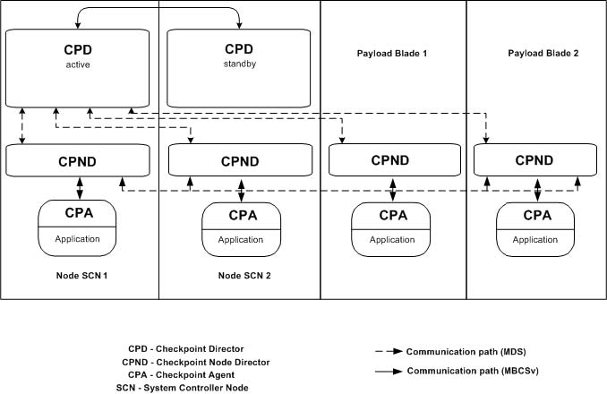

# OpenSAF Checkpoint Service (CPSv)

**Release:** Release 5.1 Programmer's Reference  
**Date:** September 2016  
**Copyright:** © OpenSAF, 2008  

> [!NOTE]
> For OpenSAF architecture overview, SAF AIS compliance, and document conventions, see the [OpenSAF Overview](OpenSAF_Overview_PR.md) and centralized [GLOSSARY.md](GLOSSARY.md).

---

# Overview

## Overview of Checkpoint Service

The Checkpoint Service (CPSv) provides a facility for processes to
record checkpoint data incrementally, which can be used to protect an
application against failures. When recovering from fail-over or
switch-over situations, or restart situations, the checkpoint data can
be retrieved, and execution can be resumed from the state recorded
before the failure.

Checkpoints are cluster-wide entities that are designated by unique
names. A copy of the data stored in a checkpoint is called a checkpoint
replica, which is stored in the main memory rather than on disk for
performance reasons. A given checkpoint may have several checkpoint
replicas stored on different nodes in the cluster to protect the
checkpoint data against node failures. To avoid accumulation of unused
checkpoints in the system, checkpoints have a retention time. When a
checkpoint has not been opened by any process for the duration of the
retention time, the Checkpoint Service automatically deletes the
checkpoint.

The CPSv service supports the following two types of update options:

  - Asynchronous update option
  - Synchronous update option

In the case of asynchronous update option, one of the replicas is
designated as the active replica. Data is always read from the active
replica and there is no guarantee that all the other replicas contain
identical data. A write call returns after updating the active replica.

In the case of synchronous update options the call invoked to write to
the replicas returns only when all replicas have been updated, i.e.
either all replicas are updated or the call fails and no changes are
made to the replicas.

The CPSv supports both collocated and non-collocated checkpoints. In
case of checkpoints opened with collocated and asynchronous update
option, it is up to the application to set a checkpoint to the active
state. In all other cases the CPSv itself handles which checkpoint is
currently active.

The CPSv defined by SAF does not support hot-standby. This means that
the currently stand-by component is not notified of any changes made to
the checkpoint. When the stand-by component gets active, it has to
iterate through the respective checkpoint sections to get up-to-date. To
overcome this drawback, the CPSv provides additional, non-SAF APIs which
help to notify the stand-by component of changes and thus facilitate the
implementation of a hot-stand-by.

## Models and Concepts

The Checkpoint Service comprises three distributed sub-parts that
maintain the cluster-wide checkpoint database.

  - Checkpoint Director
  - Checkpoint Node Director
  - Checkpoint Agent

Figure 1 Checkpoint Service -Sub-parts

### Checkpoint Director

Checkpoint Director (CPD) runs as a process on a system controller node.
CPD maintains the centralized repository of control information for all
checkpoints created in the cluster. The CPD also maintains the location
information of active replicas for all the checkpoints opened in the
cluster. In case of non-collocated checkpoint, the CPD designates a
particular node to manage an active replica for that checkpoint and also
decides on the number or replicas to be created which depends on the
policy (for policies, see section [Usage of Non-Collocated Checkpoints
](#anchor-13). Two instances of CPD are configured, one on each system
controller node, in order to achieve high-availability. The two
instances are configured to be part of a service group having a 2N
redundancy model.

### Checkpoint Node Director

There is one instance of the Checkpoint Node Director (CPND) on each
system controller and payload nodes. It is modeled as a separate
process. CPND maintains the detailed information of the Checkpoints
referred from that node and the corresponding updates and retrievals
that operate on those checkpoints. CPND also handles the requests issued
by the CPA instances on behalf of its client applications on the same
node. In case of checkpoints that have been created with the collocated
attribute and the asynchronous update option, the application will
choose the CPND that oversees the active replica of a particular
checkpoint via the invocation of the saCkptActiveReplicaSet() API. In
all other cases, the CPD will designate the CPND that oversees the
active replica. The CPND that oversees the active replica of a
particular checkpoint will control all the operations on that checkpoint
and it is not constrained to be present on the same node where the
application resides. The CPND that manages the active replica of a
particular checkpoint serializes all the requests to that checkpoint
from all the applications present at different nodes in the cluster.

### Checkpoint Agent

The Checkpoint Agent (CPA) is a linkable library, which conforms to the
SAF APIs described in the document SAF-AIS-CKPT-B.02.02. The CPA library
runs in the context of the application processes that initialize the CPA
library. The SAF APIs are part of this library through which different
checkpoint requests can be issued by the application processes.

## Compliance Report

Checkpoint Service conforms to the Checkpoint specification mentioned in
SAF-AIS-CKPT-B.02.02. The table given below provides the specification
conformance report specific to this release.

Table 1 Compliance Table - Checkpoint Service

|         |                                              |           |
| ------- | -------------------------------------------- | --------- |
| Section | Description                                  | Supported |
| 3.1.1   | Checkpoints                                  | Yes       |
| 3.1.2   | Sections                                     | Yes       |
| 3.1.3   | Checkpoint Replica                           | Yes       |
| 3.1.4   | Checkpoint Data Access                       | Yes       |
| 3.1.5   | Synchronous Update                           | Yes       |
| 3.1.6   | Asynchronous Update                          | Yes       |
| 3.1.7   | Collocated and Non-Collocated Checkpoint     | Yes       |
| 3.1.8   | Persistence of Checkpoints                   | Yes       |
| 3.3     | Include File and Library Names               | Yes       |
| 3.4     | Type Definitions                             | Yes       |
| 3.5     | Library Life Cycle                           | Yes       |
| 3.6     | Checkpoint Management                        | Yes       |
| 3.7     | Section Management                           | Yes       |
| 3.8     | Data Access                                  | Yes       |
| 4.1     | DN Format for Checkpoint Service UML Classes | Yes       |
| 4.2     | Checkpoint Service UML Classes               | Yes       |

## Related SAF Standard Documents

The document SAF-AIS-CKPT-B.02.02 is an SAF standard document. It
provides the service definition of the Checkpoint service and can be
found at the following location:

[https://opensaf.sourceforge.io/documentation.html](http://www.saforum.org/)

The following information can be found in the document:

  - Service concept definitions and descriptions
  - Functional behaviors and relationships
  - A complete set of service data types exposed to the service user
  - The set of service APIs available to the service user

# Service Extensions

## Tracking a checkpoint

The Checkpoint Service allows an application process to track changes to
checkpoints.

The application process that registers for this feature are notified
through a callback during

the following scenarios:

  - Data is written to a checkpoint
  - Section is created in a checkpoint
  - Section is deleted from a checkpoint

When data is written to a checkpoint, this callback is invoked only
after the replicas are synchronized and subsequently the application can
invoke saCkptCheckpointRead() to read the data. The expected behavior of
the application is to use these arguments provided in the callback and
use them to invoke saCkptCheckpointRead(), thus fetching the section(s)
data that has been modified in the checkpoint.

Note : Please see section [4.1.1](#anchor-21) ([Usage of Non-Collocated
Checkpoints ](#anchor-21)) implementation limitations on track changes.

### saCkptCheckpointTrackCallbackT

Prototype

typedef void (\*SaCkptCheckpointTrackCallbackT)(

SaCkptCheckpointHandleT checkpointHandle,

SaCkptIOVectorElementT \*ioVector,

SaUint32T numberOfElements);

Parameters:

checkpointHandle - \[in\]

The handle to the checkpoint of which had been updated. The handle
checkpointHandle must have been obtained by a previous invocation of
saCkptCheckpointOpen() or saCkptCheckpointOpenCallback(). The
SaCkptCheckpointHandleT type is defined in Section 3.4.1.2 on page 22.

  - ioVector - \[in/out\] A pointer to an array that contains elements
    ioVector\[0\], ..., ioVector\[numberOfElements - 1\]. The type of
    each element is SaCkptIOVectorElementT, as defined in Section
    3.4.4.1 on page 28. An element contains the following fields:

  - sectionId - \[in\] The section identifier descriptor of the section
    from which to read.
  - dataBuffer - \[in/out\] A pointer to a buffer into which read
    section data is placed, which had been changed. The buffer is
    provided by the Checkpoint Service library.  
    The buffer must be freed by the invoking process by calling the
    saCkptIOVectorElementDataFree() function.
  - dataSize - \[in\] Size of the data that is provided and to which to
    which dataBuffer points. The size is at most maxSectionSize, as
    specified in the creation attributes of the checkpoint.
  - dataOffset - \[in\] Offset in the section that marks the start of
    the data to be that was read from the section.
  - readSize - \[out\] The number of bytes of data that have been read
    from the section.
  - numberOfElements - \[in\] The number of elements in the array to
    which the ioVector parameter points. The SaUint32T type is defined
    in \[1\].

Description:

This callback is invoked in the context of a thread issuing an
saCkptDispatch() call

with the CKPT library handle that was specified when opening the
checkpoint which is tracked. If successful, the
saCkptCheckpointTrackCallback() function passes information about the
changed sections of the checkpoint indicated by the ioVector parameter.
This callback is invoked by the Checkpoint Service whenever a process
,successfully updated the checkpoint such as ckpt write, ckpt section
create and ckpt section delete.

Note: The Checkpoints which are opened with CHECKPOINT\_WRITE Open Flags
only will receive saCkptCheckpointTrackCallback() callback .

Return Values:

None

See Also

saCkptCheckpointOpen(), saCkptCheckpointTrackCallbackT,

saCkptCheckpointTrackStop(),
saCkptCheckpointWrite(),saCkptCheckpointSectionOverwrite(),
saCkptIOVectorElementDataFree(), saCkptCheckpointClose(),
saCkptInitialize(), saCkptFinalize()

### Update of the SaCkptCallbacksT

SaCkptCallbacksT\_2

The SaCkptCallbacksT\_2 structure is defined as follows:

typedef struct {

SaCkptCheckpointOpenCallbackT

saCkptCheckpointOpenCallback;

SaCkptCheckpointSynchronizeCallbackT

saCkptCheckpointSynchronizeCallback;

saCkptCheckpointTrackCallbackT

saCkptCheckpointTrackCallback;

} SaCkptCallbacksT\_2;

Description:The callbacks structure is supplied to the Checkpoint
Service by a process and contains the callback functions that the
Checkpoint Service can invoke.

### saCkptInitialize\_2()

Prototype

SaAisErrorT saCkptInitialize(

SaCkptHandleT \*ckptHandle,

const SaCkptCallbacksT\_3 \*ckptCallbacks,

SaVersionT \*version

);

Description  : This function initializes the Checkpoint Service

for the invoking process and registers the various callback functions.

The handle 'ckptHandle' is returned as the reference to this

association between the process and the Checkpoint Service..

param\[out\] : ckptHandle - A pointer to the handle designating this

particular initialization of the Checkpoint

service that it to be returned by the Checkpoint Service.

param\[in\] : ckptCallbacks-Pointer to a SaCkptCallbacksT\_2 structure,

containing the callback functions of the process

that the Checkpoint Service may invoke.

param\[in\] : version - Is a pointer to the version of the Checkpoint

Service that the invoking process is using.

### **saCkptTrack**()

Prototype:

SaAisErrorT saCkptTrack(SaCkptHandleT ckptHandle);

Parameters:

ckptHandle - \[in\]

\- A pointer to the handle designating this particular initialization of
the Checkpoint service which was returned at the time of
initialize\_2().

Description:

The saCkptTrack() function is used to request the Checkpoint Service to
notify the invoker process when checkpoint associated with the
ckptHandle has changed such as ckpt write, ckpt section create and ckpt
section delete. The Checkpoint Service will notify the calling process
by invoking its saCkptCheckpointTrackCallback() callback, which must
have been supplied when the process invoked the saCkptInitialize\_2()
function.

A process may call saCkptTrack() with different handles. If a process
calls with different handles, all checkpoints identified with these
handles are tracked.If a process has enabled tracking by calling
saCkptTrack(), it will receive callbacks as long as it does not call
saCkptTrackStop() or saCkptFinalize() or the node remains in the
cluster.

Note: The Checkpoints which are opened with SA\_CKPT\_CHECKPOINT\_READ
Open Flags only will receive saCkptCheckpointTrackCallback() callback .

Return Values:

SA\_AIS\_OK - The function completed successfully.

SA\_AIS\_ERR\_LIBRARY - An unexpected problem occurred in the library
(such as

corruption). The library cannot be used anymore.

SA\_AIS\_ERR\_TIMEOUT - An implementation-dependent timeout occurred
before the call could complete. It is unspecified whether the call
succeeded or whether it did not.

SA\_AIS\_ERR\_TRY\_AGAIN - The service cannot be provided at this time.
The process may retry later.

SA\_AIS\_ERR\_BAD\_HANDLE - The handle entity is invalid, due to one or
both of the reasons below:

  - It is corrupted,
  - It was not obtained with the SaCkptInitialize\_2() function,

See Also:

saCkptCheckpointTrackCallbackT,saCkptTrack() ,saCkptTrackStop()

saCkptCheckpointTrackStop(), saCkptCheckpointClose(),
saCkptInitialize\_2(),

### saCkptTrackStop()

Prototype:

SaAisErrorT saCkptTrackStop(SaCkptHandleT ckptHandle);

Parameters:

ckptHandle - \[in\]

A pointer to the handle designating this particular initialization of
the Checkpoint service which was returned at the time of
initialize\_2().

Description:

The saCkptTrack() function stops any further tracking notifications

for the checkpoint identified by the ckptHandle.

Return Values:

SA\_AIS\_OK - The function completed successfully.

SA\_AIS\_ERR\_LIBRARY - An unexpected problem occurred in the library
(such as corruption). The library cannot be used anymore.

SA\_AIS\_ERR\_TIMEOUT - An implementation-dependent timeout occurred
before the call could complete. It is unspecified whether the call
succeeded or whether it did not.

SA\_AIS\_ERR\_TRY\_AGAIN - The service cannot be provided at this time.
The process may retry later.

SA\_AIS\_ERR\_BAD\_HANDLE - The handle entityGroupHandle is invalid, due
to

one or both of the reasons below:

  - It is corrupted,
  - It was not obtained with the SaCkptInitialize\_2()function

SA\_AIS\_ERR\_NOT\_EXIST – No tracking was started by invoking the

saCkptTrack() function with this ckptHandle .

See Also:

saCkptCheckpointTrackCallbackT,saCkptTrack() ,saCkptTrackStop()

saCkptCheckpointTrackStop(), saCkptCheckpointClose(),
saCkptInitialize\_2()

## Extended SaNameT Type

The SaNameT type, which is used to pass distinguished names (DNs) in AIS
functions and structures, contains a fixed-size buffer that limits the
string length to a maximum of 255 bytes. As a consequence of this, the
SAF specifications also impose a 64 byte limit for the length of
relative distinguished names (RDNs). To overcome these limitations, the
extended SaNameT type has been introduced in OpenSAF. The extended
SaNameT type has the same size and memory alignment requirements as the
original type, and is fully backwards compatible as long as the string
length does not exceed 255 bytes.

When the length of the DN name is longer than 255 bytes, the extended
SaNameT type shall hold a reference to the string, which is stored in a
separate memory area.

### Configuration

In order to utilize the long DNs support in CKPT, the environment
variable SA\_ENABLE\_EXTENDED\_NAMES is set to "1". This is configured
by the support of IMM.

The support for IMM objects with DNs longer than 255 bytes and RDNs
longer than 64 bytes is controlled by introduction of the new
configuration attribute *longDnsAllowed* that is added to the class
OpensafImm. When upgrading from an older release of OpenSAF, this class
needs to be upgraded. An IMM xml file containing the extended class
definition for OpensafImm can be found in the file:

samples/immsv/OpensafImm\_Upgrade\_4.5.xml

By default, the attribute - longDnsAllowed has the value 0, which means
that the old length limits of 255 bytes for DNs and 64 bytes for RDNs
are enforced. To allow long DNs and RDNs in IMM, this attribute must be
set to 1 for example using the following command:

$ immcfg -a longDnsAllowed=1 opensafImm=opensafImm,safApp=safImmService

To prohibit DNs longer than 255 bytes and RDNs longer than 64 bytes in
IMM, do the following:

$ immcfg -a longDnsAllowed=0 opensafImm=opensafImm,safApp=safImmService

The IMM service will reject attempts to set the longDnsAllowed attribute
back to 0 if the IMM database contains objects with DNs longer than 255
bytes or RDNs longer than 64 bytes.

### Checkpoint Agent (CPA)

Following APIs use SaNameT for checkpoint name.

  - saCkptCheckpointOpen()
  - saCkptCheckpointOpenAsync()
  - saCkptCheckpointUnlink()

These APIs return error code SA\_AIS\_ERR\_TOO\_BIG if input string is
longer that max string length.

The CPA also uses SaNameT for ckpt\_name field in the
CPA\_LOCAL\_CKPT\_NODE structure. This field is changed to use
SaConstStringT.

### Checkpoint Node Director (CPND)

The CPND uses SaNameT in following structures and changed to use
SaConstStringT:

  - CPND\_CKPT\_NODE
  - CPND\_CB
  - CPSV\_CKPT\_HDR
  - CKPT\_INFO

### Checkpoint Director (CPD)

The CPND uses SaNameT in following structures and changed to use
SaConstStringT:

  - CPD\_CKPT\_INFO\_NODE
  - CPD\_CPND\_INFO\_NODE
  - CPD\_CKPT\_MAP\_INFO
  - CPD\_REP\_KEY\_INFO
  - CPD\_CB

# Implementation Notes

This section summarizes important information that should be kept in
mind when writing applications that make use of the Checkpoint service.

### Usage of Non-Collocated Checkpoints

Checkpoints created without the collocated attribute are called
non-collocated checkpoints. The management of replicas of non-collocated
checkpoints and whether they are active or not is the responsibility of
the Checkpoint Service.

#### For the non-collocated Checkpoints, OpenSAF Checkpoint Service will specify the location of the checkpoint replicas as per the following policy:

  - If a non-collocated checkpoint is opened for the first time by an
    application residing on a payload blade, the replicas will be
    created on the local payload blade and both the system controller
    nodes. In this case, the replica residing on the payload blade is
    designated as active replica.
  - If a non-collocated checkpoint is opened for the first time by an
    application residing on the system controller nodes, the replica
    will be created only on the system controller blade. In this case,
    this replica on a system controller node will act as the active
    replica.
  - If another application opens the same checkpoint from a payload
    node, the checkpoint service will not create the replica on that
    node.

Creating extra replicas on the system controller node for non-collocated
checkpoints is an overhead. The advantage of a non-collocated checkpoint
is that replica will be created in two places, no matter from how many
nodes it is opened.

#### For track changes feature ([3.1](#anchor-20) [Tracking a checkpoint](#anchor-20)), the registered application will receive callback as per the following policy:

  - Will receive track changes through a callback, if physical replica
    exist on that particular controller/payload blade( Please refer
    [4.1.1.1](#anchor-34)).

  - Will NOT receive track changes through a callback, if physical
    replica doesn't exist on that particular controller/payload blade (
    Please refer [4.1.1.1](#anchor-34))..

### Time-out Arguments for Checkpoint Service APIs

For all synchronous API calls, the application will provide the
“timeout” argument. The application will consider invocation of the
particular API failed in case it did not complete the call by the
specified time. CPSv requires that the value passed in the timeout
argument is greater than 100000000 nano seconds (100 milliseconds).

### Cancellation of Pending Callbacks

According to the SAF-AIS-CKPT-B.02.02 specification, whenever a
checkpoint is closed, all the pending callbacks corresponding to this
checkpoint should be canceled. In CPSv, implementation does cancel the
pending callbacks related to closed checkpoints. However, the selection
object already raised and related to canceled pending callbacks, will
not be cleared or reset. Due to this, saCkptDispatch API may return
without invoking callback routine.

### Maximum Number of Replicas Per Node

CPSv applications can create up to 1,000 replicas per node at a given
instance. This includes the replicas created by CPSv for non-collocated
checkpoints as per the “replica creation policy.”

In the case of collocated checkpoints, CPSv returns
SA\_AIS\_ERR\_NO\_RESOURCES if an application attempts to create a new
checkpoint and the current number of replicas on the local node is
already the maximum that CPSv can support per node.

In the case of non-collocated checkpoints, CPSv returns an
SA\_AIS\_ERR\_NO\_RESOURCES if the number of checkpoint replicas on the
node on which CPSv decides to create a replica is already the maximum
that CPSv can support per node. In all other cases, the checkpoint open
does not return an error but the replicas will not be created on the
backup nodes as decided by the “replica creation policy”.

### Handling of SA\_AIS\_ERR\_TRY\_AGAIN

If the Checkpoint service API returns SA\_AIS\_ERR\_TRY\_AGAIN, the
application should attempt the API call only after a couple of seconds.
The suggested wait time is 3 seconds. The suggested number of retries is
7.

Note that the Checkpoint write, overwrite, and read operations may
sometime return SA\_AIS\_ERR\_TRY\_AGAIN if called simultaneously. This
is to avoid any inconsistencies in the checkpoint database.

### Handling loss of system controller nodes

The CPSv supports to preserve checkpoint replicas in case both system
controller nodes down (headless state) and recover replicas in case one
of system controller nodes are up again. When both system controllers go
down, checkpoint replicas on surviving nodes still remain. When a system
controller is available again, surviving replicas are automatically
registered to the system controller checkpoint database. Content in
surviving replicas are interacted and synchronized to new replicas.

In headless state, CPSv application can read from and write to existing
checkpoint replicas. However checkpoint APIs changing checkpoint
configuration which requires system controller communication are
rejected with fault code SA\_AIS\_ERR\_TRY\_AGAIN. The rejected APIs
are:

  - saCkptCheckpointOpen()
  - saCkptCheckpointOpenAsync()
  - saCkptCheckpointClose()
  - saCkptCheckpointUnlink()
  - saCkptCheckpointRetentionDurationSet()
  - saCkptActiveReplicaSet()

In case the node which hosts the active replica goes down during
headless state, accessing checkpoint replicas does not work anymore. It
is back working when a system controller node available again.

The CPSv can not recover checkpoints in following cases:

  - The checkpoint which is unlinked before headless.
  - The non-collocated checkpoint has active replica locating on system
    controller(s).
  - The non-collocated checkpoint has active replica locating on a PL
    and this PL restarts during headless state.

In these cases, the checkpoint replica is destroyed. The fault code
SA\_AIS\_ERR\_BAD\_HANDLE is returned when the CPSv application accesses
the checkpoint in these cases. The application must re-open the
checkpoint.

Limitation Note:

For unrecoverable non-collocated checkpoint cases above, the checkpoints
are destroyed. Thus the application must re-create the checkpoint.

The ticket “\#1700 cpsv: re-create the checkpoint without any sections
in case the all replicas is lost” was created for furture enhancement.
This means that the checkpoint without any section is re-created by CPSv
when an SC is up after headless state.

## Configuration

This section describes how the Checkpoint service is preconfigured
regarding shared memory and the maximum write data size.

### Shared Memory Configuration

OpenSAF Checkpoint service uses the shared memory for storing the
checkpoint replicas. Checkpoint service will manage the shared memory
segments created by it for storing the checkpoint replicas. The shared
memory requirements for storing the checkpoint replica can be derived
from the checkpoint creation attributes supplied at the time of
saCkptCheckpointOpen( ) or saCkptCheckpointOpenAsync( ) call using the
formula. maxSections \* maxSectionSize

The maximum size of the shared memory segment is limited by the
operating system. In most of the cases, the maximum value is 31MB. This
can be found by executing the command: cat /proc/sys/kernel/shmmax

To increase the shared memory segment size to the desired value, one can
use the following command: **echo 134217728 \>/proc/sys/kernel/shmmax **

The above example command will set the maximum shared memory segment
value to 27MB.

### Maximum Data Size Per One write or Overwrite

The maximum data size per one write or over write is 40MB. Applications
that try to write more than 40MB data in one saCkptSectionWrite( )or
saCkptSectionOverwrite( ) call will get the error
SA\_AIS\_ERR\_NO\_RESOURCES.

### Logging Configuration

Add the following line in */etc/opensaf/ckptd.conf* and
*/etc/opensaf/ckptnd.conf* files to enable tracing for CPSv.

args="--tracemask=0xffffffff"

## Service Dependencies

The internal interfaces of the Checkpoint service are given below:

  - Layered Environment for Accelerated Portability (LEAP) - for Shared
    Memory: Checkpoint Service uses LEAP for portability. The service
    uses the memory manager, timers, encode-decode utility and handle
    manager services provided by the LEAP.
  - Message Distribution Service (MDS) - for Messaging: All the
    interaction between the different sub-parts of the Checkpoint
    service will take place using MDS messaging. The MDS is also used to
    register the service up and down events to handle the failure cases.

  - Availability Management Framework - for High Availability: CPD and
    CPND are modeled as AMF components.
  - Message based Checkpoint Service (MBCSv) - for checkpointing
    information: CPD uses the MBCSv to checkpoint the state information
    with the standby CPD.
  - Cluster Membership Service (CLM) - for node names: CPD uses Cluster
    membership service to get the node name for a given node ID and for
    Cluster Membership.
  - Information Management model service(IMMSv) – for managing
    information: The CPSv uses IMM for interfacing its information for
    the end user.

## Management Interface

This section describes how the CPSv can be accessed for management
purposes.

### IMM Interface

The Checkpoint Service contains two UML classes, “***SaCkptCheckpoint***
and **SaCkptReplica**“ as defined in the B.02.02 specifications, which
are runtime object classes exposing various runtime attributes of an
checkpoint .Please refer to the B.02.02 specifications for supported
attributes.

### Command Line Interface

Checkpoint Service does not provide any default CLI support on top of
IMMSv apart from the default tools provided by IMMSv (immlist, immfind,
immcfg etc).

3.  5.  
# Sample Application(s)

## Overview

The sample application provided here consists of two application
processes that use the Checkpoint service APIs to ‘write’ to a
checkpoint, and ‘read’ the checkpoint data written by the first
application process.

## Running the Checkpoint Service Sample Application(s)

This sample application assumes that the OpenSAF software is installed
and running on the target system. Refer to OpenSAF *INSTALL* and
*README* files* *for information on how to install the OpenSAF software.

Running the sample application

To run the checkpoint service sample application(s), follow the steps
given here:

1.  Build the sample program to create the executable files ckpt\_demo &
    ckpt\_track\_demo (refer to OpenSAF *README* file*)SAF *.
2.  Copy the executable files to the target. Ensure the ckpt\_demo &
    ckpt\_track\_demo has executable permission. To give executable
    permission, use the following command:  
    **chmod +x ckpt\_demo &  chmod +x ckpt\_track\_demo**
3.  Open two terminals, and change to the directory where the
    executables ckpt\_demo ckpt\_track\_demo are copied.
4.  Execute the following command in the first terminal. This
    application process will act as MESSAGE-WRITER.  
    **./ckpt\_demo 1 or ckpt\_track\_demo 1**
5.  Execute the following command in the second terminal. This
    application process will act as MESSAGE-READER.  
    **./ckpt\_demo 0 or ckpt\_track\_demo 0**
6.  Refer to Execute instruction provided in
    \<staging\>/samples/cpsv/README

The output is displayed on both the terminals.

### Sample Application Output

MESSAGE\_ WRITER

Ckpt Initialising being called ....    PASSED

Ckpt Open being called ....    PASSED

Ckpt Active Replica Set being called ....      PASSED

Ckpt Section Create being called .... PASSED

Ckpt Write being called with data: The Checkpoint Service provides a
facility for processes to record checkpoint data    .... PASSED

Ckpt Synchronize being called ....     PASSED

Ckpt Unlink being called ....  PASSED

Ckpt Close being called ....   PASSED

Ckpt Finalize being called .... PASSED

MESSAGE\_READER

Ckpt Initialising being called ....    PASSED

Ckpt Open being called ....    PASSED

Ckpt Read being called, data in the read buffer is: The Checkpoint
Service provides a facility for processes to record checkpoint data ....
PASSED Ckpt Synchronize being called ....     PASSED

Ckpt Close being called ....   PASSED

Ckpt Finalize being called .... PASSED

.
