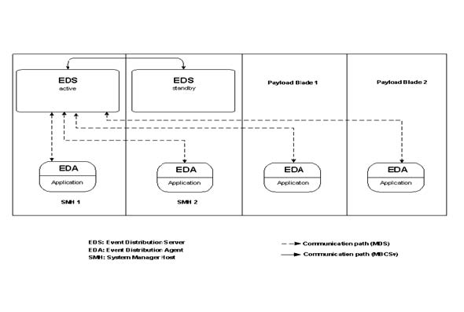

# OpenSAF Event Distribution Service (EDSv)

**Release:** Release 4.2 Programmer's Reference  
**Date:** October 2011  
**Copyright:** © OpenSAF, 2008  

> [!NOTE]
> For OpenSAF architecture overview, SAF AIS compliance, and document conventions, see the [OpenSAF Overview](OpenSAF_Overview_PR.md) and centralized [GLOSSARY.md](GLOSSARY.md).

---

# Overview

## Event Distribution Service Overview

Event Distribution Service (EDSv) is the OpenSAF implementation of the
SAF AIS Event Service B.03.01 specification.

Events consist of a standard header and zero or more bytes of publisher
event data. Multiple publishers and multiple subscribers can communicate
over the same event channel. Individual publishers and individual
subscribers can communicate over multiple event channels. Publishers can
also be subscribers on the same event channel. Subscribers are
anonymous, so they can join and leave an event channel at any time
without involving publisher(s).

## Models and Concepts

EDSv comprises two subparts distributed among many processes across the
cluster:

  - Event Distribution Server (EDS)
  - Event Distribution Agent (EDA)

Figure 1 Event Distribution Service -Subparts

### Event Distribution Server

The Event Distribution Server (EDS) is a process which handles the
distribution of events based on client subscriptions and filtering
mechanisms. It maintains publisher and subscriber information and events
with retention time. If an event was posted and event persistence was
specified, the event will be retained by the server process for the time
period specified in the call. During the retention time the EDS may
redistribute the event to new callers subscribing to this event.
Distribution criteria are filter matches specified by subscribers and
priority settings in the event handler.

EDS runs on System Controller Nodes. For high availability it employs a
2N redundancy model. One active and one standby instance of EDS exist in
a cluster.

### Event Distribution Agent

The Event Distribution Agent (EDA) is the library that any process must
link with to access EDSv functionality. It supports all the APIs defined
by SAF’s Event Service specification. It provides APIs for various EDSv
functionality including life-cycle APIs and others to open/close event
channels, subscribe/unsubscribe events, and publish events. Events
published by invoking the publish API in the Event Service are forwarded
to EDS by EDA.

The EDA also carries out preliminary event processing, channel access
verification, and other event channel-related operations.

### Compliance Report

The EDSv implementation is conformant to the SAI-AIS-EVT-B.03.01
specifications. The following table provides the compliance report
specific to this release.

Table 1 Compliance Table - Event Distribution Service

|         |                                                              |           |
| ------- | ------------------------------------------------------------ | --------- |
| Section | Description                                                  | Supported |
| 3.1     | Event Service Model                                          | Yes       |
| 3.2     | Unavailability of the Event Service API on a Non-Member Node | Yes       |
| 3.3     | Include File and Library name                                | Yes       |
| 3.4     | Type Definitions                                             | Yes       |
| 3.4.7   | “Lost Event” Event                                           | No        |
| 3.5     | Library Life Cycle                                           | Yes       |
| 3.6     | Event Channel Operations                                     | Yes       |
| 3.7     | Event Operations                                             | Yes       |
| 3.8     | Limit Fetch API                                              | Yes       |

# OpenSAF Event Distribution Service API

## Application Interface Specification

The document SAI-AIS-EVT-B.03.01 is available at
[https://opensaf.sourceforge.io/documentation.html](http://www.saforum.org/).

The following information can be found in the referenced document:

  - Service concept definitions and descriptions
  - Functional behaviors and relationships
  - The complete set of service data types exposed to the service user
  - The set of service APIs available to the service user

## Service Extensions

OpenSAF does not have any service extensions other than the
standards-based service definition explained in the document
SAI-AIS-EVT-B.03.01*.*

## Implementation Notes

In the current release Event Distribution Service implementation
supports only SAI-AIS-EVT-B.03.01 and SAI-AIS-EVT-B.01.01*
*specifications. Intermittent releases are not supported.

If Event Distribution service API returns SA\_AIS\_ERR\_TRY\_AGAIN,
application should attempt the API call only after couple of
milliseconds. The suggested wait time is 100 milliseconds

## Service Dependencies

The Event Distribution Service has internal interfaces to the following
other services:

  - Layered Enhanced Accelerated Portability (LEAP)—for portability EDSv
    uses LEAP for portability. It uses the timers, encode-decode
    utility, and handle manager services provided by LEAP.
  - Message Distribution Service (MDS)—for messaging Interaction between
    the subparts of EDSv takes place using MDS messaging.
  - Availability Management Framework (AMF) —for high availability EDS
    is modeled as an AMF component employing the 2N redundancy model.
  - Message Based Checkpoint Service (MBCSv)—for checkpointing
    information The active EDS uses MBCSv to checkpoint the state
    information with a standby EDS.
  - Information Model Management Service (IMMSv) - for configuration and
    object Management.

Management Interface

This section describes how the Event Distribution Service can be
accessed for management purposes.

### Command Line Interface

The IMM command line tools can be used to fetch information of objects
owned by the event service.

# Sample Application

## Overview

The sample Event Distribution Service application demonstrates how to
use a few SAF Event Service APIs. It implements a subscriber and a
publisher in one process.

The process consists of the following steps:

1.  Initialize the event service library
2.  Obtain a selection object
3.  Open a channel
4.  Install a subscription on the opened channel
5.  Allocate an event
6.  Set the attributes in the event header
7.  Publish an event with a pattern that matches the filters of the
    subscription with a retention timer
8.  Dispatch and receives the published event
9.  Receive the event data and attributes
10. Display the event data and attributes
11. Clear the retention timer
12. Uninstall the subscription
13. Close the channel
14. Finalize the event library

## Running the Sample Application

This sample application assumes that OpenSAF is installed and running on
the target system.

Running the Sample Application

1.  Build the sample program to create the executable file evt\_demo.
2.  Copy the executable file onto the target. Note: Ensure that the
    evt\_demo file has executable permission. To grant the permission,
    use the command **chmod +x evt\_demo**.
3.  Open a terminal and go to the directory in which the executable file
    evt\_demo is copied.
4.  Execute the following command: **./*****evt\_demo***  
    The output below will be displayed on the terminal.  

## Sample Application Output

*\#\#\#\#\#\#\#\#\#\#\#\#\#\#\#\#\#\#\#\#\#\#\#\#\#\#\#\#\#\#\#\#\#\#\#\#\#\#\#\#\#\#\#\#\#\#
*

\#                                           \#

\#  You are about to witness EDSv Demo \!\!\!  \#

\#  To start the demo, press \<Enter\> key    \#

\#                                           \#

\#\#\#\#\#\#\#\#\#\#\#\#\#\#\#\#\#\#\#\#\#\#\#\#\#\#\#\#\#\#\#\#\#\#\#\#\#\#\#\#\#\#\#\#\#\#

EDSv: EDA: EVT Initialization Done \!\!\!

EvtHandle: ff900001

EDSv: EDA: Obtained Selection Object Successfully \!\!\!

EDSv: Opened DEMO Channel: safChnl=DemoChannel,safApp=safEvtService
Successfully \!\!\!

EDSv: Subscribed for events on DEMO channel as Both a Publisher and
Subscriber \!\!\!

EDSv: Allocated an Event Successfully \!\!\!

EDSv: Set the attributes for the event successfully \!\!\!

EDSv: Published event on demo channel successfully \!\!\!, event\_id =
1001

EDSv: EDA: Dispatching message received on demo channel

EDSv: Got Attributes of the Events Successfully \!\!\!

EDSv: Got Data from the received event successfully \!\!\!

\-------------- Received Event --------------------------

publisherName =   EDSvDemokit

patternArray

pattern\[0\] =   {13, "trap xyz here"}

pattern\[1\] =   { 0, ""}

pattern\[2\] =   { 5, "abcde"}

priority      =   0

publishTime   =   1272374315

retentionTime =   10000000000

eventId       =   1001

dataLen       =   19

data          =     I am a TRAP event

\---------------------------------------------------------

Press \<Enter\> key to continue

EDSv: Cleared retention timer Successfully \!\!\!

EDSv: Freed the Event that I recieved as a Subscriber

EDSv: Freed the event that I allocated as a Publisher \!\!\!

EDSv: Unsubscribed for events Successfully \!\!\!

EDSv: Closed DEMO channel Successfully \!\!\!

EDSv: Finalized with event service successfully \!\!\!

\#\#\# EDSv Demo over, To quit, press 'q' and \<Enter\> \#\#\#
