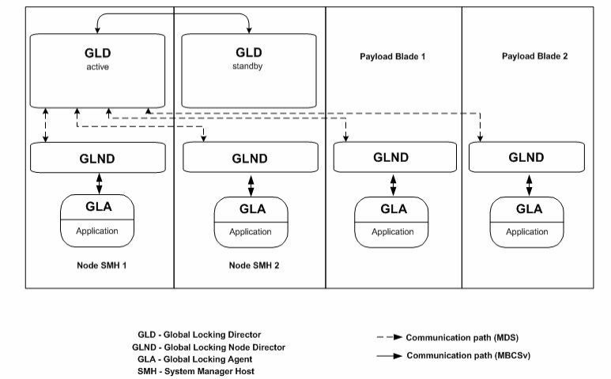

# OpenSAF Global Lock Service (GLSv)

**Release:** Release 4.2 Programmer's Reference  
**Date:** October 2011  
**Copyright:** © OpenSAF, 2008  

> [!NOTE]
> For OpenSAF architecture overview, SAF AIS compliance, and document conventions, see the [OpenSAF Overview](OpenSAF_Overview_PR.md) and centralized [GLOSSARY.md](GLOSSARY.md).

---

# Overview

## Overview of Global Lock Service

Global Lock Service (GLSv) is a distributed locking service which allows
applications running on multiple nodes to coordinate access to shared
resources.

GLSv provides a locking mechanism: locks are created and destroyed by
applications as needed. It supports two locking modes for exclusive
access and shared access of resources. Exclusive access means that only
one requester is allowed at a time. Shared access means that multiple
requesters are allowed through a lock at a time.

GLSv supports optional features such as deadlock detection and lock
orphaning. A GLSv interface allows applications to query for support for
the optional features. The locks provided by the GLSv are not recursive,
so, claiming one lock does not claim another lock; each lock must be
claimed individually.

## Models and Concepts

The Global Lock Service comprises three distributed subparts that
maintain the cluster-wide  
checkpoint database.

  - Global Locking Director (GLD)
  - Global Locking Node Director (GLND)
  - Global Locking Agent (GLA)

Figure 1 Global Lock Service -Subparts

### Global Locking Director

The Global Lock Director (GLD) maintains the details of different
resources opened by a node and about the different nodes from which a
particular resource has been opened. It is also responsible for the
election of a master global lock node director for a particular
resource. For high availability, GLD uses a 2N redundancy model.

### Global Locking Node Director

The Global Locking Node Director (GLND) handles requests issued by
application processes on a particular node. It interacts with GLD to
open resources. If GLD names a GLND as master for a resource, it is
responsible to grant access to lock requests from different nodes in the
cluster. There is one instance of GLND for each node in the system. GLND
has been modeled as an AMF service unit, which belongs to a service
group employing the AMF no-redundancy model. When a GLND process
crashes, it is automatically restarted by the AMF, and restores the
information which was there before the crash. GLND executes deadlock
algorithm.

### Global Locking Agent

The Global Locking Agent (GLA) library runs as a thread in the context
of all the application processes that initialize the GLA library. The
SAF APIs are a part of this library through which various lock service
requests can be issued by the application processes.

### Compliance Report

The Global Lock Service conforms to the SAF Lock Service specifications
mentioned in the SAF document SAI-AIS-LCK-B.01.01. Table 1 provides the
specification conformance report specific to this release.

Table 1 Compliance Table -Global Lock Service

|         |                                |           |
| ------- | ------------------------------ | --------- |
| Section | Description                    | Supported |
| 3.1.1   | Lock Owner                     | Yes       |
| 3.1.2   | Lock Naming                    | Yes       |
| 3.1.3   | Deadlock                       | Yes       |
| 3.1.4   | Lock Modes                     | Yes       |
| 3.1.5   | Orphan Locks                   | Yes       |
| 3.2     | Include File and Library Names | Yes       |
| 3.3     | Type Definitions               | Yes       |
| 3.4     | Library Life Cycle             | Yes       |
| 3.5     | Lock Resource Operations       | Yes       |

Table 2 Compliance Table -Global Lock Service (B.03.01)

|         |                        |           |
| ------- | ---------------------- | --------- |
| Section | Description            | Supported |
| 4.1     | DN Format              | Yes       |
| 4.2     | Lock Service UML Class | Yes       |

# OpenSAF Global Lock Service API

## Application Interface Specification

The document SAI-AIS-LCK-B.01.01 is a SAF standard document, and is
available at https://opensaf.sourceforge.io/documentation.html. It
provides the service definition of the Global Lock Service.

The following information can be found in the referenced document:

  - Service concept definitions and descriptions
  - Functional behaviors and relationships
  - A complete set of service data types exposed to the service user
  - The set of service APIs available to the service user

## Service Extensions

The only service extension provided is the standards-based service
definition explained in the document SAI-AIS-LCK-B.01.01.

## Implementation Notes

This section provides important information that is useful when creating
applications that make use of the GLSv.

### Timeout Arguments for Lock Service APIs

For all synchronous API calls, the application provides the timeout
argument. The application considers the API invocation failed if it does
not complete the call by a specified time. The value passed in the
timeout argument should be greater than *1,000,000,000* nanoseconds
(1,000 milliseconds). To specify the timeouts the granularity is 1sec
i.e *1,000,000,000* nanoseconds as specified in the code (you need to
supply at least 1 followed by 9 zeros).

### Maximum Number of Resources and Locks Per Node

GLSv supports up to 1000 resources per node at a given instance. All
applications on that node using GLSv together can create up to 1000
resources at any instance. If applications try to create more than 1000
resources, GLSv returns the error SA\_AIS\_ERR\_NO\_RESOURCES.

The OpenSAF GLSv supports up to 1000 locks per node at a given instance,
If applications try to take more than 1000 locks on one node, GLSv
returns the error SA\_AIS\_ERR\_NO\_RESOURCES.

### Cancellation of Pending Callbacks

According to the SAI-AIS-LCK-B.01.01 specification, whenever a resource
is closed or a lock is canceled, all the pending callbacks corresponding
to the resource or lock should be canceled. GLSv cancels pending
callbacks for closed resources and canceled locks. However, the
selection object already raised for canceled pending callbacks is not
cleared or reset. So the saLckDispatch() API may return without invoking
callback routine.

### Handling of SA\_AIS\_ERR\_TRY\_AGAIN

If the API returns SA\_AIS\_ERR\_TRY\_AGAIN, the application should
attempt the API call only after a couple of milliseconds. The waiting
time depends on the platform.

### DN Naming Convention for B.01.01

DN naming format has to be followed for B.01.01 implementations

## Configuration

### Logging Configuration

Add the following line in */etc/opensaf/lckd.conf *and
*/etc/opensaf/lcknd.conf* files to enable tracing for GLSv.

args="--tracemask=0xffffffff"

## Service Dependencies

GLSv provides the following internal interfaces:

  - Layered Environment for Accelerated Portability (LEAP) - for Shared
    Memory: Global Lock Service uses LEAP for portability. The service
    uses the memory manager, timers, encode-decode utility and handle
    manager services provided by the LEAP.
  - Message Distribution Service (MDS) - for Messaging: All the
    interaction between the different subparts of the Global Lock
    service will take place using MDS messaging.
  - Availability Management Framework (AMF) - for High Availability: GLD
    and GLND are modeled as AMF components.
  - Message based Checkpoint Service (MBCSv) -for checkpointing
    information: The active GLD uses the MBCSv to checkpoint the state
    information with the standby GLD.
  - Information Management Model Service(IMMSv) -for managing
    information: The GLSv uses IMM for interfacing its information for
    the end user.

The applications need to include the following libraries to use GLSv:
*libSaLck.so*.

## Management Interface

This section describes how the GLSv can be accessed for management
purposes.

### IMM Interface

The Lock Service contains one UML class, “***SaLckResource*** “ as
defined in the B.03.01 specifications, which is a runtime object class
exposing various runtime attributes of an lock resource. Please Refer to
the B.03.01 specifications for supported attributes.

### Command Line Interface

Global Lock Service does not provide any default CLI support on top of
IMMSv apart from the default tools provided by IMMSv (immlist, immfind,
immcfg etc).

# Sample Application

## Overview

The sample application demonstrates how to use a few SAF Lock Service
APIs. In this sample application, two processes access a shared resource
and claim to lock it. A lock is granted to the first application. The
second application has to wait for that lock until the first one
releases the lock.

## Running Sample Global Lock Service Application

This sample application assumes that the OpenSAF software is installed
and running on the target system.

Running the sample application

To run the global lock service sample application, follow the steps
given here:

1.  Build the sample program to create executable file lck\_demo.
2.  Copy the executable file onto the target.
3.  Ensure the file lck\_demo has executable permission. To grant
    executable permission, use the following command: **chmod +x
    lck\_demo **
4.  Open two terminals, and go to the directory in which the executable
    file lck\_demo is copied.
5.  Execute the following command in both the terminals:**./lck\_demo **

## Sample Application Output

Lock Initialising being called ....PASSED  
Lock SelectionObjectGet being called ....PASSED  
Resource Open being called ....PASSED res\_id = 4293920273  
Resource Lock for Exclusive lock being called ....PASSED lock\_id =
4293920785  
Waiting for 5 seconds....  
Resource Unlock being called ....PASSED  
Resource Close being called ....PASSED  
Lock Finalize being called ....PASSED
