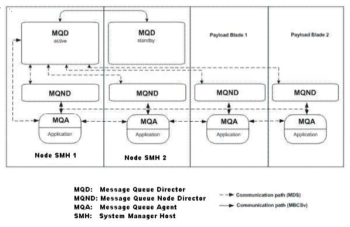

# OpenSAF Message Queue Service (MQSv)

**Release:** Release 4.2 Programmer's Reference  
**Date:** October 2011  
**Copyright:** © OpenSAF, 2008  

> [!NOTE]
> For OpenSAF architecture overview, SAF AIS compliance, and document conventions, see the [OpenSAF Overview](OpenSAF_Overview_PR.md) and centralized [GLOSSARY.md](GLOSSARY.md).

---

# Overview

## Overview of Message Queue Service

The Message Queue Service (MQSv) provides a multipoint-to-multipoint
communication mechanism for processes on the same or different nodes.
Applications which use this service, send messages to queues and not to
application processes themselves. This means, if a process dies, the
message stays in the queue and can be read by the restarted application
or by another process. Queues are persistent or non-persistent, and are
expected to preserve messages during a switch-over.

Applications may create and destroy queues, where each queue has a
globally unique name. Multiple senders may direct messages to a queue,
while single receiver reads messages from the named queue.

Queues can be grouped to form queue groups, which permit
multipoint-to-multipoint communication. The sender addresses queue
groups in the same way as addressing single queues. Queue groups
distribute workload among queues in the group, and are accessible under
the same name regardless of the number of queues to which the work is
distributed. The sender process communicates with the queue group to
obtain service from the other receiver processes and continues to
communicate even if a receiver process fails.

For message queues, the Message Service uses the model of “n” senders to
“1” receiver. For message queue groups, the Message Service uses the
model of “m” senders to “n” receivers.

## Service Structure Overview

Message Queue Service comprises three distributed subparts that maintain
the cluster-wide  
message queue database.

  - Message Queue Director (MQD)
  - Message Queue Node Director (MQND)
  - Message Queue Agent (MQA)

Figure 1 Message Queue Service -Subparts

### Message Queue Director

The Message Queue Director (MQD) runs as a process on system controller
nodes. It maintains the message queue and queue group location
information, state information and other properties of the queues and
queue groups residing in the system. It resolves the queue/queue group
name to location information, and notifies Message Queue Agents about
the changes in the queue groups. MQD allows Message Queue Agents to
register the track for queues and queue groups, and distributes the
queue and group track information to the MQAs when there is a change in
the location, status or other properties of the queue and queue groups.
MQD supports high availability and redundancy through the Availability
Management Framework (AMF) integration. It registers with the
Availability Management Framework (AMF) to smoothly recover the message
queue and queue group information when there is a switch-over/fail-over
of the system controller node. MQD uses 2N redundancy model in which
there are active and standby instances of MQD.

### Message Queue Node Director

Message Queue Node Director (MQND) runs as a process on system
controller nodes and payload nodes. It processes the management of queue
operations and Message send and receive operations from the MQAs. It
preserves the messages, and transfers the queues when applications open
and close queues across different nodes. Since the Linux message queues
preserve the messages irrespective of the application being terminated,
they are used to store the messages.

The MQND creates, maintains, and destroys the message queues on behalf
of applications. It is responsible for achieving the message delivery
properties defined by SAI-AIS-MSG-B.03.01 \[1\]. MQND notifies MQA about
the message delivery and queue open, and also interacts with MQD for
validation, resolution of queue name to location and
registration/deregistration of queues in the system. MQND has been
modeled as an AMF service unit, which belongs to a service group
employing the AMF No-Redundancy model.

### Message Queue Agent

The Message Queue Agent is a library, which conforms to the SAF APIs
described in the document SAF-AIS-MSG-B.03.01\[1\]. MQA library runs in
the context of the application processes that initialize the message
queue library. The SAF APIs are part of this library through which
message queue service requests can be issued by the application
processes.

When the application exercises the first send API, MQA maintains the
cache of the destination information of the queue and queue groups and
uses the information for subsequent send requests to queues and queue
groups.

## Compliance Report

Message Queue Service conforms to the Message Queue specifications
mentioned in the SAF document SAI-AIS-MSG-B.03.01. The following table
provides the specification compliance report specific to this release.

Table 1-1 Table 1 Compliance Table - Message Queue Service

|         |                                                                |           |
| ------- | -------------------------------------------------------------- | --------- |
| Section | Description                                                    | Supported |
| 3.1     | Message Service Model                                          | Yes       |
| 3.2     | Unavailability of the Message Service API on a Non-Member Node | Yes       |
| 3.3     | Include Files and Library Name                                 | Yes       |
| 3.4     | Type Definitions                                               | Yes       |
| 3.4.12  | Critical Capacity of Message Queues and Message Queue Groups   | No        |
| 3.5     | Library Life Cycle                                             | Yes       |
| 3.6     | Message Queue Operations                                       | Yes       |
| 3.7     | Management of Message Queue Groups                             | Yes       |
| 3.8     | Message Send and Receive Operations                            | Yes       |
| 3.9     | Request-Reply Operations                                       | Yes       |
| 3.10    | Set and Get Critical Capacity Threshold Operations.            | No        |
| 3.11    | Retrieve Meta data Size and Limit Fetch Operations             | No        |
| 4       | Message Service Information Model                              | Yes       |
| 5       | Alarms and Notifications                                       | No        |
| 6       | Message Service Management Interface                           | No        |

<table>
<tbody>
<tr class="odd">
<td>**NOTE**</td>
<td>
SA AIS Message Queue Service Specification SAI-AIS-MSG-B.03.01 has defined several different unicast and multicast queue group policies. OpenSAF Message Queue Service supports the “Equal Load Distribution” policy, which is mandated by the specification, as well as the “Local Equal Load Distribution” and “Broadcast”, which are optional. OpenSAF Message Queue Service does not support “Local Best Queue (unicast),” which is optional. 
</td>
</tr>
</tbody>
</table>

# OpenSAF Message Queue Service API

## Application Interface Specification

The document SAI-AIS-MSG-B.03.01 is a SAF standard document, and is
available at
[*https://opensaf.sourceforge.io/documentation.html*](http://www.saforum.org/apps/org/workgroup/twg/ais/download.php/1456/aisMsg.B0101.pdf).
It provides the service definition of the Message Queue Service:

The following information can be found in the referenced document:

  - Service concept definitions and descriptions
  - Functional behaviors and relationships
  - A complete set of service data types exposed to the service user
  - The set of service APIs available to the service user

## Service Extensions

The only service extension provided is the standards-based service
definition explained in the document SAI-AIS-MSG-B.03.01.

## Implementation Notes

In the following sections you will find information that is important
when writing applications that make use of the Message Queue service.

### Timeout Arguments for Message Queue APIs

For synchronous API calls, the application will provide the timeout
argument. The application will consider the invocation of the particular
API as failed if it does not complete the call within the specified
time. The value passed in the timeout argument should be greater than
1,000,0000 nanoseconds (10 milliseconds).

### MQND Listener Queue

If the application opens a message queue with a receive callback option
by setting the SA\_MSG\_QUEUE\_RECEIVE\_CALLBACK flag in the open flags,
MQSv will create one extra Linux message queue for invoking the “message
received” callbacks. While calculating the message queue requirements
per node, this factor needs to be considered.

### Cancellation of Pending Callbacks

According to the SAI-AIS-MSG-B.03.01 specification, when a queue is
closed by invoking saMsgQueueClose( ) API, pending callbacks that refer
directly or indirectly related to the queue should be canceled MQSv
cancels pending callbacks for closed queue, but, the selection object
already raised for canceled pending callbacks is not cleared or reset.
So the saMsgDispatch( ) API may return without invoking the callback
routine.

### Handling of SA\_AIS\_ERR\_TRY\_AGAIN

If the Message Queue Service API returns SA\_AIS\_ERR\_TRY\_AGAIN, the
application should repeat the API call only after couple of seconds. The
waiting time depends on the platform, but a waiting time of 3 seconds
between the attempts is advised.

### Maximum Message Size

Message queue service supports a maximum of 4096 bytes of the message
data in SaMsgMessageT structure.

### Queue Group Member Selection Policy

According to the SAF AIS Message Service spec B.03.01, "If an error
occurs when sending to a member, it is implementation-dependent whether
the error is returned immediately or the Message Service chooses the
next member in turn and for how many members this is repeated."

In OpenSAF MQSv, if the message sent to a message queue group fails, the
next member queue is selected. This selection process continues until
all the members in the queue groups are tried.

### Limitation of the saMsgMessageReplyAsync() API

The saMsgMessageReplyAsync( ) API gets blocked to a maximum of 5 seconds
to return the SA\_AIS\_ERR\_NOT\_EXIST error in case the sender process
that exercises saMsgMessageSendReceive( ) API does not exist. This is
because OpenSAF MQSv depends on the MDS peer discovery process, which
takes up to 5 seconds to discover the nonexistence of the peer.

### Retaining the Sender Context

When a message, which was sent using the saMsgMessageSendReceive() API
is received by a process, the sender\_id info obtained from the
saMsgMessageGet() API is retained for a predetermined duration. This is
done because the OpenSAF implementation of MQSv expects the reply to be
sent to the sender within that time.

### **Usage of saMsgMessageDataFree() and saMsgQueueGroupNotificationFree()**

****These functions shall cause the space pointed by data pointer, which
was allocated in Message queue service library either by
*****saMsgMessageGet()***** or *****saMsgMessageSendReceive()***** or
*****saMsgQueueGroupTrack()***** functions, to be deallocated. ****If
the data pointer does not match the earlier returned pointer by MQSv
library functions, or use of pointer that refers to freed space will
result in undefined behavior.

### Limitation on Maximum Number of Message Queues

If the limit of number of message queues that can be created on a blade
is reached, MQSv returns SA\_AIS\_ERR\_NO\_RESOURCES. Refer [Error:
Reference source not found](#anchor-29)[Error: Reference source not
found](#anchor-29) for increasing the kernel message queue limit on the
blade.

### Broadcast Queue Group Policy

When MQA sends a message to a queue group with
SA\_MSG\_QUEUE\_GROUP\_BROADCAST policy, the send API returns:

  - SA\_AIS\_ERR\_QUEUE\_FULL : If all the available member queues of
    the queue group are full.
  - SA\_AIS\_OK : If send operation to any available member queue of the
    queue group is successful.

A queue is said to be available, if the MQND on node that owns the queue
is alive.

### Local Best Queue Policy

MQSv implementation does not support
SA\_MSG\_QUEUE\_GROUP\_LOCAL\_BEST\_QUEUE queue group policy.

### Support for DN name convention in B.01.01

Though the present implementation of MQSv is backward compatible to
B.01.01 specifications the DN name format has to be followed while
creating a queue resource or queue Group.Configuration

### Setting the Maximum Number of Queues in Linux

The OpenSAF Message Queue Service uses System V native message queues
for storing the messages. In most of the Linux operating systems, the
default value for the maximum number of queues that can be created at
one time, is 16. The following procedure describes how to change the
default value.

1.  Open the configuration file /etc/sysctl.conf
2.  Edit or append the entry kernel.msgmni=100 (To configure 100 as the
    maximum number of queues that can be opened at a time)
3.  Save the file /etc/sysctl.conf
4.  Execute **sysctl -p** (This will load sysctl settings from
    /etc/sysctl.conf) This configuration change needs to be done before
    OpenSAF Services on that blade are started. This can be done by
    adding these configuration commands in any of the application
    scripts that gets executed before osafmsgnd starts. Changing this
    configuration information after starting the MQND will not get
    effected even after restarting only MQND.

### Logging Configuration

Add the following line in */etc/opensaf/msgd.conf* and
*/etc/opensaf/msgnd.conf* files to enable tracing for MQSv.

args="--tracemask=0xffffffff"

## Service Dependencies

The Message Queue Service provides internal interfaces to the following
services:

  - Layered Environment for Accelerated Portability (LEAP) - for Shared
    Memory: Message Queue Service uses LEAP for portability. The service
    uses the memory manager, timers, encode-decode utility and handle
    manager services provided by the LEAP.
  - Message Distribution Service (MDS) - for Messaging: All the
    interaction between the different subparts of the Message Queue
    service will take place using MDS messaging.
  - Availability Management Framework (AMF) - for High Availability: MQD
    and MQND are modelled as AMF components.
  - Message based Checkpoint Service (MBCSv) - for checkpointing
    information: The active MQD uses MBCSv to checkpoint the state
    information with the standby MQD.
  - Information management Model Service (IMMSv) – for managing
    information: The MQSv uses IMM for interfacing its information for
    the end user.
  - Cluster Membership Service(CLMsv) – for tracking node presence: MQND
    waits on the CLM notifications to keep track of the node presence.

The applications need to include the following library to use* MQSv:
libSaMsg.so*

## Management Interface

This section describes management interfaces of the Message Queue
Service.

### IMM Interface

Refer MQSv B.03.01 specification for IMM classes implementation.

### Command Line Interface

The Message Queue Service does not provide any default CLI commands on
top of IMMSv apart from the default tools provided by IMMSv (immlist,
immfind, immcfg etc).

# Sample Application

## Overview

The sample application consists of the following two application
processes that use MQSv APIs to send and receive messages:

  - Message Sender Application
  - Message Receiver Application

The features supported by the sample application scenarios are given
below:

  - Message send and receive operations using synchronous APIs
  - Message send and receive operations using asynchronous APIs
  - Request-reply operations using synchronous API for the reply
  - Request-reply operations using asynchronous API for the reply

The sample applications assume that OpenSAF software is installed and
running on the target system.

## Running the Sample Message Queue Service

This section describes how to run the sample application.

Procedure

In order to run the sample application, proceed as follows:

1.  Build the sample program to create the executable file *msg\_demo*.
    Refer to the *OpenSAF README file*.
2.  Copy the executable file onto the target.
3.  Ensure the file msg\_demo has executable permission. To grant
    permission, use the following command: **chmod +x msg\_demo **
4.  Open two terminals and go to the directory in which the executable
    file msg\_demo is copied.
5.  Execute ***./msg\_demo 0** *command in the first terminal. This
    application process acts as “MESSAGE-RECEIVER”:The output is
    displayed on the both the terminals indicating the messaging
    operations are being demonstrated.
6.  Execute **./msg\_demo 1** command in the second terminal. This
    application process acts as “MESSAGE-SENDER”:**. **Press a key on
    the first terminal to receive a message. A key has to be pressed on
    the sending side to send a message and subsequently a key has to be
    pressed to receive the message.** **

## Sample Application Output

The output of the sample applications for two different scenarios is
given below.

### Receiever Logs

STARTING THE MQSv DEMO

\======================

MessageQ Receiver Application

\#\#\#\#\#\#\#\#\#\#\#\#\#\#\#\#\#\#\#\#\#\#\#\#\#\#\#\#\#\#\#\#\#\#\#\#\#\#\#\#\#\#\#\#\#\#\#\#\#\#\#\#\#\#\#\#\#\#\#\#\#\#\#\#\#\#\#\#\#\#\#\#\#\#\#\#\#\#\#\#\#\#\#\#\#

DEMO SCENARIO\#1: Receiving messages via Sync API - saMsgMessageGet
START

Opened message queue with params:-

Queue Name - safMq=Demo\_Queue1,safApp=safMsgService

QCreation Flags: 0

QSize - 512

QRetention time - 10000000000

Retention time set function passed

Ready to receive messages... Press a key to continue

Reading the message using saMsgMessageGet()

Received message0

\-------------------

This is demo message0

message0 info

\-------------

send time - 1271925043

sender id - 0

Reading the message using saMsgMessageGet()

Received message1

\-------------------

This is demo message1

message1 info

\-------------

send time - 1271925043

sender id - 0

Reading the message using saMsgMessageGet()

Received message2

\-------------------

This is demo message2

message2 info

\-------------

send time - 1271925043

sender id - 0

Reading the message using saMsgMessageGet()

Received message3

\-------------------

This is demo message3

message3 info

\-------------

send time - 1271925043

sender id - 0

Reading the message using saMsgMessageGet()

Received message4

\-------------------

This is demo message4

message4 info

\-------------

send time - 1271925043

sender id - 0

SCENARIO\#1: Receiving messages via Sync API - saMsgMessageGet END

\#\#\#\#\#\#\#\#\#\#\#\#\#\#\#\#\#\#\#\#\#\#\#\#\#\#\#\#\#\#\#\#\#\#\#\#\#\#\#\#\#\#\#\#\#\#\#\#\#\#\#\#\#\#\#\#\#\#\#\#\#\#\#\#\#\#\#\#\#\#\#\#\#\#\#\#\#\#\#\#\#\#\#\#\#

Press Enter Key to Continue...

SCENARIO\#2: Receiving messages via Async API - Poll and saMsgDispatch
START

Open Flags - SA\_MSG\_QUEUE\_RECEIVE\_CALLBACK

Opening message queue with params: Queue Name -
safMq=Demo\_Queue2,safApp=safMsgService,creation flags 0, size - 512,
retention time - 100000000000

poll() on Selection Object...

Dispatching the notification using saMsgDispatch

Message Received Callback invoked with Queue Handle - 786432

Received Message

\-------------------

This is demo message0

poll() on Selection Object...

Dispatching the notification using saMsgDispatch

Message Received Callback invoked with Queue Handle - 786432

Received Message

\-------------------

This is demo message1

poll() on Selection Object...

Dispatching the notification using saMsgDispatch

Message Received Callback invoked with Queue Handle - 786432

Received Message

\-------------------

This is demo message2

poll() on Selection Object...

Dispatching the notification using saMsgDispatch

Message Received Callback invoked with Queue Handle - 786432

Received Message

\-------------------

This is demo message3

poll() on Selection Object...

Dispatching the notification using saMsgDispatch

Message Received Callback invoked with Queue Handle - 786432

Received Message

\-------------------

This is demo message4

SCENARIO\#2: Receiving messages via Async API - Using POLL and
saMsgDispatch END

Press Enter Key to Continue...

SCENARIO\#3:Replying Messages via Sync API - saMsgMessageReply START

Opening message queue with params: Queue Name -
safMq=Demo\_Queue3,safApp=safMsgService,creation flags 0, size - 512,
retention time - 10000000000

Received message

\-------------------

This is demo message4

message info

\-------------

send time - 1271925065

sender id - 134590536

Received a message with sendReceive Flags set to TRUE

Replying to the sender using saMsgMessageReply

saMsgMessageReply success

SCENARIO\#3:Replying Messages via Sync API - saMsgMessageReply END

Press Enter Key to Continue...

SCENARIO\#4:Replying Messages via Async API - saMsgMessageReplyAsync
START

Opening message queue with params: Queue Name -
safMq=Demo\_Queue4,safApp=safMsgService,creation flags 0, size - 512,
retention time - 10000000000

Received message

\-------------------

This is demo message4

message info

\-------------

send time - 1271925074

sender id - 134590536

Received a message with sendReceive Flags set to TRUE

Replying to the sender using saMsgMessageReplyAsync

saMsgMessageReplyAsync success

SCENARIO\#4:Replying Messages via Async API - saMsgMessageReplyAsync END

Press Enter Key to Continue...

End of MessageService Demo. Press Enter Key to Quit

### Sender Logs

STARTING THE MQSv DEMO

\======================

MessageQ Sender Application

\#\#\#\#\#\#\#\#\#\#\#\#\#\#\#\#\#\#\#\#\#\#\#\#\#\#\#\#\#\#\#\#\#\#\#\#\#\#\#\#\#\#\#\#\#\#\#\#\#\#\#\#\#\#\#\#\#\#\#\#\#\#\#\#\#\#\#\#\#\#\#\#\#\#

SCENARIO\#1:Sending Messages via Sync API - saMsgMessageSend START

Sending Message0 using saMsgMessageSend()...success.

Sending Message1 using saMsgMessageSend...success.

Sending Message2 using saMsgMessageSend...success.

Sending Message3 using saMsgMessageSend...success.

Sending Message4 using saMsgMessageSend...success.

SCENARIO\#1:Sending Messages via Sync API - saMsgMessageSend END

\#\#\#\#\#\#\#\#\#\#\#\#\#\#\#\#\#\#\#\#\#\#\#\#\#\#\#\#\#\#\#\#\#\#\#\#\#\#\#\#\#\#\#\#\#\#\#\#\#\#\#\#\#\#\#\#\#\#\#\#\#\#\#\#\#\#\#\#\#\#\#\#\#\#

Press Enter Key to Continue...

\#\#\#\#\#\#\#\#\#\#\#\#\#\#\#\#\#\#\#\#\#\#\#\#\#\#\#\#\#\#\#\#\#\#\#\#\#\#\#\#\#\#\#\#\#\#\#\#\#\#\#\#\#\#\#\#\#\#\#\#\#\#\#\#\#\#\#\#\#\#\#\#\#\#

SCENARIO\#2:Sending Messages via Async API - saMsgMessageSendAsync START

Sending Message0 using saMsgMessageSendAsync...success.

Sending Message1 using saMsgMessageSendAsync...success.

Sending Message2 using saMsgMessageSendAsync with
SA\_MSG\_MESSAGE\_DELIVERED\_ACK set and invocation=3...success.

Sending Message3 using saMsgMessageSendAsync with
SA\_MSG\_MESSAGE\_DELIVERED\_ACK set and invocation=4...success.

Sending Message4 using saMsgMessageSendAsync with
SA\_MSG\_MESSAGE\_DELIVERED\_ACK set and invocation=5..success.

SCENARIO\#2:Sending Messages via Async API - saMsgMessageSendAsync END

\#\#\#\#\#\#\#\#\#\#\#\#\#\#\#\#\#\#\#\#\#\#\#\#\#\#\#\#\#\#\#\#\#\#\#\#\#\#\#\#\#\#\#\#\#\#\#\#\#\#\#\#\#\#\#\#\#\#\#\#\#\#\#\#\#\#\#\#\#\#\#\#\#\#

Press Enter Key to Continue...

\#\#\#\#\#\#\#\#\#\#\#\#\#\#\#\#\#\#\#\#\#\#\#\#\#\#\#\#\#\#\#\#\#\#\#\#\#\#\#\#\#\#\#\#\#\#\#\#\#\#\#\#\#\#\#\#\#\#\#\#\#\#\#\#\#\#\#\#\#\#\#\#\#\#\#\#\#\#\#\#\#\#\#\#\#

SCENARIO\#3:Sending & Receiving Messages via Sync API -
saMsgMessageSendReceive START

Sending Message using saMsgMessageSendReceive()...success.

SCENARIO\#3:Sending & Receiving Messages via Sync API -
saMsgMessageSendReceive END

\#\#\#\#\#\#\#\#\#\#\#\#\#\#\#\#\#\#\#\#\#\#\#\#\#\#\#\#\#\#\#\#\#\#\#\#\#\#\#\#\#\#\#\#\#\#\#\#\#\#\#\#\#\#\#\#\#\#\#\#\#\#\#\#\#\#\#\#\#\#\#\#\#\#\#\#\#\#\#\#\#\#\#\#\#

Press Enter Key to Continue...

\#\#\#\#\#\#\#\#\#\#\#\#\#\#\#\#\#\#\#\#\#\#\#\#\#\#\#\#\#\#\#\#\#\#\#\#\#\#\#\#\#\#\#\#\#\#\#\#\#\#\#\#\#\#\#\#\#\#\#\#\#\#\#\#\#\#\#\#\#\#\#\#\#\#\#\#\#\#\#\#\#\#\#\#\#

SCENARIO\#4:Sending & Receiving Messages via Async API -
saMsgMessageSendReceive

Sending Message using saMsgMessageSendReceive()...success.

SCENARIO\#4:Sending & Receiving Messages via Async API -
saMsgMessageSendReceive END

\#\#\#\#\#\#\#\#\#\#\#\#\#\#\#\#\#\#\#\#\#\#\#\#\#\#\#\#\#\#\#\#\#\#\#\#\#\#\#\#\#\#\#\#\#\#\#\#\#\#\#\#\#\#\#\#\#\#\#\#\#\#\#\#\#\#\#\#\#\#\#\#\#\#\#\#\#\#\#\#\#\#\#\#\#

Press Enter Key to Continue...

End of MessageService Demo. Press Enter Key to Quit
