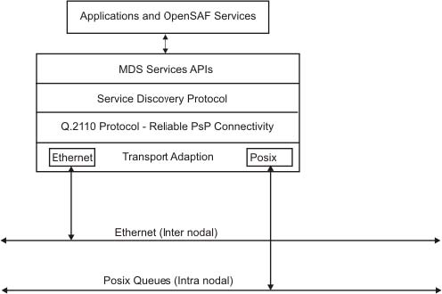

# OpenSAF Architecture Overview

**Release:** Release 5.20.08 Programmer's Reference  
**Date:** August 2020  
**Copyright:** © OpenSAF, 2008  

> [!NOTE]
> For standardized abbreviations, acronyms, and typographic conventions across all OpenSAF services, see the centralized [GLOSSARY.md](GLOSSARY.md).

---

# Overview

## OpenSAF Overview

OpenSAF is a suite of HA middleware which implements the Service
Availability Forum™ (SAF) interface specification. The SAF is a
consortium of industry-leading communications and computing companies
working together to develop and publish high availability and management
software interface specifications.

In addition to the services that implement the SAF interface, OpenSAF
contains complementary services which are required in a complete
high-availability system solution.

The set includes:

  - SA Forum-compliant services:

  - Availability Management Framework

  - Checkpoint Service

  - Global Lock Service

  - Event Distribution Service

  - Log Service

  - Message Queue Service

  - Information Model Management Service

  - Notification Service

  - Platform Management Service

  - Software Management Framework

  - Cluster Management Service

  - OpenSAF complementary services:

  - Message Distribution Service
  - Message-Based Checkpoint Service
  - OpenSAF Base

SAF-compatible services, as well as the complementary services, are
described in detail in this manual.

All these services have versioning infrastructure to support In Service
Upgrade.

# OpenSAF Services

## Architectural Overview

OpenSAF system architecture defines two types of nodes in the OpenSAF
cluster:

  - System Controller Node
  - Payload Node

System Controller Node - A designated node within an OpenSAF cluster
that hosts the centralized functions of various OpenSAF services. The
system controller node also includes the management access point for the
entire cluster. Application components may or may not be configured on a
system controller node depending on the target OpenSAF application's
design. For high availability purposes, you can configure several system
controller nodes. OpenSAF will utilize the system controller nodes using
the 2N redundancy model, where one node will be ACTIVE, another node
will be STANDBY, and the rest of the controller nodes (if any) will be
spares.

Payload Node -All nodes which are not system controller nodes are termed
payload nodes. These nodes contain node-scoped functions of various
OpenSAF services. They are expected to host the target OpenSAF
application components.

The following section gives an overview on different components of the
OpenSAF Services and provides brief insights into each service.

The following figure illustrates the main software layers that
constitute the OpenSAF software:

### OpenSAF Services

The following table lists and briefly explains the OpenSAF services that
implement the Service Availability Forum (SAF) Application Interface
Specification (AIS).

|                                              |                                            |                                                                                                                                                                                                                                                                                                                            |
| -------------------------------------------- | ------------------------------------------ | -------------------------------------------------------------------------------------------------------------------------------------------------------------------------------------------------------------------------------------------------------------------------------------------------------------------------- |
| OpenSAF Service Name                         | Corresponding SAF AIS Service(s)           | Description                                                                                                                                                                                                                                                                                                                |
| Availability Management Framework (AMF)      | Availability Management Framework (AMF)    | This service provides a standardized means to model system components and standardized mechanisms for monitoring, fault reporting, fault recovery and repair of components.                                                                                                                                                |
| Cluster Management Service (CLMSv)           | Cluster Management Service(CLM)            | It further provides functionality that oversees cluster nodes as they join and leave the cluster.                                                                                                                                                                                                                          |
| Checkpoint Service (CPSv)                    | Checkpoint Service (CKPT)                  | This service oversees the life and integrity of entities called checkpoints. Active components write to checkpoints so that stand-by components recover the last known good state while turning active. CPSv coordinates the creation and deletion of checkpoints and maintains the checkpoint inventory within a cluster. |
| Message Queue Service (MQSv)                 | Messaging Service (MSG)                    | This service provides a standardized means for distributed applications to send messages among themselves. MQSv oversees entities called queues and queue groups and is capable of preserving unread messages if a reader process dies.                                                                                    |
| Event Distribution Service (EDSv)            | Event service (EVT)                        | This service provides a standardized means to publish events and to subscribe to events anywhere in a cluster.                                                                                                                                                                                                             |
| Global Lock Service (GLSv)                   | Lock Service (LCK)                         | This service provides a means to control access to a cluster resources by competing distributed clients.                                                                                                                                                                                                                   |
| Log Service (LOGSv)                          | Log Service (LOG)                          | This service provides a standardized means for applications to express and forward log records through well-known streams that leads to an associated named file.                                                                                                                                                          |
| Information Model Management Service (IMMSv) | Information Model Management Service (IMM) | The IMM Service delivers the requested operations to the appropriate AIS Services or applications (referred to as object implementers) that implement these objects for execution.                                                                                                                                         |
| Notification Service (NTFSv)                 | Notification Service (NTF)                 | The Notification Service is used by a service user to report an event to a peer service user. A notification producer generates notifications. A consumer consumes notifications that were generated by producers. A subscriber for notifications gets notifications forwarded as they occur.                              |
| Software Management Framework (SMF)          | Software Management Framework (SMF)        | The Software Management Framework maintains the information about the availability, the contents, and the deployment of different software bundles in the SA Forum system and coordinates the upgrades.                                                                                                                    |
| Platform Management Service (PLMSv)          | Platform Management (PLM)                  | Platform Management Service provides a logical view of the hardware and low-level software of the system. PLM Service also provides objects that are administratively configurable.                                                                                                                                        |

Table 1: SAF Compliant OpenSAF Services

Further details about each of these services will be given in the
following sections.

The following table lists and briefly describes complementary OpenSAF
services.

|                                             |                                                                                                                                                                                                                                                                                                                                                                                                                                                         |
| ------------------------------------------- | ------------------------------------------------------------------------------------------------------------------------------------------------------------------------------------------------------------------------------------------------------------------------------------------------------------------------------------------------------------------------------------------------------------------------------------------------------- |
| Message Based Checkpointing Service (MBCSv) | This service provides message-based checkpointing between an active and one or more stand-by components [Message-Based Checkpointing Service ](#anchor-13).                                                                                                                                                                                                                                                                                             |
| Message Distribution Service (MDS)          | The Message Distribution Service (MDS) provides high-performance, reliable message distribution services. OpenSAF services and user applications invoke the services provided by MDS through an API which is exposed in the form of a library that can be linked to a process. MDS supports intra-process, inter-process as well as inter-node communication. Further details about MDS is given in section [Message Distribution Service](#anchor-14). |

Table 2: OpenSAF-Complementary Services

Further details about these services will be given in the following
sections.  

## Distribution of OpenSAF Services

Many OpenSAF services are subdivided into subparts. All subparts
together form one OpenSAF service. The subparts may run together on one
node or may even be distributed among several nodes. This section will
provide more details.

The following figure provides an overview on how OpenSAF services are
distributed in a system.

### OpenSAF Service Directors

A Director for a particular OpenSAF service manages and coordinates key
data among the other distributed sub-parts of that service. The Director
is located on a controller node and is implemented with a 2N redundancy
model. Active Director checkpoints the data to StandBy Director using
MBCSv. Directors on spare system controller nodes receive checkpoint
data until they are given an active or standby assignment.

A director communicates with Node Directors that are located on blades
in a system. Node Directors handle node-scoped activities such as
messaging with the central Director or with the local OpenSAF service
agent.

The OpenSAF service agent makes service capabilities available to
clients such as customer applications, by way of shared linkable
libraries that expose well defined APIs.

The following figure illustrates Directors and their interaction with
other OpenSAF service subparts.

The following OpenSAF service Directors exist in an OpenSAF system:

  - Availability Director
  - Checkpoint Director
  - Cluster Management Director
  - Global Lock Director
  - Message Queue Director
  - Information Model Management Director
  - Software Management Framework Director (SMFD)

A more detailed description of these Directors will be given in the
description of the respective OpenSAF service later in this manual.

### OpenSAF Service Servers

An OpenSAF Service specific server provides central intelligence for a
particular OpenSAF service, but unlike with OpenSAF service Directors,
there is no corresponding Node Director for an OpenSAF service Server.
Instead the server communicates directly with OpenSAF service Agents.

These Servers are implemented in a 2N redundancy fashion. Active Server
checkpoints the data to StandBy Server using MBCSv. Servers on spare
system controller nodes receive checkpoint data until they are given an
active or standby assignment. The following figure illustrates the role
of OpenSAF service Servers in a system.

The following OpenSAF Servers exist in a system:

  - Cluster Membership Server
  - Distributed Trace Server
  - Event Distribution Server
  - Log Server
  - Notification Server
  - Platform Management Server

A more detailed description is given together with the description of
the respective OpenSAF service later in this manual.

### Sample Applications

The OpenSAF software suit contains a set of sample applications and
sample make files that ease the development of customer applications.
They illustrate the use of the various APIs and serve as a good
starting-point to develop your own applications.

OpenSAF System Model

The OpenSAF System description provides an easy and flexible way to
describe, create, and configure a system using XML syntax. This makes it
easy to view hierarchical information in a structured way.

OpenSAF system definition provides a set of XML clauses that describe a
system and its default configuration. Together, these XML clauses make
up the system configuration file.

For arriving at default system configuration the nodes in the system has
to be specified as argument to the IMM utility tool immxml-clustersize,
and yet another IMM utility immxml-configure generates the default
*imm.xml* file by walking through all service specific configuration
templates, classes and objects files.

The system is visualized by breaking it into three node groups

  - Only System controller nodes
  - Only Payload nodes
  - All nodes ( controller nodes and payload nodes )

All the OpenSAF service directors are modeled in a 2N redundancy model,
and typically runs only on controller nodes. For this reason SG (object
of class SaAmfSG) with a DN name safSg=2N,safApp=OpenSAF hosts all the
service units hosted by node group safAmfNodeGroup=SCs.

Similarly all the OpenSAF service node directors are modeled in
No-Redundancy model and runs on all the nodes including controller
nodes. For this reason SG with DN name safSg=NoRed, safApp=OpenSAF hosts
all the service units hosted by node group safAmfNodeGroup=AllNodes.

## SAF-Compliant OpenSAF Services

This section briefly describes those OpenSAF services which implement
standard SAF services. For each service an architectural overview and a
functional description is given. Furthermore, a reference to user
manuals is given where you can find more detailed information.

### Availability Management Framework (AMF)

The Availability Management Framework (AMF) provides the following
functionality:

  - Leverage the SAF "Information Model Management "
  - Honor the Availability Management Framework" API

The Availability Management Framework Director (AMFD) maintains a
software system model database which captures SAF described logical
entities and their relationships to each other. The software system
model database is initially configured from data contained in the System
Description file. Through time the system model will modify due to
changing system realities and administrative actions.

The SAF logical entities configured in the information management model
include components which normalize the view of physical resources such
as processes, drivers or devices. Components are grouped into Service
Units according to fault dependencies that exist among them. A Service
Unit is also scoped to one or more (physical) fault domains. Service
Units of the same type are grouped into Service Groups (SG) which
exhibit particular redundancy modeling characteristics. Service Units
within a SG are assigned to Service Instances (SI) and given a High
Availability state of active and standby.

Further functionality provided by AMFD includes:

  - Automatic and administrative means to instantiate, terminate and
    restart resources
  - Automatic and administrative means to manage or reflect Service
    Group, Service Unit, Service Instance and Resource state
  - Administrative means to perform switch-over
  - Administrative means to lock and unlock nodes
  - Heartbeat and event subscription schemes for fault detection,
    isolation and identification
  - Health-check services to probe and prevent system trauma that lead
    to faults
  - Fault recovery mechanisms to fail-over SIs which maintain service
    availability in case of system trauma
  - Fault repair mechanisms to restore failed components

The AMF itself cannot be a single-point of failure. It provides its own
internal scheme and mechanisms to protect itself from its own failure.

#### Architecture

The AMF is comprised of the following main software components:

  - Availability Management Framework Director (AMFD)
  - Availability Management Framework Node Director (AMFND)
  - Availability Management Framework Agent (AMFA)
  - Availability Management Framework Process

##### Availability Management Framework Director

The Availability Management Framework Director (AMFD) maintains the most
abstract portions of the Software System Model, such as service groups,
service instances and service nodes.

Its main tasks include fault detection, isolation and recovery
procedures as defined in the SAF AMF. Any problems and failures on a
component that cannot be handled locally, are promoted to the
Availability Director which controls and triggers the isolation of the
affected component and, if possible, the activation of a stand-by
component.

##### Availability Management Framework Node Director

The Availability Management Framework Node Director (AMFND) resides on
each system node and its main task is to maintain the node-scoped part
of the software system model described above.

The AMFND coordinates local fault identification and repair of
components and furthermore facilitates any wishes it receives from the
AMFD.

The AMFND watches for components arriving or leaving the system and
summarizes this information in a Service Unit (SU) presence state, and
keeps the AMFD informed about the current status and changes. The AMFND
is capable of disengaging, restarting and destroying any component
within its scope. This may occur according to AMFD instructions or as a
result of an administrative action or automatically triggered by
policies.

##### Availability Management Framework Agent

The Availability Management Framework Agent (AMFA) is a linkable library
that exposes the SAF APIs to applications. Its task is to convey
requests from the AMFND or the AMFD through the AMFND to the application
and vice versa.

### Checkpoint Service

The Checkpoint Service (CPSv) implements the SAF Checkpoint Service. It
provides check-pointing of data in a manner which is equivalent to
hardware shared memory between nodes.

#### Basic Functionality

The CPSv maintains a set of replicated repositories called checkpoints.
Each checkpoint may have one or more replicas within the scope of a
cluster. At most, one replica per checkpoint may exist on one node
within a cluster.

Each checkpoint comprises one or more sections which can be dynamically
created or deleted. The CPSv does not encode the data written into
checkpoint sections. If checkpoints are replicated on heterogeneous
nodes, for example nodes with different endian architecture, you must
make sure that the data can be appropriately interpreted on all nodes.

The CPSv service supports the following two types of update options:

  - Asynchronous update option
  - Synchronous update option

In the case of asynchronous update option, one of the replicas is
designated as the active replica. Data is always read from the active
replica and there is no guarantee that all the other replicas contain
identical data. A write call returns after updating the active replica.

In the case of synchronous update options, the call invoked to write to
the replicas returns only when all replicas have been updated, i.e.
either all replicas are updated or the call fails and no changes are
made to the replicas.

The CPSv supports both collocated and non-collocated checkpoints. In
case of checkpoints opened with collocated and asynchronous update
option, it is up to the application to set a checkpoint to the active
state. In all other cases the CPSv itself handles which checkpoint is
currently active.

The Checkpoint Service defined by SAF does not support hot-standby. This
means that the currently stand-by component is not notified of any
changes made to the checkpoint. When the stand-by component gets active,
it has to iterate through the respective checkpoint sections to get
up-to-date. To overcome this drawback, the CPSv provides additional,
non-SAF APIs which help to notify the stand-by component of changes and
thus facilitate the implementation of a hot-stand-by.

#### Architecture

The CPSv service consists of the following subparts:

  - Checkpoint Director (CPD)
  - Checkpoint Node Director (CPND)
  - Checkpoint Agent (CPA)

##### Checkpoint Director

The Checkpoint Director runs on the active system controller node. Its
main tasks are:

  - Generating a unique ID for each new checkpoint created by
    applications
  - Maintaining the list of nodes on which replicas of a particular
    checkpoint exist
  - Selecting the Checkpoint Node Director (CPND) which oversees the
    active replica for each checkpoint
  - Coordinating the creation and deletion of checkpoints
  - Maintaining a repository for the CPSv policy and
    configuration-related information

There is an active and a stand-by CPD running respectively on the two
system controller nodes. CPD uses the OpenSAF Message based Checkpoint
Service to keep the two synchronized and available for failover
situations.

##### Checkpoint Node Director

The Checkpoint Node Director (CPND) runs as process both on payload
blades and on the two system controller nodes. Its tasks are:

  - Accepting checkpoint requests from Checkpoint Agents and streamline
    requests from applications to checkpoints
  - Maintaining and controlling the state information pertaining to
    checkpoints
  - Coordinating read and write accesses to/from checkpoint applications
    across the cluster
  - Keeping track of CPNDs on other nodes in order to update the local
    data if a CPND that is managing the active checkpoint goes down
  - Maintaining local replicas in shared memory
  - Storing checkpoint control information in the shared memory so that
    it may be retrieved after a CPND restart
  - Managing accesses to sister replicas and coordinating accesses from
    other applications to the replicas within the scope of the CPND

##### Checkpoint Agent

The Checkpoint Agent (CPA) is a linkable library available to
applications that want to use checkpoint services.

### Message Queue Service

The Message Queue Service (MQSv) implements the SAF Message service API.

#### Basic Functionality

Sender application(s) which use this service, send messages to queues
and queue groups managed by MQSv and not to receiving application(s)
directly. This means, if a process dies, the message persists in the
queue and can be read by the restarted application or by another
process.

Applications may create and destroy queues, where each queue has a
globally unique name. Multiple senders may then direct messages to a
queue, while a single receiver may read messages from the named queue.

Applications may group several queues into a system-wide named queue
group. When sending a message to a queue group, a group policy dictates
which queue actually receives the message. The sender does not know how
many queues are in the group or what the policy is.

#### Architecture

The MQSv service consists of the following three subparts:

  - Message Queue Director
  - Message Queue Node Director
  - Message Queue Agent

##### Message Queue Director

The Message Queue Director (MQD) runs as process on a system controller
node. Its main tasks are:

  - Maintaining location and state data of all queues and queue groups
    in a system
  - Resolving all queue and queue group names and location information
  - Supporting group change tracking on behalf of registering clients

There is an active and a stand-by MQD running respectively on the two
system controller nodes. MQD uses the OpenSAF Message based Checkpoint
Service to keep the two synchronized and available for failover
situations.

##### Message Queue Node Director

The Message Queue Node Director (MQND) runs as process both on payload
and on controller

nodes. Its main tasks are:

  - Managing queue send/receive operations initiated by Message Queue
    Agents (MQA)
  - Creating, maintain and destroy queues
  - Notifying MQAs when messages are delivered, received or when tracked
    group traits change
  - Destroying a queue if its creator process dies or a retention timer
    expires
  - Preserving messages until fetched or queue is destroyed

##### Message Queue Agent

This is a linkable library that makes all MQSv APIs available to
applications.

### Event Distribution Service

The Event Distribution Service (EDSv) is compliant with the Event
Service APIs defined by the SAF.

This service controls the multiplexing of event messages in a
publish/subscribe environment. It exposes a rich set of APIs which allow
applications to control event distribution criteria. The implementation
details of the event distribution mechanism remain transparent to the
application. In the OpenSAF environment, the EDSv uses the underlying
Message Distribution Service (MDS) to implement the communication
channels.

The EDSv functionality is closely linked with other OpenSAF services,
such as System Definition, Availability Management Framework and
Checkpoint Service.

#### Architecture

The EDSv consists of the following two parts:

  - Event Distribution Server (EDS)
  - Event Distribution Agent (EDA)

##### Event Distribution Server

The Event Distribution Server (EDS) is an OpenSAF process on the System
Controller blade which handles the distribution of events based on
client subscriptions and filtering mechanisms. If an event was posted
and event persistence was specified, the event will be retained by the
server process for the time period specified in the call. During the
retention time period, the EDS may redistribute the event to new
subscribers for that event. Events are distributed based on a match
against the filter settings specified by the subscribed client and a
priority specified in the event header.

There is an active and a stand-by EDS running respectively on the two
system controller nodes. EDS uses the OpenSAF Message based Checkpoint
Service to keep the two synchronized and available for failover
situations.

##### Event Distribution Agent

This is a library that makes the EDSv APIs available to applications.
The APIs themselves are all described in the respective SAF documents.

### Global Lock Service

The Global Lock Service (GLSv) implements the SAF Lock Service API.

#### Basic Functionality

The GLSv provides a distributed locking service which allows
applications running on multiple nodes to coordinate access to shared
resources.

Locks are created and destroyed by applications as needed. Participating
applications know that the locks exist and know how to use them. Access
policies are outside the scope of the GLSv, which only provides the
locking mechanism.

The GLSv supports exclusive and shared access modes. Exclusive access
mode means that only one requester is allowed through the lock at a
time. Shared access mode means that multiple requesters are allowed
through a lock at a time.

The GLSv furthermore supports synchronous and asynchronous APIs to carry
out locking operations. In addition, GLSv provides an internal mechanism
which ensures deadlock detection and prevention.

If an application creates a lock and then exits without unlocking,
orphan locks are the result. Orphan locks are managed until they are
properly purged from the system.

#### Architecture

The GLSv consists of the following subparts:

  - Global Locking Director
  - Global Locking Node Director
  - Global Locking Agent

There is an active and a stand-by GLD running respectively on the two
system controller nodes. GLD uses the OpenSAF Message based Checkpoint
Service to keep the two synchronized and available for failover
situations.

##### Global Locking Director

The Global Locking Director performs the following tasks:

  - Generating unique IDs referred to by an application process
  - Naming one of the Global Locking Node Director (GLND) subparts as
    master of a particular resource
  - Reelecting a new master GLND for a resource if a GLND has left the
    system

##### Global Lock Node Director

The Global Lock Node Director (GLND) runs as process on all the payload
and system controller nodes. Its main tasks are:

  - Managing the resource open and lock operation initiated by GLAs.
  - For a particular resource, the GLND designated by GLD act as Master.
    This Master GLND is responsible for managing the lock and unlocks
    operations on those resources.
  - GLND maintains the persistence state information in a shared memory
    to protect against GLND crashes and restarts

##### Global Locking Agent

A Global Locking Library (GLA) is a linkable library which makes the
respective GLSv APIs available to applications.

### Log Service

The Log Service (LogSv) implements the SAF Log Service API.

#### Architecture

The LogSv consists of the following parts:

  - Log Server (LGS)
  - Log Agent (LGA)

##### Log Server

The Log Server (LGS) is an OpenSAF process executing on the System
Controller nodes which handles formatting of log records and writing
them to file.

There is an active and a stand-by LGS running respectively on the two
system controller nodes. LGS uses the OpenSAF Message based Checkpoint
Service to keep the two synchronized and available for fail over
situations.

See the LOG programmer's reference for more information.

##### Log Agent

This is a library that makes the LogSv API available to applications.
The API itself is described in the respective SAF document.

### Platform Management Service

The OpenSAF Platform Management Service (PLMSv) is the core service of
the OpenSAF software. It provides a logical view of the hardware and
low-level software of the system. This logical view is presented in the
Service Availability Forum Information Model by a set of objects that

  - allows for the management of hardware entities and execution
    environments
  - allows other software to keep track of status changes of the
    hardware and execution environments
  - allows the mapping of the HPI data to objects represented in the SAF
    Information Model

Platform Management Service is made up of the following sub-parts:

  - Platform Management Server (PLMS)
  - HPI Request Broker (HRB)
  - HPI Session Manager (HSM)
  - Platform Management Coordinator (PLMC)
  - Platform Management Agent (PLMA)

#### Platform Management Server

PLMS uses the Information Model Management Service (IMM) to retrieve its
configuration and reflects the runtime view of the platform. PLMS is
responsible for managing Finite State Machine, Readiness tracking and
Entity Group management. PLM uses the SA Forum Notification Service
(NTF) to generate notifications. PLMS runs on each controller (active/
standby).

#### Platform Management Coordinator

PLMC provides a common interface to PLMS and coordinates admin
operations and verifications on EEs irrespective of which OS is run on
EEs. There will be one PLMC on each cluster node.

#### Platform Management Agent

The PLMA is a library linked with a client application, PLMA will
execute in the context of the client process. Clients will access PLM
service through PLM API. There can be any number of such PLMA/client
processes per node. Each PLMA  talks directly to the Active PLMS on the
controller through MDS.

#### HPI Request Broker

HRB facilitates all the HPI requests from PLMS. MDS is used for
communication from PLMS to this module. This module implemented as a
thread of PLMS receives and processes the HPI requests from PLMS. PLMS
uses entity path to refer to any entity.

#### HPI Session Manager

HPI Session Manager interfaces directly with the HPI and is implemented
as a separate thread of PLMS. HSM is designed to manage single domain
only. It discovers the resources available on the domain managed by the
session and blocks for receiving HPI events. Only Hot-swap and Resource
events are forwarded to PLMS.

### Software Management Framework

The Software Management Framework maintains the information about the
availability, the contents, and the deployment of different software
bundles in the SA Forum system. A collection of software for these
software entities is delivered to the SA Forum system in the form of a
software bundle. The contents of a software bundle are described in
terms of the types of software entities it delivers.

The SMF service is implemented as a director process (smfd) executing on
the controllers using a 2N redundancy model and a node director (smfnd)
process executing on all nodes without redundancy. The node director is
a helper process used by the director when a command needs to be
executed on a specific node

The smfd is the process that is the IMM-OI for the campaigns and
executes the actual upgrade campaign. Only one campaign can be executed
at the time. When the admin operation execute is called on a campaign
object a campaign thread is started that executes the campaign.

### Cluster Membership Service

The Cluster Membership Service (CLMSv) provides applications with
membership information about the nodes that have been administratively
configured in the cluster configuration, these nodes are called cluster
nodes or configured nodes. CLMSv is core to any clustered system. A
cluster consists of the set of configured nodes, each with a unique node
name.

Cluster Membership Service is comprised of the following modules:

  - Cluster Membership Server (CLMS)
  - Cluster Membership Agent (CLMA)
  - Cluster Membership Node Agent (CLMNA)

#### Cluster Membership Server

The CLMS maintains the database of all nodes in cluster. CLMS maintains
information of applications that have registered for cluster tracking
and the applications are notified through callbacks about membership
changes to the cluster nodes.

#### Cluster Membership Agent

The CLMA is a library that any process must link with, to access CLMSv
functionality. CLMA supports two sets of API’s based on B.01.01 and
B.04.01 version respectively.

#### CLM Node Agent

One instance of the CLMNA runs on each node. The CLMNA updates the node
specific attributes to the CLMS. The CLMNA allows a node to join the
cluster only if it is a configured node. It is also responsible for
monitoring the presence of system controller nodes in the cluster, and
initiates an election for a new active system controller when the
cluster has no active or standby controller at cluster startup or when
both the active and standby controller nodes have failed simultaneously.

### Information Model Management Service

The IMM service comprises of three subparts distributed among many
processes

across the cluster:

• IMM Director

• IMM Node Director

• IMM Agent

#### IMM Director

The IMM Director is responsible for implementing mainly two functions:

  - Reliable multicast between IMMNDs.
  - Election of IMMND Coordinator.

The multicast service that the IMMD provides for the IMMNDs is supposed
to be reliable in the sense that any message arriving to one IMMND
should also arrive at all other IMMNDs and in the same order.

#### IMM Node Director

The IMMND process contains the IMM repository and is the actual provider
of the IMM service at the node. All connections and sessions started at
the node are handled by the IMMND at that node.

At all times when the IMM service is available in the cluster, one and
only one of the IMMNDs has the role of coordinator.

The IMMND that is currently the coordinator will take on the task of
conducting a few cluster global operations when needed:

  - Initial loading;
  - Sync of restarted IMMNDs;
  -  Aborting CCBs waiting on apparently hung implementers.

#### IMM Agent

The IMM Agent (IMMA) is a library that any process must link with in
order to access IMMSv functionality. It supports the API defined by
SAF’s IMM Service specification.

There are two interfaces OM and OI, and two libraries libSaImmOm.so and
libSaImmOi.so provided. Management applications use only the OM
interface. Object implementer applications use both the OI and OM
interface. In particular, the OM interface is used by implementers to
obtain the initial configuration.

#### Persistence

The current implementation of the IMMSv in OpenSAF does not fully
support persistence at the CCB granularity. Persistence is supported by
IMM using Persistent Back-End (PBE). PBE has been made based on sqlite.

This allows the user to:

  - dump imm contents to an sqlite3 database file.
  - load the imm-service from an sqlite3 database file
  - Enable and Disable the PBE feature at runtime.

The following command line programs are available: immdump, immfind,
immlist, immcfg and immadm. Each command is described in the OpenSAF IMM
Service Programmer's Reference document.

IMM service has dependency on the xml2 library. This is a 3rd party
open-source product. It is used by the immloader and imm-dumper to parse
and generate the imm.xml file.

### Notification Service

NTFSv comprises two subparts distributed among many processes across the
cluster:

  - Notification Server (NTFS)
  - Notification Agent (NTFA)

#### Notification Server

The Notification service is implemented as a server process executing on
the controllers using a 2N redundancy model. Message based check
pointing is used to synchronize the two server instances. The NTF Server
holds a database of the subscribers in the cluster and send incoming
notifications to subscribers. The NTF server also holds a cache of the
latest 100 sent alarm notifications which can be read by using the
reader API.

#### Notification Agent

The Notification Agent (NTFA) is the library that any process must link
with to access NTFSv functionality. It supports a subset of the API
defined by SAF’s NTF Service specification. Notifications sent by
invoking the API in the Notification Service are forwarded to the NTFS
by NTFA.

## OpenSAF Complementary Services

This section describes in more detail the OpenSAF complementary services
which were introduced to complement the OpenSAF services that implement
SAF APIs.

### Message-Based Checkpointing Service

The Message-Based Checkpointing Service (MBCSv) was introduced to
complement the SAF-compliant Checkpointing Service. MBCSv defines a
simple synchronization protocol which keeps an active and one or more of
its stand-by entities in synchronization. Unlike the SAF-compliant
Checkpointing Service, the MBCSv does not maintain replicas.

#### Basic Functionality

The main tasks of the MBCSv are:

  - Dynamic discovery of peer entities
  - Providing an interface to the active entity for check-pointing the
    state updates to the standby peers
  - Whenever the clients role changes to stand-by from any other role or
    whenever a new active client is detected, the client synchronizes
    its state with that of the active client (cold synchronization)
  - Periodic synchronization of the client’s state with that of the
    currently active client to obtain an abbreviated summary account
    (warm synchronization)
  - Driving client behavior depending on the HA role assigned by the
    client application

#### Architecture

The only component of the MBCSv is the Message-Based Checkpointing Agent
(MBCA). It provides stateful, message-based checkpoint replication
services for its clients.

## Message Distribution Service

The Message Distribution Service (MDS) provides a communication network
to be used by threads and/or processes distributed over physical nodes
in a system. MDS clients can dynamically find and talk to other MDS
clients anywhere in the same MDS system.

The following figure provides an overview of the components that
constitute the MDS.

Figure 5 Message Distribution Service Software Components

The MDS Services API make the MDS available to its clients, i.e. other
OpenSAF services or user applications.

The Service Discovery Protocol layer realizes the connection paths
between all MDS participants. If connections are broken or connected or
participants die, fellow MDS instances are informed asynchronously
through callbacks which other services are no longer reachable.

MDS uses the Q.2110 Reliability P2P as underlying communication
protocol. It has been adapted slightly to OpenSAF needs and provides:

  - Transfer of data with sequence integrity
  - Error connection by selective retransmission
  - Error reporting to layer management

The Transport Adaption layer is an abstraction layer which hides the
details of the underlying transport protocol.

## OpenSAF BASE

The OpenSAF base is a collection of common code and utility functions
that has been introduced to avoid code duplication, simplify common use
cases of POSIX functions, and to facilitate common coding patterns.
OpenSAF base includes among other things the following:

  - A mailbox for inter-thread communication
  - A patricia tree implementation
  - Wrappers providing error handling for common POSIX functions
  - Replacements for functionality that is not included in the latest
    version of Linux Standard Base (LSB)
  - Timers functions similar to POSIX per-process timers, to work around
    a bug in GLIBC 2.9 and earlier.

## Tunable OpenSAF configuration parameters

### Scheduling properties of OpenSAF process/threads

This section lists out the default priority values of OpenSAF threads,
processes and the corresponding environment variables that could be used
to specify them.

NOTE: The following default values are tested and supported by OpenSAF.
A system integrator/designer may choose to fine-tune these values
relatively and upon their own discretion.

#### Priorities of OpenSAF Threads

The following table lists the default priority values of OpenSAF threads
and the corresponding environment variables could be used to specify
them

<table>
<tbody>
<tr class="odd">
<td>Thread Name</td>
<td> <strong> Environment variable </strong></td>
<td>Default settings</td>
</tr>
<tr class="even">
<td>
MDS Agent thread.:

Description: One MDS agent thread exists in every OpenSAF process and in every OpenSAF applications that use the OpenSAF libraries(i.e. libSa**.so) . The MDS thread is used for communication between OpenSAF services.
</td>
<td>OSAF_MDS_SCHED_PRIORITY</td>
<td>85</td>
</tr>
<tr class="odd">
<td>OSAF_MDS_SCHED_POLICY</td>
<td>2 (SCHED_RR)</td>
<td></td>
</tr>
<tr class="even">
<td>
Timer thread:

Description: One timer thread is created in every OpenSAF process and in every OpenSAF application that use the OpenSASF libraries (i.e. libSa**.so)
</td>
<td>OSAF_TMR_SCHED_PRIORITY </td>
<td>85</td>
</tr>
<tr class="odd">
<td>OSAF_TMR_SCHED_POLICY </td>
<td>2 (SCHED_RR)</td>
<td></td>
</tr>
<tr class="even">
<td>
DTM threads:

Description: Two DTM threads are created in the DTMD process. One for intra-node communication and one for inter-node communication. This process is started when user chooses to use TCP as the transport for MDS.

process name: osafdtmd
</td>
<td>OSAF_DTM_INTRANODE_SCHED_PRIORITY </td>
<td>85</td>
</tr>
<tr class="odd">
<td>OSAF_DTM_INTRANODE_SCHED_POLICY</td>
<td>2 (SCHED_RR)</td>
<td></td>
</tr>
<tr class="even">
<td>OSAF_NODE_DISCOVERY_SCHED_PRIORITY</td>
<td>85</td>
<td></td>
</tr>
<tr class="odd">
<td>OSAF_NODE_DISCOVERY_SCHED_POLICY</td>
<td>2 (SCHED_RR)</td>
<td></td>
</tr>
<tr class="even">
<td>
RDE Agent thread:

Description: One RDA(Role Distribution Agent) agent thread is created in OpenSAF processes that use the RDE agent library. This thread is responsible for processing the system controller role change communication with the RDE process. Currently, the RDE agent is used by AMF, CLM, LOG, NTF, IMM, SMF and FM services.

Library name: librda.so
</td>
<td>OSAF_RDA_SCHED_PRIORITY</td>
<td>0</td>
</tr>
<tr class="odd">
<td>OSAF_RDA_SCHED_POLICY</td>
<td>0 (SCHED_OTHER)</td>
<td></td>
</tr>
<tr class="even">
<td>
MQSV Agent thread:

Description: One MQA agent thread is created when OpenSAF applications use the libSaMsg.so library. This is the MQA reader thread that notifies the MQA (application context) when there is a message in the queue. The scheduling properties of this thread are specified through the below variables. OSAF_MQA_SCHED_PRIORITY and OSAF_MQA_SCHED_POLICY

One MQA receiver thread is created when OpenSAF application chooses to use the receive callback option.

OSAF_MQA_CLBK_SCHED_PRIORITY and OSAF_MQA_CLBK_SCHED_POLICY are used to specify the scheduling properties of the receive callback thread.
</td>
<td>OSAF_MQA_SCHED_PRIORITY</td>
<td>0</td>
</tr>
<tr class="odd">
<td>OSAF_MQA_SCHED_POLICY</td>
<td>0 (SCHED_OTHER)</td>
<td></td>
</tr>
<tr class="even">
<td>OSAF_MQA_CLBK_SCHED_PRIORITY</td>
<td>0</td>
<td></td>
</tr>
<tr class="odd">
<td>OSAF_MQA_CLBK_SCHED_POLICY </td>
<td>0 (SCHED_OTHER)</td>
<td></td>
</tr>
<tr class="even">
<td>
AMFND Monitoring thread:

Description: One monitoring thread is created when AMF processes the first request (from the AMF application) to start AMF passive monitoring. This thread is exited when all AMF applications on that local node have stopped passive monitoring.

process name: osafamfnd
</td>
<td>OSAF_AVND_MON_SCHED_PRIORITY</td>
<td>0</td>
</tr>
<tr class="odd">
<td>OSAF_AVND_MON_SCHED_POLICY </td>
<td>0 (SCHED_OTHER)</td>
<td></td>
</tr>
<tr class="even">
<td>
SMF Campaign thread:

Description: One Campaign thread is created whenever a campaign is executed. This thread is responsible for orchestrating an upgrade campaign and shall exist till the campaign is completed (either success or failure).

process name: osafsmfnd
</td>
<td>OSAF_SMF_CAMP_SCHED_PRIORITY</td>
<td>0</td>
</tr>
<tr class="odd">
<td>OSAF_SMF_CAMP_SCHED_POLICY </td>
<td>0 (SCHED_OTHER)</td>
<td></td>
</tr>
<tr class="even">
<td>
SMF SI SWAP thread:

Description: This thread triggers the SI-SWAP operation of the middleware SI during middleware upgrade campaigns involving the system controller nodes.

process name: osafsmfnd
</td>
<td>OSAF_SMF_UPGRADE_PROC_SCHED_PRIORITY</td>
<td>0</td>
</tr>
<tr class="odd">
<td>OSAF_SMF_UPGRADE_PROC_SCHED_POLICY </td>
<td>0 (SCHED_OTHER)</td>
<td></td>
</tr>
<tr class="even">
<td>
SMF Procedure thread:

During the execution of a campaign, one procedure thread is created for every procedure in the campaign. This thread is responsible for execution of steps within a procedure and if necessary suspend the procedure execution.

process name: osafsmfnd
</td>
<td>OSAF_SMF_PROC_SCHED_PRIORITY</td>
<td>0</td>
</tr>
<tr class="odd">
<td>OSAF_SMF_PROC_SCHED_POLICY</td>
<td>0 (SCHED_OTHER)</td>
<td></td>
</tr>
</tbody>
</table>

Table 3: Default OpenSAF Thread Priorities

#### Priorities of OpenSAF Processes

The following table lists the default priority values of OpenSAF
processes and the corresponding environment variables could be used to
specify them.

<table>
<tbody>
<tr class="odd">
<td>Process Name</td>
<td>Environment variable</td>
<td>Default settings</td>
</tr>
<tr class="even">
<td>AMF Node Director process </td>
<td>OSAFAMFND_SCHED_PRIORITY</td>
<td>1</td>
</tr>
<tr class="odd">
<td>OSAFAMFND_SCHED_POLICY </td>
<td>2 (SCHED_RR)</td>
<td></td>
</tr>
<tr class="even">
<td>AMF WatchDog process </td>
<td>OSAFAMFWDOG_SCHED_PRIORITY </td>
<td>1</td>
</tr>
<tr class="odd">
<td>OSAFAMFWDOG_SCHED_POLICY</td>
<td>2 (SCHED_RR)</td>
<td></td>
</tr>
<tr class="even">
<td>AMF Director process </td>
<td>OSAFAMFD_SCHED_PRIORITY</td>
<td>0</td>
</tr>
<tr class="odd">
<td>OSAFAMFD_SCHED_POLICY</td>
<td>0 (SCHED_OTHER)</td>
<td></td>
</tr>
<tr class="even">
<td>RDE Director process </td>
<td>OSAFRDED_SCHED_PRIORITY </td>
<td>0</td>
</tr>
<tr class="odd">
<td>OSAFRDED_SCHED_POLICY </td>
<td>0 (SCHED_OTHER)</td>
<td></td>
</tr>
<tr class="even">
<td>FM Director process </td>
<td>OSAFFMD_SCHED_PRIORITY</td>
<td>0</td>
</tr>
<tr class="odd">
<td>OSAFFMD_SCHED_POLICY</td>
<td>0 (SCHED_OTHER)</td>
<td></td>
</tr>
<tr class="even">
<td>IMM Director process</td>
<td>OSAFIMMD_SCHED_PRIORITY </td>
<td>0</td>
</tr>
<tr class="odd">
<td>OSAFIMMD_SCHED_POLICY</td>
<td>0 (SCHED_OTHER)</td>
<td></td>
</tr>
<tr class="even">
<td>IMM Node Director process </td>
<td>OSAFIMMND_SCHED_PRIORITY</td>
<td>0</td>
</tr>
<tr class="odd">
<td>OSAFIMMND_SCHED_POLICY</td>
<td>0 (SCHED_OTHER)</td>
<td></td>
</tr>
<tr class="even">
<td>LOG Director process </td>
<td>OSAFLOGD_SCHED_PRIORITY</td>
<td>0</td>
</tr>
<tr class="odd">
<td>OSAFLOGD_SCHED_POLICY</td>
<td>0 (SCHED_OTHER)</td>
<td></td>
</tr>
<tr class="even">
<td>NTF Director process </td>
<td>OSAFNTFD_SCHED_PRIORITY </td>
<td>0</td>
</tr>
<tr class="odd">
<td>OSAFNTFD_SCHED_POLICY</td>
<td>0 (SCHED_OTHER)</td>
<td></td>
</tr>
<tr class="even">
<td>CLM Director process</td>
<td>OSAFCLMD_SCHED_PRIORITY</td>
<td>0</td>
</tr>
<tr class="odd">
<td> OSAFCLMD_SCHED_POLICY</td>
<td>0 (SCHED_OTHER)</td>
<td></td>
</tr>
<tr class="even">
<td>SMF Director process</td>
<td> OSAFSMFD_SCHED_PRIORITY </td>
<td>0</td>
</tr>
<tr class="odd">
<td>OSAFSMFD_SCHED_POLICY</td>
<td>0 (SCHED_OTHER)</td>
<td></td>
</tr>
<tr class="even">
<td>SMF Node Director process</td>
<td>OSAFSMFND_SCHED_PRIORITY </td>
<td>0</td>
</tr>
<tr class="odd">
<td>OSAFSMFND_SCHED_POLICY</td>
<td>0 (SCHED_OTHER)</td>
<td></td>
</tr>
<tr class="even">
<td>MQSv Director process</td>
<td>OSAFMSGD_SCHED_PRIORITY</td>
<td>0</td>
</tr>
<tr class="odd">
<td>OSAFMSGD_SCHED_POLICY </td>
<td>0 (SCHED_OTHER)</td>
<td></td>
</tr>
<tr class="even">
<td>MQSv Node Director process</td>
<td>OSAFMSGND_SCHED_PRIORITY</td>
<td>0</td>
</tr>
<tr class="odd">
<td>OSAFMSGND_SCHED_POLICY</td>
<td>0 (SCHED_OTHER)</td>
<td></td>
</tr>
<tr class="even">
<td>LCK Director process </td>
<td>OSAFLCKD_SCHED_PRIORITY</td>
<td>0</td>
</tr>
<tr class="odd">
<td>OSAFLCKD_SCHED_POLICY</td>
<td>0 (SCHED_OTHER)</td>
<td></td>
</tr>
<tr class="even">
<td>LCK Node Director process </td>
<td>OSAFLCKND_SCHED_PRIORITY</td>
<td>0</td>
</tr>
<tr class="odd">
<td>OSAFLCKND_SCHED_POLICY</td>
<td>0 (SCHED_OTHER)</td>
<td></td>
</tr>
<tr class="even">
<td>CKPT Director process  </td>
<td>OSAFCKPTD_SCHED_PRIORITY</td>
<td>0</td>
</tr>
<tr class="odd">
<td>OSAFCKPTD_SCHED_POLICY</td>
<td>0 (SCHED_OTHER)</td>
<td></td>
</tr>
<tr class="even">
<td>CKPT Node Director process </td>
<td>OSAFCKPTND_SCHED_PRIORITY</td>
<td>0</td>
</tr>
<tr class="odd">
<td> OSAFCKPTND_SCHED_POLICY</td>
<td>0 (SCHED_OTHER)</td>
<td></td>
</tr>
<tr class="even">
<td>EDS Director process</td>
<td>
OSAFEVTD_SCHED_PRIORITY

OSAFEVTD_SCHED_POLICY
</td>
<td>
0

0 (SCHED_OTHER)
</td>
</tr>
<tr class="odd">
<td>FM process</td>
<td>
OSAFFMD_SCHED_PRIORITY

OSAFFMD_SCHED_POLICY
</td>
<td>
0

0 (SCHED_OTHER)
</td>
</tr>
<tr class="even">
<td>PLM Director process</td>
<td>
OSAFPLMD_SCHED_PRIORITY

OSAFPLMD_SCHED_POLICY
</td>
<td>
0

0 (SCHED_OTHER)
</td>
</tr>
</tbody>
</table>

Table 4: Default OpenSAF Process Priorities

#### Configuration methods

  - The environment variables defined for thread/process priority can be
    exported in \`/etc/opensaf/nid.conf\` file (or) service specific
    environment variable can be exported in the respective
    \`/etc/opensaf/ \<service\>.conf\` file.
  - When these environment variables are exported through
    \`/etc/opensaf/nid.conf\` file, OpenSAF services and applications
    spawned by OpenSAF shall be able to get the priority values using
    “getenv()” on a start of OpenSAF.
  - For those applications not spawned by OpenSAF and using OpenSAF
    library threads can export thread priority configuration values
    through a script placed at \`/etc/profile.d/\` directory.

#### General Guidelines

  - It is recommended that MDS, DTM and Timer threads should have higher
    priority values compared to any process or thread priorities.
  - AMFND and AMFWDOG process does Heart Beat messaging which are
    critical to process in HA system, it is recommended that these
    processes should be configured priority values at higher priority
    ranges.

### OpenSAF global configuration object

Configurations can be specified through an object of the *OpensafConfig*
class. The object name is
*opensafConfigId=opensafGlobalConfig,safApp=OpenSAF*

The offline (in the OpenSAF distribution) location of the IMM
configuration files is: *\~/osaf/services/config *and the file names are
*osaf\_globalconfig\_classes.xml *and* osaf\_globalconfig\_objects.xml.*

Configuration attribute:

|                    |           |     |                       |
| ------------------ | --------- | --- | --------------------- |
| opensafNetworkName | \<Empty\> | Yes | Show the network name |

Table 5: Configuration attributes in configuration IMM class.

### Minimum number of nodes with system controller capability

The OSAF\_AMF\_MIN\_CLUSTER\_SIZE variable in /etc/opensaf/amfd.conf
should be set to the minimum number of nodes with system controller
capability that you wish to have in the system. AMF will reject attempts
to delete a node from the IMM configuration if the total number of such
nodes would fall below this configured limit.

### Active controller election initiation delay time

The CLMNA\_ELECTION\_DELAY\_TIME variable in /etc/opensaf/clmna.conf
should be set to the time in milliseconds without any active or standby
system controller node that OpenSAF will wait before starting an
election for a new active system controller. CLMNA will detect the
presence of active and standby system controllers in the cluster. If no
active or standby system controller has been seen during the configured
time period, CLMNA will initiate an election with the own node as a
candidate for a new active system controller. Note that lowering this
value will increase the risk for split-brain. Values lower than 5000 are
not recommended for clusters with more than two system controllers. For
legacy installations with only two system controller nodes, the default
delay of 200 ms should be sufficient. For systems with a very large
number of configured system controller nodes and/or with unreliable
network connections, values larger than 5000 may be needed.

### Support for remote fencing of system controllers to avoid split-brain during system controller failover

OpenSAF handles and detects split-brain via FM and uses PLM to fence the
peer system controller by invoking the opensaf\_reboot script.

However, in virtualized environments and also when PLM is not enabled on
that system, OpenSAF uses STONITH to perform remote fencing of the peer
system controller upon detecting "link loss" or when the peer system
controller is alive but in a hung state. This is necessary to avoid
split-brains between the system controller nodes.

OpenSAF FM service uses the stonith library interfaces that are a part
of the *cluster-glue* package.

The following variables in /etc/opensaf/fmd.conf needs to be configured
accordingly:

(a) FMS\_USE\_REMOTE\_FENCING

This variable is used to enable the remote fencing feature and can be
configured as below:

FMS\_USE\_REMOTE\_FENCING=1

(b) FMS\_PROMOTE\_ACTIVE\_TIMER

The Promote active timer is used to delay the Standby controllers reboot
request, since the Active controller probably would also be requesting
reboot of the standby particularly in scenarios when the node is hung.

This variable can be configured as below (units of 10 ms):

export FMS\_PROMOTE\_ACTIVE\_TIMER=300

(c) FMS\_NODE\_ISOLATION\_TIMEOUT

When OpenSAF FM detects that the local node is not connected to any
other node in the cluster, the local node is fenced by self reboot after
a default timeout value of 10 seconds or after a timeout value as
configured in the FMS\_NODE\_ISOLATION\_TIMEOUT variable. For example:

export FMS\_NODE\_ISOLATION\_TIMEOUT=1

The following variables in opensaf\_reboot script shall be uncommented
and configured accordingly:

\#export FMS\_FENCE\_CMD="stonith"

\#export FMS\_DEVICE\_TYPE="external/libvirt"

\#export FMS\_HYPERVISOR\_URI="qemu+tcp://192.168.122.1/system"

\#export FMS\_FENCE\_ACTION="reset"

Additional Notes:

(a) Please also refer the cluster-glue documentation for configuration
stonith

(b) Below is an example of how to install and setup cluster-glue and
libvirt on Ubuntu 14.04.

Install the stonith package on each cluster node as below:

*$ sudo apt-get install cluster-glue*

The name of each virtual node should be the same as the CLM node name,

e.g. safNode=SC-2,safCluster=myClmCluster the virtual node name should
be SC-2.

If TCP is used and if a firewall is used on the "hypervisor" host, the
TCP port 16509 has to be added to the firewall rule. If SSH is used use
ssh-keygen and generate ssh keys for each virtual node.

To verify the installation virsh can be used, e.g:

$virsh --connect=qemu+tcp://192.168.122.1/system list --all

Example output of the command is as below:

Id   Name                          State

\----------------------------------------------------

2    SC-1                          running

3    SC-2                          running

4    PL-3                          running

### Support for split-brain prevention with consensus services

OpenSAF implements split-brain prevention by utilizing a consensus
service that implements a replicated state machine. The consensus
service uses quorum to prevent state changes in network partitions that
don't include more than half of the nodes in the cluster. In network
partitions containing half of the nodes or less, the state is either
read-only or unavailable. Thus, it is important to keep in mind that the
consensus service by itself does not prevent the presence of multiple
active system controller nodes.

In the case where the network has been split up into partitions, OpenSAF
relies on some additional mechanism like fencing to ensure that only one
active controller exists among the network partitions.

If fencing is not available, the old active system controller can detect
that it has lost write access and step down from its active role.

The consensus service can be implemented, for example, using the RAFT
algorithm. When using RAFT, there are mainly three possibilities:

1\. The RAFT servers run on the same nodes as OpenSAF

2\. The RAFT servers run on a subset of the OpenSAF nodes

3\. The RAFT servers run on an external set of nodes, outside of the
OpenSAF cluster

The consensus services relies on a plugin to communicate with a
distributed key-value store database. This plugin must still function
according to the API when the network has split up into partitions. The
plugin interface is defined in src/osaf/consensus/plugins/sample.plugin.
Please note this API is subject to change, and future versions may not
be backward compatible.

An implementation for etcdv2 is provided. It assumes etcd is installed
and configured on all system controllers. In clusters where there are
only two system controllers, it is highly recommended to configure etcd
so it runs on at least three nodes to facilitate a majority vote with
failure tolerance.

Other implementations of a distributed key-value store service can be
used, if a plugin that implements the interface documented in
sample.plugin is provided.

To enable split-brain prevention, edit fmd.conf and update accordingly:

export FMS\_SPLIT\_BRAIN\_PREVENTION=1

export
FMS\_KEYVALUE\_STORE\_PLUGIN\_CMD=/usr/local/lib/opensaf/etcd.plugin

As discussed, the key-value store does not need to reside on the same
nodes as OpenSAF. In such a configuration, an appropriate plugin that
handles the communication with a remotely located key-value store, must
be provided.

If remote fencing is enabled, then it will be used to fence a node that
the consensus service believes should not be active. Otherwise,
rded/amfd will initiate a 'self-fencing' by rebooting the node, if it
determines the node should no longer be active according to the
consensus service, to prevent

a split-brain situation.

### Support for split-brain recovery

When an OpenSAF cluster has none of split-brain prevention features in
[3.7.5](#anchor-68) and [3.7.6](#anchor-69) enabled, a network
disturbance event can separate the cluster into multiple partitions.
Each of these partitions may have no SC (headless partition), one SC or
many SCs (spare system controllers). Once network has merged back, these
partitions join into a single cluster and may conflict themselves in
term of IMM data and AMF assignments.

The support of split-brain recovery aims to resolve this confliction and
to avoid unpredictable cluster behaviors, such as cyclic reboot, data
corruption, etc.

At the release 5.20.08, OpenSAF has two implementations for split-brain
recovery:

\- OpenSAF\_AMF\_PR, 2.2.19 Excessive assignments

\- OpenSAF\_IMMSv\_PR, 3.5.14.1 Select one from multiple IMM partitioned
clusters after network rejoins

### Transportd Service Configuration options and Command Line Tool

#### Configuration File

transportd.conf

This file contains the configuration for transportd Service. This file
has to be

modified in the following cases:

(a) To override the default max log file size (5242880 bytes), enable
the option

TRANSPORT\_MAX\_FILE\_SIZE by removing \# at the start of the line and
update

its value to the required number of bytes. Suffixes k, M and G can be
used

for kilo-, mega- and gigabytes.

(b) To override the default number of log backups (9 backup files),
enable the

option TRANSPORT\_MAX\_BACKUPS by removing \# at the start of the line
and

update its value to the required number of backups.

#### Command Line Tool

Use the osaflog command line tool to change the log server
configuration.

osaflog tool supports the below options.

Usage: osaflog \[OPTION\] \[LOGSTREAM\]

print the messages stored on disk for the specified

LOGSTREAM. When a LOGSTREAM argument is specified, the option

\--flush is implied.

Options:

\--flush              Flush all buffered messages in the log

server to disk even when no LOGSTREAM

is specified.

\--print              print the messages stored on disk for the

specified LOGSTREAM(s). This option is the

default when no option is specified.

\--delete             Delete the specified LOGSTREAM(s) by

removing allocated resources in the log

server. Does not delete log files from disk.

\--max-file-size=SIZE Set the maximum size of the log file to

SIZE bytes. The log file will be rotated

when it exceeds this size. Suffixes k, M and

G can be used for kilo-, mega- and

gigabytes.

\--max-backups=NUM    Set the maximum number of backup files to

retain during log rotation to NUM.

### OpenSAF tracing and logging

#### Local node log

OpenSAF supports an option to direct all logs including error logs
(ERROR, CRITICAL, ALERT, EMERGENCY) and non-error logs (WARNING, NOTICE,
DEBUG, INFO) to a local log file. This option avoids the system log to
be occupied by OpenSAF logging which may result in a loss of system log
of non-OpenSAF processes running on the same node. From there, it will
be easy to read OpenSAF logs for developers in the unusual situation.

To enable this option, export the environment variable
OSAF\_LOCAL\_NODE\_LOG=1 in the service config file.

#### Thread trace buffer

This option enables per-thread tracing of an OpenSAF service. The buffer
is written in circular fashion in which the oldest trace will be
overwritten. This is a lightweight tracing to capture the service’s
latest footprints before an error occurs. Also, the thread trace buffers
persist in coredump file to help post-mortem debugging.

To enable this option, export the environment variable
THREAD\_TRACE\_BUFFER=1 in the service config file.

# Related Documentation

## OpenSAF Documents

For further information on OpenSAF, refer to the publications below.

|                                                                     |
| ------------------------------------------------------------------- |
| OpenSAF Availability Management Framework Programmer’s Reference    |
| OpenSAF Checkpoint Service Programmer’s Reference                   |
| OpenSAF Event Distribution Service Programmer’s Reference           |
| OpenSAF Global Lock Service Programmer’s Reference                  |
| OpenSAF Message Queue Service Programmer’s Reference                |
| OpenSAF Overview Programmer’s Reference                             |
| OpenSAF Log Service Programmer’s Reference                          |
| OpenSAF Information Model Management Service Programmer’s Reference |
| OpenSAF Notification Service Programmer’s Reference                 |
| OpenSAF Platform Management Model Service Programmer’s Reference    |
| OpenSAF Software Management Framework Programmer’s Reference        |
| OpenSAF Cluster Membership Service Programmer’s Reference           |
| OpenSAF Extensions Programmer's Reference                           |

Table 6: OpenSAF Publications

## Related Specifications

For additional information, refer to the following table for related
specifications. As an additional help, a source for the listed document
is provided. Please note that, while these sources have been verified,
the information is subject to change without notice.

<table>
<tbody>
<tr class="odd">
<td>Document Title </td>
<td>Version/Source </td>
</tr>
<tr class="even">
<td>Service Availability Forum Application Interface Specification, Overview </td>
<td>SAF-AIS-B.05.01/ <a href="http://www.saforum.org/"><em><em>https://opensaf.sourceforge.io/documentation.html</em></em></a></td>
</tr>
<tr class="odd">
<td>Service Availability Forum Application Interface Specification, Availability Management Framework </td>
<td>
SAF-AIS-AMF-B.01.01/     

<a href="http://www.saforum.org/"><em><em>https://opensaf.sourceforge.io/documentation.html</em></em></a>

<em><em>(Please check AMF_PR for more information on compliance report)</em></em> 
</td>
</tr>
<tr class="even">
<td>Service Availability Forum Application Interface Specification, Cluster Membership Service </td>
<td>SAF-AIS-CLM-B.01.01/     SAF-AIS-CLM-B.04.01/ <a href="http://www.saforum.org/"><em><em>https://opensaf.sourceforge.io/documentation.html</em></em></a></td>
</tr>
<tr class="odd">
<td>Service Availability Forum Application Interface Specification, Checkpoint Service </td>
<td>SAF-AIS-CKPT-B.02.02/ <a href="http://www.saforum.org/"><em><em>https://opensaf.sourceforge.io/documentation.html</em></em></a></td>
</tr>
<tr class="even">
<td>Service Availability Forum Application Interface Specification, Event Service </td>
<td>SAF-AIS-EVT-B.03.01/ <a href="http://www.saforum.org/"><em><em>https://opensaf.sourceforge.io/documentation.html</em></em></a></td>
</tr>
<tr class="odd">
<td>Service Availability Forum Application Interface Specification, Message Service </td>
<td>SAF-AIS-MSG-B.03.01/ <a href="http://www.saforum.org/"><em><em>https://opensaf.sourceforge.io/documentation.html</em></em></a></td>
</tr>
<tr class="even">
<td>Service Availability Forum Application Interface Specification, Lock Service </td>
<td>SAF-AIS-LCK-B.01.01/ <a href="http://www.saforum.org/"><em><em>https://opensaf.sourceforge.io/documentation.html</em></em></a></td>
</tr>
<tr class="odd">
<td>Service Availability Forum Application Interface Specification, Information Model Management Service</td>
<td>SAI-AIS-IMM-A.02.01 <a href="http://www.saforum.org/"><em><em>https://opensaf.sourceforge.io/documentation.html</em></em></a></td>
</tr>
<tr class="even">
<td>Service Availability Forum Application Interface Specification, Log Service</td>
<td>SAI-AIS-LOG-A.02.01 <a href="http://www.saforum.org/"><em><em>https://opensaf.sourceforge.io/documentation.html</em></em></a></td>
</tr>
<tr class="odd">
<td>Service Availability Forum Application Interface Specification, Notification Service</td>
<td>SAI-AIS-NTF-A.01.01 <a href="http://www.saforum.org/"><em><em>https://opensaf.sourceforge.io/documentation.html</em></em></a></td>
</tr>
</tbody>
</table>

Table 7: Related Specifications

