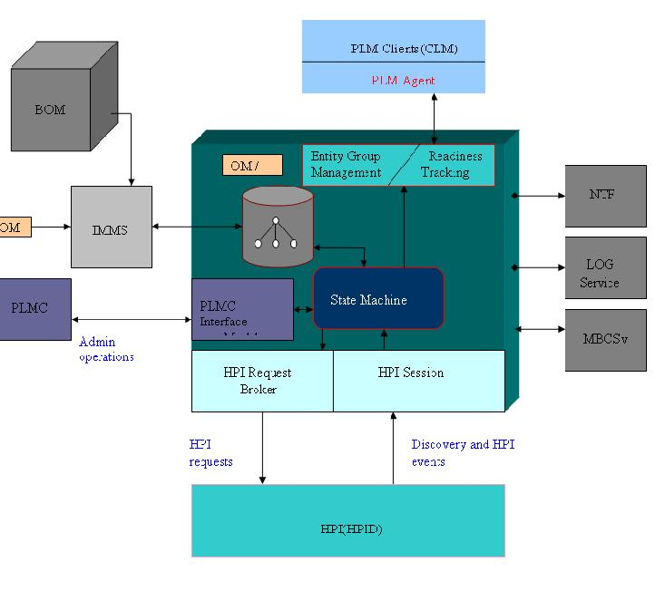

# OpenSAF Platform Management Service (PLMSv)

**Release:** Release 5.1 Programmer's Reference  
**Date:** September 2016  
**Copyright:** © OpenSAF, 2010  

> [!NOTE]
> For OpenSAF architecture overview, SAF AIS compliance, and document conventions, see the [OpenSAF Overview](OpenSAF_Overview_PR.md) and centralized [GLOSSARY.md](GLOSSARY.md).

---

# Overview

## Platform Management Service Overview

The OpenSAF Platform Management Service (PLMSv) is the core service of
the OpenSAF software. The PLMSv functionality is a highly compliant
implementation of Platform Management Service specification
(SAI-AIS-PLM-A.01.02 ) of Service Availability Forum’s (SAF) Application
Interface Specification (AIS).

PLMSv provides a logical view of the hardware and low-level software of
the system. This logical view is presented in the Service
AvailabilityTM Forum Information Model by a set of objects
that allows:

  - The management of hardware entities and execution environments
  - Other software to keep track of status changes of the hardware and
    Execution Environments (EE)
  - The mapping of the Hardware Platform Interface (HPI) data to objects
    represented in the SA Forum Information Model

PLMSv also provides objects that are administratively configurable.
Additionally, PLMSv is responsible for matching the configuration with
the discovered hardware.

The OpenSAF implementation of PLMSv provides the following
functionality:

  - Represent hardware with a containment tree of Hardware Element (HE)
    objects in SAF IMM model
  - Discover and manage hot swap state information of the HE objects
    interfacing with HPI
  - Check, match and verify the discovered hardware entities with the
    configured HE objects
  - Manage all the state information of HE objects defined by PLM state
    model (Presence, Administrative, Operational, Readiness states and
    Readiness flags )
  - Allow Administrative operations on hardware at granularity of HE
    Objects
  - Implement and support all kinds of dependencies

  -   - On-the-parent dependency
      - One-on-one dependency
      - One-of-a-group dependency
      - All-of-a-group dependency
      - n-of-a-group dependency

  - Model EE directly running on a HE, as child of the HE in containment
    tree using SAF IMM model
  - Manage all the state information of Execution Environment (EE)
    objects defined by PLM state model ( Presence, Administrative,
    Operational, Readiness states and Readiness flags)
  - Support administrative operation on EEs
  - Fault Isolation of HEs and EEs
  - Support virtualized EEs
  - Implement Library Life Cycle API as per specification
  - Implement Entity Group Management, Readiness Status Tracking and
    Readiness Impact PLM operations
  - Generate PLM state change notifications and HPI events notifications
    using SAF Notification Service
  - Generate HE and EE Alarms for hardware faults (only physical
    extractions and isolated faults) and unmapped HE Alarms using SAF
    Notification service
  - Support ATCA mapping and the following hotswap models

  -   - TWO\_HOTSWAP\_MODEL
      - THREE\_HOTSWAP\_MODEL
      - PARTIAL\_FIVE\_HOTSWAP\_MODEL
      - FULL\_FIVE\_HOTSWAP\_MODEL

## Design Overview

This chapter provides information on:

  - Service structure and architecture
  - Dependencies
  - References to SAF documents
  - Compliance to SAF standard

### Service Structure and Architecture

Platform Management Service is made up of the following sub-parts

  - Platform Management Server (PLMS)
  - Platform Management Coordinator (PLMC)
  - Platform Management Agent (PLMA)
  - HPI Request Broker (HRB)
  - HPI Session Manager (HSM)

Figure 1 Platform Management Service

#### Platform Management Server

Platform Management Server (PLMS) uses the Information Management Model
Service (IMMSv) to retrieve its configuration and reflects the runtime
view of the platform. PLMS is responsible for managing Finite State
Machine, Readiness Tracking and Entity Group Management. PLM uses the SA
Forum Notification Service (NTFSv) to generate notifications. PLMS runs
on each controller (active/ standby).

#### Platform Management Coordinator

Platform Management Coordinator (PLMC) provides a common interface to
PLMS and coordinates admin operations and verifications on EEs
irrespective of which OS is running on EEs. There is one PLMC on each
cluster node.

#### Platform Management Agent

Platform Management Agent (PLMA) is a library linked with a client
application, which executes in the context of the client process.
Clients access the PLM service through PLM API. There can be any number
of such PLMA or client processes per node. Each PLMA interacts directly
with the active PLMS on the controller through MDS.

#### HPI Request Broker

HPI Request Broker (HRB) facilitates all the HPI requests from PLMS.
Message Distribution Service   (MDSv) is used for communication from
PLMS to this module. This module implemented as a thread of PLMS
receives and processes the HPI requests from PLMS. PLMS uses entity path
to refer to any entity.

#### HPI Session Manager

HPI Session Manager (HSM) interfaces directly with the HPI and is
implemented as a separate thread of PLMS. HSM is designed to manage
single domain only. It discovers the resources available on the domain
managed by the session and blocks for receiving HPI events. Only
Hot-swap and Resource events are forwarded to PLMS.

### Dependencies

This section describes dependencies between the PLM Service and other
services. This also captures the dependent libraries.

The following table lists other OpenSAF services and how the Platform
Management Service depends on them.

<table>
<tbody>
<tr class="odd">
<td>Service</td>
<td>Dependency</td>
</tr>
<tr class="even">
<td>Message Distribution Service (MDS)</td>
<td>
Interaction between the subparts of PLMSv takes place

using MDS messaging.
</td>
</tr>
<tr class="odd">
<td>IMMSv</td>
<td>Information Model and configuration is done using this service</td>
</tr>
<tr class="even">
<td>NTFSv</td>
<td>Notification and Alarms are published using this service</td>
</tr>
<tr class="odd">
<td>LOGSv Trace Service</td>
<td>For logging errors and for tracing PLMs functionality</td>
</tr>
<tr class="even">
<td>Message Based Checkpoint Service (MBCSv)</td>
<td>
The active PLMS uses MBCSv to checkpoint the state

information with a standby PLMS
</td>
</tr>
<tr class="odd">
<td>AMF</td>
<td>PLM is an AMF component</td>
</tr>
</tbody>
</table>

### References to SAF Documents

For more information on Platform Management Service of OpenSAF, refer
following documents. They provide the service definition for the PLMSv.

  - SAI-Overview-B.05.01 - This provides information about SAF AIS based
    system
  - SAI-HPI-B.03.01 – This provides the Hardware Platform Interface
    detail to manage HEs
  - SAI-AIS-NTF-A.03.01 –This provides information for sending
    notifications and alarms
  - SAI-AIS-PLM-A.01.02 – This Provides service details of PLM
  - SAI-AIS-CPROG-B.05.01 – Programmers reference guide
  - SAI-AIS-AMF-B.04.01 – Availability Framework for High Availability

The above documents are available at
[*_https://opensaf.sourceforge.io/documentation.html_*](http://www.saforum.org/)

### Compliance to SAF standard

Platform Management Service implementation is in compliance with
SAI-AIS-PLM-A.01.02 specification. The scope of the implementation is
covered in [Overview](#anchor-2). Refer [Implementation
Notes](#anchor-24) for the implementation specific deviations.

|         |                                                                        |         |                                                                        |
| ------- | ---------------------------------------------------------------------- | ------- | ---------------------------------------------------------------------- |
| Section | Description                                                            | Support | Notes                                                                  |
| 3.1.3.5 | Hardware Health monitoring and periodic polling for sensor information | No      | Not Implemented                                                        |
| 3.1.4.2 | EEs representing virtual machines - PLM Virtualization.                | Yes     | Only supported for an OS integrated virtual machine monitor (e.g. KVM) |
| 6.2.1.3 | HE Security Alarm                                                      | No      | Not Implemented                                                        |
| 6.2.1.4 | EE Security Alarm                                                      | No      | Not Implemented                                                        |

# Management Interface and Configuration

This section describes the management interface to configure the
Platform Management Service.

## Configuration

Platform Management Service provides a management interface to configure
the HEs, EEs, and dependencies between PLM entities and to perform
runtime administrative operations. This configuration is maintained by
the Service Availability Forum AIS Information Model Management Service
(IMMSv).

PLMS tries to map the HPI discovered entities with those configured in
the information model. HPI APIs are used for retrieving the information
to match or verify.

Similarly when PLMS tries to map the configured EE objects in the
information model with EEs in the domain PLMC provides such information
by reading the *plmcd.conf *present on each EE. The *plmcd.conf*
captures the information on the ee\_id, controller ips, and tcp/udp port
numbers to use services to start and stop during lock and unlock
operations.

A sample *plmcd.conf *looks like below:

ee\_id\]

0020f

\[plmc\_msg\_protocol\_version\]

1.0

\[controller\_1\_ip\]

10.105.1.3

\[controller\_2\_ip\]

10.105.1.6

\[services\]

/etc/init.d/snmpd

/etc/init.d/openhpid

\[osaf\]

/etc/init.d/opensafd

\[tcp\_plms\_listening\_port\]

6868

\[udp\_broadcast\_port\]

6869

\[os\_type\]

1;os;Fedora;2.6.31

\[plmc\_cmd\_timeout\_secs\]

180

\[os\_reboot\_cmd\]

/sbin/reboot

\[os\_shutdown\_cmd\]

/sbin/shutdown -H 0

PLMS does the tracing that can be configured in
*/etc/opensaf/osafplmd.conf*

\# Uncomment the next line to enable trace

\#args="--tracemask=0xffffffff"

To configure HPI related parameters and to configure PLM service to run
on non-HPI supported domains *imm.xml* defines configuration class
SaHpiConfig.

Sample configuration of such object looks like below:

\<object class="SaHpiConfig"\>

\<dn\>safHpiCfg=hpi\_cfg\_1\</dn\>

\<attr\>

\<name\>isHpiSupported\</name\>

\<value\>0\</value\>

\</attr\>

\<attr\>

\<name\>extrPendingTimeout\</name\>

\<value\>1000\</value\>

\</attr\>

\<attr\>

\<name\>insPendingTimeout\</name\>

\<value\>1000\</value\>

\</attr\>

\</object\>

### Configuration of virtualized EEs

Configuration of virtualized EEs and of the hypervisor (virtual machine
monitor) is done using OpenSAF proprietary classes in imm.xml. The
virtual machines must be created outside of OpenSAF using virt-manager
or similar tool. Libvirtd must also be started in some fashion.

To use virtualization support in PLM, you will need to do the following:

1\) Configure access to the hypervisor: This is done by adding an XML
object of type OpenSafPlmVirtualMachineMonitorConfig. "saPlmEE" should
point to the EE you have defined elsewhere for the hypervisor, and
"libVirtSession" should be the URI libvirt should use to connect to the
hypervisor. For KVM, this should be something like
"qemu+\<transport\>://\<hostname\>/system". Please see the libvirt
documentation for your connection specifics.

\<object class="OpenSafPlmVirtualMachineMonitorConfig"\>

\<dn\>plmVmmConfig=1,safApp=safPlmService\</dn\>

\<attr\>

\<name\>saPlmEE\</name\>

\<value\>safEE=VirtualMachineMonitor,safHE=myHardwareHE,safDomain=mySafDomain\</value\>

\</attr\>

\<attr\>

\<name\>libVirtSession\</name\>

\<value\>qemu:///system\</value\>

\</attr\>

\</object\>

2\) Map the virtual machine EE to the libvirt domain name: This is done
by adding an XML object of type OpenSafPlmVirtualMachineConfig.
"saPlmEE" should point to the EE you have defined elsewhere for the
virtual machine, and "libVirtDomainName" should point to the libvirt
name of the domain.

\<object class="OpenSafPlmVirtualMachineConfig"\>

\<dn\>plmVmConfig=1,safApp=safPlmService\</dn\>

\<attr\>

\<name\>saPlmEE\</name\>

\<value\>safEE=VirtualMachine1,safEE=VirtualMachineMonitor,safHE=myHardwareHE,safDomain=mySafDomain\</value\>

\</attr\>

\<attr\>

\<name\>libVirtDomainName\</name\>

\<value\>EE\_test\_1\</value\>

\</attr\>

\</object\>

## Administrative Operations

Following administrative operations can be performed on PLM HE/EE
objects.

### EE Admin Operations

Following are the commands to perform admin operations on EEs.

The DNs used in the below commands are example DNs.

  - Admin Lock operation (with default-lock option)

immadm –o 1 safEE=SC-1,safDomain=domain\_1

  - Admin Lock operation (with try-lock option)

immadm –o 1 –p lockOption:SA\_STRING\_T:trylock
safEE=SC-1,safDomain=domain\_1

  - Admin Lock operation (with forced-lock option)

immadm –o 1 –p lockOption:SA\_STRING\_T:forced
safEE=SC-1,safDomain=domain\_1

  - Admin Unlock operation

immadm –o 2 safEE=SC-1,safDomain=domain\_1

  - Admin Lock-Instantiation operation

immadm –o 3 safEE=SC-1,safDomain=domain\_1

  - Admin Unlock-Instantiation operation

immadm –o 4 safEE=SC-1,safDomain=domain\_1

  - Admin Shutdown operation

immadm –o 5 safEE=SC-1,safDomain=domain\_1

  - Admin Repair operation

immadm –o 6 safEE=SC-1,safDomain=domain\_1

  - Admin Restart operation (with default option)

immadm –o 7 safEE=SC-1,safDomain=domain\_1

  - Admin Restart operation (with abrupt-restart option)

immadm –o 7 –p restartOption:SA\_STRING\_T:abrupt
safEE=SC-1,safDomain=domain\_1

  - Admin Remove operation

immadm –o 11 safEE=SC-1,safDomain=domain\_1

### HE Admin Operations

Following are the commands to perform admin operations on HEs.

The DNs used in the below commands are example DNs.

  - Admin Lock operation (with default-lock option)

immadm –o 1 safHE=he\_1,safDomain=domain\_1

  - Admin Lock operation (with try-lock option)

immadm –o 1 –p lockOption:SA\_STRING\_T:trylock
safHE=he\_1,safDomain=domain\_1

  - Admin Lock operation (with forced-lock option)

immadm –o 1 –p lockOption:SA\_STRING\_T:forced
safHE=he\_1,safDomain=domain\_1

  - Admin Unlock operation

immadm –o 2 safHE=he\_1,safDomain=domain\_1

  - Admin Shutdown operation

immadm –o 5 safHE=he\_1,safDomain=domain\_1

  - Admin Repair operation

immadm –o 6 safHE=he\_1,safDomain=domain\_1

  - Admin Activate operation

immadm –o 8 safHE=he\_1,safDomain=domain\_1

  - Admin Deactivate operation

immadm –o 9 safHE=he\_1,safDomain=domain\_1

  - Admin Reset operation

immadm –o 10 safHE=he\_1,safDomain=domain\_1

  - Admin Remove operation

    immadm –o 11 safHE=he\_1,safDomain=domain\_1

## Implementation Notes

1.  PLM rejects the IMM CCB Delete object request for SaPlmHE or SaPlmEE
    object , if the readiness state of the target object is not
    out-of-service, or if there is an SaPlmHE or SaPlmEE object which
    depends on the target object.
2.  PLM rejects the IMM CCB Delete object request for SaPlmHEBaseType
    object, if there exists a configured SaPlmHE object with
    SaPlmHEBaseHEType attribute is set to the SaPlmHEBaseType object.
3.  PLM rejects the IMM CCB Delete object request for SaPlmHEType
    object, if any SaPlmHE object is configured with saPlmHECurrHEType
    attribute set to this SaPlmHEType object. Also, if any SaPlmHE
    object is configured with saPlmHEBaseHEType attribute set to the
    parent SaPlmHEBaseType object, the delete operation should be
    rejected. PLM rejects the delete request if the object is not
    present in its patricia tree, it does not check if the object is
    created in same CCB.
4.  PLM rejects the IMM CCB Delete object request for SaPlmEEType
    object, if there exist any SaPlmEE object configured with
    saPlmEEType attribute pointing to this SaPlmEEType object.
5.  PLM rejects the IMM CCB Delete object request for SaPlmEEBaseType
    object, if any child of this object is configured as saPlmEEType
    attribute for any SaPlmEE object.
6.  PLM rejects the IMM CCB Delete object request for SaPlmDomain
    object, if any of its child object exists.
7.  PLM rejects the IMM CCB Modify object request for SaPlmHE object, if
    the presence state of the target HE object is any value other than
    not-present. PLM also rejects if saPlmHEBaseHEType attribute value
    points to a SaPlmHEBaseType object which does not exist.
8.  PLM rejects the IMM CCB Modify object request for SaPlmEE object, if
    the presence state of the target EE object is any value other than
    un-instantiated. PLM also rejects if saPlmEEType attribute value
    points to a SaPlmEEType object which does not exist.
9.  PLM rejects the IMM CCB Modify object request for SaPlmHEBaseType
    object, if this object is pointed by the saPlmHEBaseHEType attribute
    of any configured SaPlmHE object.
10. PLM rejects the IMM CCB Modify object request for SaPlmHEType
    object, if there exists any SaPlmHE object configured with
    saPlmHECurrHEType attribute pointing to this SaPlmHEType object .
    Also, if the parent SaPlmHEBaseType object of this object is pointed
    by the saPlmHEBaseHEType attribute of any configured SaPlmHE object.
    PLM rejects the modify request if the object is not present in its
    patricia tree, it does not check if the object is created in same
    CCB.
11. PLM rejects the IMM CCB Modify object request for SaPlmEEType
    object, if this object is pointed by the saPlmEEType attribute of
    any configured SaPlmEE object.
12. PLM rejects the IMM CCB Modify object request for SaPlmEEBaseType
    object, if any child of this object is pointed by the saPlmEEType
    attribute of any configured SaPlmEE object.
13. PLM rejects the IMM CCB Modify object request for SaPlmDomain
    object, if any of its child objects exists or
    saPlmHEDeactivationPolicy attribute value is out of range.
14. PLM rejects the IMM CCB Modify object request for SaPlmDependency
    object, if admin state of its parent HE or EE is locked.
15. In our current data structures, we have support for having only one
    dependency object as child of HE/EE, whereas spec says that a HE or
    EE object instance may be parent to any number of SaPlmDependency
    objects.
16. It is assumed that *imm.xml* file follows the order of creating the
    objects. Also if there are any mis-configurations since OI is not
    yet initialized and IMM DB holds these objects, PLMSv is going to
    accept without performing OI validation during initialization just
    to be in sync with IMM database. Once initialized, OI verification
    is done.

Other alternative is PLMS to be aware of initialization and still
perform verification, and if fails send the node/service to restart. For
first release we are going to live with this limitation as restart is
not going to fix the problem in imm.xml and is considered better to live
with stale objects created during initialization.

1.  Domain object cannot be added to an entity group with any of the
    options.

2.  If there are multiple threads in the application, multiple
    initialize is supported. However, when the same plmHandle is used to
    invoke APIs there are locks to protect but if finialize or group
    remove is called from one thread where some other operation is under
    process after getting access to the data it may result in crash.
    Application writer need to be cautious executing these API.

3.  If a new group or entity is added in between an operation, then that
    entity or group is not considered for that operation.

4.  Correlation-ids parameter of the notification api is not used. For
    the time being we are passing SA\_NTF\_IDENTIFIER\_UNUSED.

5.  All attribute changes for an entity, associated with an operation,
    can be sent as part of one notification and also the spec says so.
    But we are sending notification for each attribute change.

6.  If both admin operation pending and isolate pending flags are set,
    then while clearing the management lost flag, isolate pending takes
    precedence i.e. isolate the entity and clear both the flags.

7.  In every cbk, we should send the notification id corresponding to
    the first notification send in the operation context. Currently we
    are not doing it, we are passing SA\_NTF\_IDENTIFIER\_UNUSED.

8.  Configuration of entity path fragments and wild-card characters in
    entity paths attribute of HE object is not supported. Full entity
    path has to be configured in saPlmHEEntityPaths attribute of HE.

9.  For an unmapped HE notification, the nearest (parent) mapped HE
    should be mentioned. We are mentioning the domain name.

10. HPI inv data configuration, int val 0 and string val NULL is ignored
    and is not taken into consideration for inv data verification.

11. In deactivation context, completed callback is called only after
    receiving M1 of the targeted entity.

12. While clearing the management lost flag, if admin-pending flag is
    set, then the pending admin operation is not performed.

13. PLMSv specification recommends use of SaInt64 for readiness state of
    HE, while it recommends SaInt32 for readiness state of EE.
    Implementation uses SaInt64 for both.

14. If the plmc-lib call fails for any admin command, management lost
    flag and admin pending flag are set and ERR\_DEPLOYEMENT is
    returned. However if plmc-lib returns success, and the asynchronous
    command response is failure/timeout, only management lost flag is
    set. Admin pending flag is not set, as PLMS comes out of the admin
    context, due to this the return value is OK but not ERR\_DEPLOYMENT.

15. In the configure step of OpenSAF, add the linker option ***-Wl,-E***
    to the existing options of CFLAGS and CXXFLAGS as shown in the below
    example:

    ./configure CFLAGS="-g
    -I/opt/windriver/pne-2.0/f120/sysroot/usr/include
    -fstack-protector-all -Wl,-E" CXXFLAGS="-g
    -I/opt/windriver/pne-2.0/f120/sysroot/usr/include
    -fstack-protector-all -Wl,-E"

# Sample PLMSv Application

## Overview

This section describes what the sample application does and how to build
and run the sample application.

**Application Scope**:

This is only a trivial sample test application which exercises the
Library Life Cycle APIs, Entity Group Management and Readiness Status
Tracking APIs. The functional test of PLM state management and
additional tests are out of scope of this application.

The APIs exercised in this sample are

saPlmInitialize()

saPlmSelectionObjectGet()

saPlmDispatch()

saPlmFinalize()

saPlmEntityGroupCreate()

saPlmEntityGroupAdd()

saPlmEntityGroupDelete()

saPlmReadinessTrack()

saPlmReadinessTrackStop()

Note that the entity added to the group in this sample is referred as
“*entityAddedInImmXML”, *** **but when using this application
substitute with the real entity name defined in the *imm.xml*.

\#include \<saPlm.h\>

\#include \<sys/select.h\>

\#include \<stdio.h\>

\#include \<stdlib.h\>

\#include \<string.h\>

\#include \<errno.h\>

\#include \<logtrace.h\>

void myTrackCallback(

SaPlmEntityGroupHandleT entityGroupHandle,

SaUint64T trackCookie,

SaInvocationT invocation,

SaPlmTrackCauseT cause,

const SaNameT \*rootCauseEntity,

SaNtfIdentifierT rootCorrelationId,

const SaPlmReadinessTrackedEntitiesT \*trackedEntities,

SaPlmChangeStepT step,

SaAisErrorT error)

{

if(error == SA\_AIS\_OK)

{

syslog(LOG\_INFO, "Your Readiness Track Callback is invoked. \\nLook
into the trac kedEntities and go on.\\n");

}

return;

}

int main()

{

SaAisErrorT ret\_val;

SaPlmHandleT plmHandle;

SaVersionT plmVersion = {'A', 0x01, 0x01};

SaPlmCallbacksT plms\_cbks;

SaPlmEntityGroupHandleT entityGroupHandle;

SaSelectionObjectT selectionObject;

fd\_set read\_fd;

SaNameT myEntityDn;

plms\_cbks.saPlmReadinessTrackCallback = \&myTrackCallback;

ret\_val = saPlmInitialize(\&plmHandle, \&plms\_cbks, \&plmVersion);

if (ret\_val \!= SA\_AIS\_OK)

{

syslog(LOG\_ERR, "Initialization with PLM failed: %d \\n", ret\_val);

return 1;

}

syslog(LOG\_INFO, "Initialization with PLM Successful.\\n");

ret\_val = saPlmEntityGroupCreate(plmHandle,\&entityGroupHandle);

if (ret\_val \!= SA\_AIS\_OK)

{

syslog(LOG\_ERR, "Group Creation failed: err %d\\n", ret\_val);

return 1;

}

syslog(LOG\_INFO, "Group Create with PLM Successful. \\n");

ret\_val = saPlmReadinessTrack( entityGroupHandle, SA\_TRACK\_CHANGES
,121, NULL);

if (ret\_val \!= SA\_AIS\_OK)

{

syslog(LOG\_ERR, "Failed to start tracking: err %d\\n", ret\_val);

return 1;

}

syslog(LOG\_INFO, "saPlmReadinessTrack API Successful. \\n");

memset(\&myEntityDn, 0, sizeof(SaNameT));

strcpy((char \*)\&myEntityDn.value, " entityAddedInImmXML ");

myEntityDn.length = strlen("entityAddedInImmXML ");

ret\_val = saPlmEntityGroupAdd(entityGroupHandle , \&myEntityDn, 1,
SA\_PLM\_GROUP\_SINGLE\_ENTITY);

if (ret\_val \!= SA\_AIS\_OK)

{

syslog(LOG\_ERR, "Group Add failed: err %d\\n", ret\_val);

return 1;

}

syslog(LOG\_INFO, "Done saPlmEntityGroupAdd to the group created
Successfully. \\n");

ret\_val = saPlmSelectionObjectGet(plmHandle, \&selectionObject);

if (ret\_val \!= SA\_AIS\_OK)

{

syslog(LOG\_ERR, "Failed to get Selection Object: err %d\\n", ret\_val);

return 1;

}

syslog(LOG\_INFO, "Invoked Selection Object API.\\n");

FD\_ZERO(\&read\_fd);

FD\_SET(selectionObject , \&read\_fd);

while (select(selectionObject+1 , \&read\_fd, 0, 0, NULL) \> 0 )

{

/\* process all the PLM messages \*/

if (FD\_ISSET(selectionObject ,\&read\_fd))

{

syslog(LOG\_INFO, "Invoked saPlmDispatch API with
flag=SA\_DISPATCH\_ONE.\\n");

ret\_val = saPlmDispatch(plmHandle, SA\_DISPATCH\_ONE);

FD\_CLR(selectionObject , \&read\_fd);

}

break; /\* you can choose to be in loop \*/

}

ret\_val = saPlmReadinessTrackStop(entityGroupHandle);

if (ret\_val \!= SA\_AIS\_OK)

{

syslog(LOG\_ERR, "Failed to stop tracking: err %d\\n", ret\_val);

return 1;

}

syslog(LOG\_INFO, "Stopped Tracking. \\n");

ret\_val = saPlmEntityGroupDelete(entityGroupHandle);

if (ret\_val \!= SA\_AIS\_OK)

{

syslog(LOG\_ERR, "Failed to stop tracking: err %d\\n", ret\_val);

return 1;

}

syslog(LOG\_INFO, "Delete Entity Group Successful. \\n");

ret\_val = saPlmFinalize(plmHandle);

if (ret\_val \!= SA\_AIS\_OK)

{

syslog(LOG\_ERR, "Failed to Finalize: err %d\\n", ret\_val);

return 1;

}

syslog(LOG\_INFO, "saPlmFinalize API returned success. \\n");

syslog(LOG\_INFO, "Successfully exercises all PLM APIs.\\n");

return 0;

}

## Building and Running Sample PLMSv Application

Build the sample application using the following command:

\# gcc -I/working\_dir/osaf/libs/core/common/include -lSaPlm plm\_demo.c
-o plm\_demo

Run the sample PLMSv application, without any need for input arguments.

\# ./plm\_demo

## Expected Sample PLMSv Output

The following messages are observed if sample application runs
successfully:

Apr 7 19:16:37 linux-8yot plm\_demo: Initialization with PLM Successful.

Apr 7 19:16:37 linux-8yot plm\_demo: Group Create with PLM Successful.

Apr 7 19:16:37 linux-8yot plm\_demo: saPlmReadinessTrack API Successful.

Apr 7 19:16:37 linux-8yot plm\_demo: Done saPlmEntityGroupAdd to the
group created Successfully.

Apr 7 19:16:37 linux-8yot plm\_demo: Invoked Selection Object API.

Apr 7 19:16:37 linux-8yot plm\_demo: Invoked saPlmDispatch API with
flag=SA\_DISPATCH\_ONE.

Apr 7 19:16:37 linux-8yot plm\_demo: Your Readiness Track Callback is
invoked. Look into the trackedEntities and go on.

Apr 7 19:16:37 linux-8yot plm\_demo: Stopped Tracking.

Apr 7 19:16:37 linux-8yot plm\_demo: Delete Entity Group Successful.

Apr 7 19:16:37 linux-8yot plm\_demo: saPlmFinalize API returned success.

Apr 7 19:16:37 linux-8yot plm\_demo: Successfully exercises all PLM
APIs.
