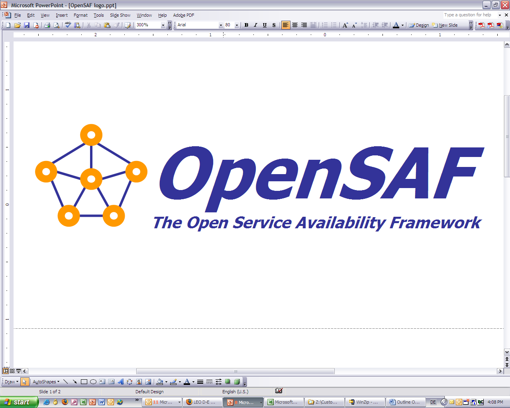

# OpenSAF Software Management Framework Service (SMFSv)

**Release:** Release 5.26.02 Programmer's Reference  
**Date:** February 2026  
**Copyright:** © OpenSAF, 2017  

> [!NOTE]
> For OpenSAF architecture overview, SAF AIS compliance, and document conventions, see the [OpenSAF Overview](OpenSAF_Overview_PR.md) and centralized [GLOSSARY.md](GLOSSARY.md).

---

# Overview

## SMF Service Overview

The Software Management Framework Service (SMFSv) is the OpenSAF
implementation of the SAF SMF service version A.01.02.

## Models and Concepts

The SMF service follows the three tier OpenSAF “Service Director”
framework (see OpenSAF Overview User's Guide). It comprises three
subparts distributed among many processes across the cluster:

  - SMF Director
  - SMF Node Director
  - SMF Agent

### SMF Director

The SMF Director is responsible for implementing mainly the following
functionality:

  - Parsing of campaign xml file
  - Control the execution according to the campaign file.

The SMFD is implemented with a 2N redundancy model. The active director
is the object implementer of the SaSmfCampaign class. The directors does
not communicates with each other during campaign execution. If a
failover/switchover occurs the active director uses the campaign xml
file and the SMF upgrade campaign status objects stored in IMM to
continue the execution at step level. When a campaign execution is
started the director creates threads for the campaign and for the
procedures found in the campaign xml. The threads communicates via
events. See figure below.

SMFD is the object implementer of the following classes according to the
figure below

### SMF Node Director

The SMFND process executes on all nodes (both controller and payload).
It performs all upgrade actions which must be executed locally on the
nodes. e.g. installation of software bundles. SMFND acts only by direct
order from the SMFD.

### SMF Agent

The SMF Agent implements Life Cycle Management API and allows process
Registration and Unregistration of the Scope of Interest. This will
allow the applications to be informed about the initiation and progress
of upgrade campaigns in the system in order to synchronize some
application-level actions with the upgrade process.

### Limitations of this Implementation

When SMFND is restarted while the callback responses are pending from
SMF Agent, SMFND losses the entire context (count and invocation ids)
and shall drop any responses from Agent which results in callback
timeout at SMFD. Failure response will be ignored is the limitation in
SMFND restart scenario.

SMF-API callback timeout values are specified in nanoseconds, SaTimeT,
in the campaign xml. This is according to the SA Forum/OpenSAF campaign
schema. The SMF implementation can however only handle millisecond
level. SMF internally divides all SaTimeT timeout values given in the
campaign xml by 1000000 and use the results as millisecond timeout
values. A special case are timeout values values between 1 and 99999
nanoseconds which will result in a 1 millisecond timeout.

### Compliance Report

The SMFSv conforms to the SMF Service specification described in the SAF
document SAI-AIS-SMF-A.01.2 with the following exceptions.

  - The following functionality is implemented beyond the specification:

  - Procedures for upgrade of software requiring reboot to install.
  - Procedures for RAM disk based nodes using common activation for all
    software in an upgrade step.

Table 1 Compliance Table – Exceptions

<table>
<tbody>
<tr class="odd">
<td>Section</td>
<td><strong>Description  </strong></td>
<td>Support</td>
</tr>
<tr class="even">
<td>3.2.2.1</td>
<td>Repository Management</td>
<td>
No bundle import function implemented, manual procedure.

No bundle remove function implemented, manual procedure.

No bundle check function implemented, specific for each adaptation.

For demo purposes dummy scripts can be found: 
-in devel tree at "OpenSAFroot/osaf/services/saf/smfsv/scripts"

-on target at "/usr/local/lib/opensaf/"
</td>
</tr>
<tr class="odd">
<td>3.2.3</td>
<td>Software Installation and Uninstallation</td>
<td>
Implemented.

SMF will run installation/removal commands found in the SaSmfSwBundle object(s) pointed out by the campaign xml file.

For demo use, dummy installation/removal commands are provided in directory "OpenSAFroot/samples/smf" .

These commands: 
-offline_install.sh 
-offline_remove.sh 
-online_install.sh 
-online_remove.sh

must be manually copied to a location pointed out by the SaSmfSwBundle object(s).

In the sample UML cluster comfiguration (imm.xml) the software bundle will point out directory "/hostfs"
</td>
</tr>
<tr class="even">
<td>3.2.3.1</td>
<td>Ordering of the Operations for Upgrade</td>
<td>Implemented</td>
</tr>
<tr class="odd">
<td>3.2.3.2</td>
<td>Ordering of the Operations for Recovery</td>
<td>Implemented for rollback</td>
</tr>
<tr class="even">
<td>3.2.4</td>
<td>Software Bundle Object Class</td>
<td>
 Partly implemented.

On/offline installation/removal attributes not interpreted as URI's, these attributes can currently only contain file paths.

Default timeout used if saSmfBundleDefaultCmdTimeout is not specified.
</td>
</tr>
<tr class="odd">
<td>3.3.2.3</td>
<td>Actions of the Upgrade Step</td>
<td>
Extension 1: An additional set of actions is introduced to support upgrade of software which requires reboot to install e.g. OS and middleware.

Extension 2: An additional set of actions is introduced to support upgrade of software in systems (typically RAM disc based) which activates all the software changes in a single point activation.
</td>
</tr>
<tr class="even">
<td>3.3.4</td>
<td> Service Outage</td>
<td>Not implemented</td>
</tr>
<tr class="odd">
<td>4.1</td>
<td>Failure Detection</td>
<td>
Implemented: 
-The Software Management Framework must evaluate the result of each individual action performed, such as the success or failure of a CLI operation during an upgrade step.

-The Software Management Framework must monitor the operational state change notifications generated by the Availability Management Framework that indicate that the disabled entity was involved in a maintenance campaign.

Not implemented: 
-The Software Management Framework must evaluate the results reported back by registered processes of upgrade-aware entities. These are processes that register with the Software Management Framework to be called back during the upgrade campaign under certain circumstances (see Section 6.1.1.4).

-The Software Management Framework may monitor other notifications and alarms in the system to correlate them with the actions performed by the campaign
</td>
</tr>
<tr class="even">
<td>4.1.1</td>
<td>Upgrade Prerequisites</td>
<td>
Implemented: 
1. The Software Management Framework is operational. 
2. The software repository is accessible. 
3. There is no other upgrade campaign in progress. 
4. The currently running version of the software is available in the software repository. 
6. The desired version of the software is available in the software repository. 
10.Any necessary backup is created (note: a backup is always created within the campaign execution)

Not implemented: 
 
5. The specifics of the upgrade campaign have been provided, and the campaign is still applicable. 
6. …. and all the dependencies of the required packages have been checked and are satisfied. 
7. All affected nodes must provide the resources (for instance, sufficient disk space and proper access rights) needed to perform the upgrade campaign. 
8. The target system is in a state such that the expected service outage does not exceed the acceptable service outage defined for the campaign. 
9. Upgrade-aware entities are ready for an upgrade campaign. 

</td>
</tr>
<tr class="odd">
<td>4.1.2</td>
<td>Upgrade Step Verification</td>
<td>
Implemented: 
-Actions that return their result immediately (for instance, CLI commands for the installation), and this result is directly applicable to the upgrade step within which it is performed (see Section 4.1.5). The Software Management Framework can use this return value immediately to decide about the outcome of the upgrade step.

Not implemented: 
-Actions that do not return their result immediately. The Software Management Framework needs to rely on the error reports propagated by the Notification Service. These notifications and alarms may occur with some delay; therefore, the failures they report are referred to as asynchronous failures and are handled at the campaign level.
</td>
</tr>
<tr class="even">
<td>4.2.1.2</td>
<td>Upgrade History</td>
<td>Implemented</td>
</tr>
<tr class="odd">
<td>4.2.1.3</td>
<td>Detection of Asynchronous Failures of AMF Entities</td>
<td>Implemented</td>
</tr>
<tr class="even">
<td>4.2.1.4</td>
<td>Handling Persistent Changes During Upgrade</td>
<td>Not implemented</td>
</tr>
<tr class="odd">
<td>4.2.1.4.1</td>
<td>Changes Caused by the Upgrade</td>
<td>
Implemented.

Note:Changes caused by the upgrade are not logged into any information set that will be re-read to the system after a restore.
</td>
</tr>
<tr class="even">
<td>4.2.1.4.2</td>
<td>Changes Caused by Normal Operation</td>
<td>Not implemented</td>
</tr>
<tr class="odd">
<td>4.2.2.1</td>
<td>Undoing an Upgrade Step</td>
<td>Implemented</td>
</tr>
<tr class="even">
<td>4.2.2.2</td>
<td>Retry of an Upgrade Step</td>
<td>Implemented</td>
</tr>
<tr class="odd">
<td>4.2.2.3</td>
<td>Rollback</td>
<td>
Implemented.

<strong>Note: Single step procedure reboot the cluster, campaign can not be rolled back.</strong>
</td>
</tr>
<tr class="even">
<td>4.2.2.4</td>
<td>Fallback</td>
<td>Not within SMF implementation</td>
</tr>
<tr class="odd">
<td>4.2.2.4.1</td>
<td>Roll forward</td>
<td>Not implemented</td>
</tr>
<tr class="even">
<td>5.1.4</td>
<td>Undoing State</td>
<td>Implemented</td>
</tr>
<tr class="odd">
<td>5.1.6</td>
<td>Undone State</td>
<td>Implemented</td>
</tr>
<tr class="even">
<td>5.1.7</td>
<td>Rolling Back State</td>
<td>Implemented</td>
</tr>
<tr class="odd">
<td>5.1.8</td>
<td>Undoing Rollback State</td>
<td>Implemented</td>
</tr>
<tr class="even">
<td>5.1.9</td>
<td>Rolled Back, Rollback Undone and Rollback Failed States</td>
<td>Implemented</td>
</tr>
<tr class="odd">
<td>5.2.3</td>
<td>Suspended and Step Undone States</td>
<td>Implemented</td>
</tr>
<tr class="even">
<td>5.2.5</td>
<td>Rolling Back State</td>
<td>Implemented</td>
</tr>
<tr class="odd">
<td>5.2.6</td>
<td>Rollback Suspended State</td>
<td>Implemented</td>
</tr>
<tr class="even">
<td>5.2.7</td>
<td>Rolled Back, Failed, and Rollback Failed States</td>
<td>Implemented</td>
</tr>
<tr class="odd">
<td>5.3.4</td>
<td>Error Detected State</td>
<td>Implemented</td>
</tr>
<tr class="even">
<td>5.3.6</td>
<td>Error Detected in Suspending State</td>
<td>Implemented</td>
</tr>
<tr class="odd">
<td>5.3.7</td>
<td>Suspended by Error Detected State</td>
<td>Implemented</td>
</tr>
<tr class="even">
<td>5.3.9</td>
<td>Rolling Back State</td>
<td>Implemented</td>
</tr>
<tr class="odd">
<td>5.3.10</td>
<td>Rollback Completed State</td>
<td>Implemented</td>
</tr>
<tr class="even">
<td>5.3.11</td>
<td>Suspending Rollback State</td>
<td>Implemented</td>
</tr>
<tr class="odd">
<td>5.3.12</td>
<td>Rollback Suspended State</td>
<td>Implemented</td>
</tr>
<tr class="even">
<td>5.3.13</td>
<td>Execution Failed and Rollback Failed States</td>
<td>Implemented</td>
</tr>
<tr class="odd">
<td>5.3.nn</td>
<td>Campaign committed, Rollback Committed State</td>
<td>Implemented</td>
</tr>
<tr class="even">
<td>5.3.14</td>
<td>System Backup, Restart, and Fallback Operations</td>
<td>Partly implemented. SMF calls the backup script when the campaign execution starts.</td>
</tr>
<tr class="odd">
<td>6.1.1.4</td>
<td>Customized Callback Action</td>
<td>Implemented</td>
</tr>
<tr class="even">
<td>6.1.1.4.1</td>
<td>Timing of Customized Callback Actions</td>
<td>Implemented</td>
</tr>
<tr class="odd">
<td>6.2.2</td>
<td>Configuration Base</td>
<td>Not implemented</td>
</tr>
<tr class="even">
<td>6.3.1</td>
<td>Required Software Bundles</td>
<td>
Not implemented.

Note: SMF check if the bundles to be installed and removed within any procedure are available in IMM, as a part of the prerequisites check.
</td>
</tr>
<tr class="odd">
<td>6.3.3.1</td>
<td>Generic Initialization Action</td>
<td>Implemented</td>
</tr>
<tr class="even">
<td>6.3.3.2</td>
<td>Predefined Conditions for Customized Callback Actions</td>
<td>Implemented</td>
</tr>
<tr class="odd">
<td>6.4.1</td>
<td>Outage Information</td>
<td>Not implemented</td>
</tr>
<tr class="even">
<td>6.4.2.1.2</td>
<td>Activation Unit Template</td>
<td>
Note: If two (or more) SG parent elements are entered. The SUs found ends up in separate steps. According to spec the SUs belonging to the different SGs shall be acted on in the same step.

See table 3 row 4 on page 99 in the SMF A.01.02 spec.
</td>
</tr>
<tr class="odd">
<td>6.4.2.1.5</td>
<td>Upgrade Step of a Rolling Upgrade</td>
<td>
Implemented
</td>
</tr>
<tr class="even">
<td>6.4.2.1.6</td>
<td>Timing of Callback Actions Within the Procedure</td>
<td>Implemented</td>
</tr>
<tr class="odd">
<td>6.4.2.2.1</td>
<td>Deactivation Unit Specification</td>
<td>Partly implemented. 
Not implemented:: 
forAddRemove/removed by Template</td>
</tr>
<tr class="even">
<td>6.4.2.2.2</td>
<td>Activation Unit Specification</td>
<td>Implemented</td>
</tr>
<tr class="odd">
<td>6.4.2.2.3</td>
<td>Symmetric activation Unit Specification</td>
<td>Implemented</td>
</tr>
<tr class="even">
<td>6.4.2.2.4</td>
<td>Upgrade Step of a Single-Step Upgrade</td>
<td>Implemented</td>
</tr>
<tr class="odd">
<td>6.5.1</td>
<td>Completion of the Upgrade Campaign</td>
<td>Partly implemented. 
Not implemented: Timers</td>
</tr>
<tr class="even">
<td>6.5.2</td>
<td>Committing the Upgrade Campaign</td>
<td>Partly implemented. 
Not implemented: Timers</td>
</tr>
<tr class="odd">
<td>8</td>
<td>Software Management Framework API</td>
<td>Implemented</td>
</tr>
<tr class="even">
<td>9.3.4</td>
<td>SA_SMF_CAMPAIGN_ROLLBACK</td>
<td>Implemented</td>
</tr>
</tbody>
</table>

## Handling of IMM persistent backend (PBE)

If IMM is configured to use the PBE it shall normally be turned off
during upgrade. SMF can be configured to handle this task.

The configuration attribute *smfInactivatePbeDuringUpgrade* in the SMF
configuration class smfConfig instantiated at
*smfConfig=1,safApp=safSmfService,* control SMF behavior.

If set to false(0) or the attribute is not set/found, SMF will not
handle IMM PBE.

If set to true(1) and IMM PBE is not activated, SMF will not handle IMM
PBE.

If set to true(1) and IMM PBE is activated, SMF will deactivate IMM PBE
just before going to *Executing* state and activate it just before going
to Execution Completed state.

If deactivation of IMM PBE fails the campaign will remain in *Initial*
state which mean that the campaign can be re-executed when the problem
is solved. If the activation of the IMM BPE fails, the campaign will
continue to *CampaignCommitted/RollbackCommitted* state and log an error
message to syslog.

## Built in SMF API callback receiver

This feature make it possible to call commands also during the campaign
step execution.

Possible use cases are e.g. to call command “immadm” to suspend the
campaign execution between steps for stepwise execution or call
verification commands in locked state.

The SMF API provides functionality for any user to register and
participate in an upgrade campaign. The participants are called from the
\<callback\> element within an upgrade campaign A registered upgrade
participant is here called a callback receiver.

When starting an upgrade campaign SMF always registers a built in
callback receiver executing as a thread within the SMF director (smfd)
process. This callback receiver registers three callback labels as scope
of interest.

  - OsafSmfCbkUtil-Cmd, the command is executed at upgrade and rollback.
  - OsafSmfCbkUtil-UpgradeCmd, the command is only executed at upgrade.
  - OsafSmfCbkUtil-RollbackCmd, he command is only executed at rollback.

The callback labels can be used in any position in the campaign XML
where it is possible to specify callbacks.

The callback receiver executes on the active System Controller (SC) and
executes the command give in the *_stringToPass_* attribute in the
campaign *_\<callback\>_* element as shown in the examples below.

Example 1   Callback /directory/command1

\<callback callbackLabel="OsafSmfCbkUtil-UpgradeCmd" time="60000000000"
stringToPass="/directory/command1"/\>

The command */directory/command1* will be executed during upgrade (not
rollback).

The *stringToPass* argument can use the token *“$OSAFCAMPAIGNROOT”* to
address the directory where the campaign xml file is located.

Example 2   Callback
$OSAFCAMPAIGNROOT/command2

callback callbackLabel="OsafSmfCbkUtil-Cmd" time="60000000000"
stringToPass="$OSAFCAMPAIGNROOT/command2"/\>

The command *command2*, which is located in the same directory as the
campaign XML file, will be executed at upgrade and rollback.

The built in callback receiver set up two environment variables for the
called commands to use.

  - CBK\_OBJECT\_NAME, which contain the DN of the object representing
    the upgrade campaign, procedure or step within which the callback
    was initiated.
  - CBK\_PHASE, contain a string telling the direction of execution.  
    \-“UPGRADE”, for campaign execution in the upgrade/forward
    direction.  
    \-”ROLLBACK”, for campaign execution in the rollback direction.

## Pre-campaign callback check (Verify)

It is required by SMF standard that as many checks are done prior to
start of the campaign; but SMF does not define implementation mechanism
to achieve that. This feature introduces a new callback to which
applications can subscribe to be invoked in the early stage of the
campaign; or triggered with new specific administrative operation
(verify) that SMF will support; meaning outside of the campaign
execution scope.

Today SMF supports generic mechanism for application to register to
arbitrary callback labels that can be placed in the campaign by the
campaign designer. With this feature SMF will define a specific verify
callback with the callback label “*OsafSmfCbkVerify”*. Any application
can subscribe to this callback and respond OK or ERROR to indicate if
they think it's OK or not to start an upgrade campaign at this time.

This feature also introduces two new attributes, smfVerifyEnable and
smfVerifyTimeout, to be added in OpenSafSmfConfig class. The smfConfig
object have to be created in IMM during either installation or upgrade
to system supporting verify callback (unless it already exists).

\<class name="OpenSafSmfConfig"\>

...

\<attr\>

\<name\>smfVerifyTimeout\</name\>

\<default-value\>100000000000\</default-value\>

\<type\>SA\_TIME\_T\</type\>

\<category\>SA\_CONFIG\</category\>

\<flag\>SA\_WRITABLE\</flag\>

\</attr\>

\<attr\>

\<name\>smfVerifyEnable\</name\>

\<default-value\>0\</default-value\>

\<type\>SA\_UINT32\_T\</type\>

\<category\>SA\_CONFIG\</category\>

\<flag\>SA\_WRITABLE\</flag\>

\</attr\>

…

\</class\>

The attribute smfVerifyEnable toggles the verify callback feature in the
early execution stage of the campaign. This attribute is set to 0 as
default value, which means the new verify callback is NOT activated at
beginning of campaign execution. Any other value will activate the
callback at start of campaign execution.

The attribute smfVerifyTimeout defines the timeout value for the verify
callback. The default value is set to 100 seconds (*100000000000 in
nanoseconds).*This is the time that all callback receivers for the
verify callback must respond within.

The new administrative operation, verify, (immadm -o 10) supports the
verify callback outside of campaign execution scope, meaning that it
will trigger the verify callback without starting the campaign
execution. All the normal prerequsite tests will also be executed as
part of the verify operation. The result of the verify operation will be
reported in the error string attribute for the campaign object. The
string “Verify Passed” means that verify was successful. Any other
string means failure.

# The upgrade step actions

As an addition to the upgrade steps described in the specification a set
of steps has been introduced to cover the scenarios of OS/MW upgrades
and to support systems using RAM disk based file systems.

## OS/MW upgrade step actions

Step actions supporting SW which requires reboot to install/uninstall
This set of actions are triggered by the bundle object attributes
saSmfBundleInstallOfflineScope and saSmfBundleRemoveOfflineScope.

If any of these attributes are set to SA\_SMF\_CMD\_SCOPE\_PLM\_EE(4)
this set of actions are entered.

The set of actions are as below:

1.  Online installation of new software (all new bundles)
2.  Lock deactivation unit
3.  Terminate deactivation unit
4.  Offline uninstallation of old software (all old bundles)
5.  Modify information model and set maintenance status

\------inner step-----------

1.  If any SW bundle to install have the attribute
    saSmfBundleInstallOfflineScope set to SA\_SMF\_CMD\_SCOPE\_PLM\_EE  
    a) reboot node
2.  If any SW bundle to remove have the attribute
    saSmfBundleRemoveOfflineScope set to SA\_SMF\_CMD\_SCOPE\_PLM\_EE  
    a) Online uninstallation for those bundles.  
    b) reboot node

\------end of inner step----

1.  Offline installation of new software (all new bundles)
2.  Instantiate activation unit
3.  Unlock activation unit
4.  Online uninstallation (of all old SW bundles which have not set the
    saSmfBundleRemoveOfflineScope to SA\_SMF\_CMD\_SCOPE\_PLM\_EE)

Note: Typically SW which requires reboot only have online scripts. The
procedure above allows steps with mixed types of SW bundles. The only
addition to the standard set of actions are 6, 7 and modified 11. The
set of actions described above requires the AU/DU to be on node level.

## Upgrade step actions with single point activation of software

The upgrade set of step actions are usable for RAM disk based clusters
which support prepare and activate functionality. These sets of actions
are triggered by the attribute "smfNodeBundleActCmd" in the SMF
configuration object "SmfConfig". If this attribute is set, a new set of
actions are used. The value of the attribute shall point out the command
to be used for activation of the queued installation/removal tasks.

### Full set of actions for non restartable unit

1.  Online installation of new software (all new bundles)
2.  Lock deactivation unit
3.  Terminate deactivation unit
4.  Offline uninstallation of old software (all old bundles)
5.  Modify information model and set maintenance status
6.  Offline installation of new software (all new bundles)
7.  Online uninstallation (all old bundles)
8.  If any SW bundle to install have the attribute
    saSmfBundleInstallOfflineScope or saSmfBundleRemoveOfflineScope set
    to SA\_SMF\_CMD\_SCOPE\_PLM\_EE  
    \*reboot node (activation is assumed to be a part of the reboot)  
    else  
    \*Activate installations/uninstallations using the command given in
    the "smfNodeBundleActCmd" attribute.
9.  Instantiate activation unit
10. Unlock activation unit

Note: If reboot required, the AU/DU must be on node level

### Reduced set of actions for restartable units

1.  Online installation of new software (all new bundles)
2.  Modify information model and set maintenance status
3.  Online uninstallation (all old bundles)
4.  Activate installations/uninstallations using the command given in
    the "smfNodeBundleActCmd" attribute.
5.  Restart symmetric activation unit

## Handling of restartable components

In an upgrade campaign it is possible to specify saSmfStepRestartOption
within the upgrade step.

For procedures specified on component level i.e. contain a parent/type
in the \<activationUnitTemplate\> targeting components, the following
rules are applied:

  - If saSmfStepRestartOption is set to “1” (true):  
    \-The component must be restartable i.e. instanceCtDefDisableRestart
    is set or overridden by component instance
    instanceCompDisableRestart. Smfd checks if the component is
    restartable, if not the campaign fails. The STEP reduced set of
    actions are used.
  - If saSmfStepRestartOption is set to “0” (false):  
    \-Smfd will not check if the component is restartable or not. Both
    restartable and non restartable components will pass. The STEP full
    set of actions are used. Smfd will use the SUs which are parents to
    the component instances found from the \<activationUnitTemplate\>.

For procedures specified on component level the \<targetEntityTemplate\>
must contain a parent/type spec for the component modification.

If no template is specified, the AU/DU is used as DN to the object to
modify. In case the saSmfStepRestartOption is set to “false”, SMF will
use the parent of the component as AU/DU. This will have the effect that
the modification will be applied to the wrong object, the SU (and will
most likely fail).

# Campaign xml

## Handling of parent/type pairs in \<activationUnitTemplate\>

SMF implementation will interpret the
parent/type pairs as follows.

In the \<activationunittemplate\> in rolling upgrade the following rule
is applied:  
\-a parent followed by a type is always treated as a pair.

E.g.

\<activationUnitTemplate\>  
\<type objectDN="dn=dn1"\>\</type\>  
\<parent objectDN="dn=dn2"\>\</parent\>  
\<type objectDN="dn=dn3"\>\</type\>  
\<parent objectDN="dn=dn4"\>\</parent\>  
\<parent objectDN="dn=dn5"\>\</parent\>  
\<type objectDN="dn=dn6"\>\</type\>  
\<type objectDN="dn=dn7"\>\</type  
\</activationUnitTemplate\>

Dn1 = single type  
Dn2/dn3 = parent/type pair  
Dn4 = single parent  
Dn5/dn6 = parent/type pair  
Dn7 = single type

## Target Entities

SMF requires the target entity template to be written as in the examples
below:

\<targetEntityTemplate\>  
\<type objectDN="dn=dn1"\>\</type\>  
\<parent objectDN="dn=dn2"\>\</parent\>  
\<modifyOperation\>  
...  
\</modifyOperation  
\</targetEntityTemplate\>

\<targetEntityTemplate\>  
\<type objectDN="dn=dn3"\>\</type\>  
\<modifyOperation\>  
...  
\</modifyOperation\>  
\</targetEntityTemplate\>

\<targetEntityTemplate\>  
\<parent objectDN="dn=dn4"\>\</type\>  
\<modifyOperation\>  
...  
\</modifyOperation\>  
\</targetEntityTemplate\>

## Campaign.xml keyword

It could be convenient to locate the campaign xml file and associated
scripts in a single directory or a directory structure. To avoid knowing
the absolute path to called scripts they can be addressed relative to
the location of the campaign xml file.

When referring to commands in the init- and wrapup-sections, it is
possible to use the keyword $OSAFCAMPAIGNROOT. This keyword is
substituted with the directory path to the running campaign.xml file.

E.g. if the attribute saSmfCmpgFileUri in object saSmfCampaign point to
file “/filesystem/myCampaigns/theCampaign.xml”, the $OSAFCAMPAIGNROOT
will be substituted with “/filesystem/myCampaigns” at parsing time.

\<doCliCommand command="$OSAFCAMPAIGNROOT/campaign\_script.sh"
args="arg1" \>\</doCliCommand\>

The command line above will result in command “/filesystem/myCampaigns/
campaign\_script.sh arg1” being called.

The keyword $OSAFCAMPAIGNROOT can also be used in the argument portion
of the xCliCommand.

E.g. if the attribute saSmfCmpgFileUri in object saSmfCampaign point to
file “/filesystem/myCampaigns/theCampaign.xml”, the $OSAFCAMPAIGNROOT
will be substituted with “/filesystem/myCampaigns” at parsing time.

\<doCliCommand command="wc" args="$OSAFCAMPAIGNROOT/campaign\_script.sh"
\>\</doCliCommand\>

The command line above will result in command “wc
/filesystem/myCampaigns/ campaign\_script.sh” being called.

## The pathnamePrefix

The pathnamePrefix is an optional attribute. In the \<swRemove\> portion
of the campaign, it could seems unnecessary to specify the attribute.
The information is however needed to perform a successful rollback
procedure.

The rule is to always specify the pathnamePrefix attribute.

## Clarification of campaign execution behavior

### Creation of AMF entity types

SMF will accept attempt re-creations an already existing AMF entity
types in the \<amfEntityType\> portion of the campaign i.e. “already
exist” response from IMM is accepted as a positive response.

### \<swAdd\> and \<swRemove\>

If the same software bundle DN is given in both \<swAdd\> and
\<swRemove\> within the same upgrade procedure, the bundle is ignored.

### Campaign wrapup actions at commit

The campaign wrapup actions are always executed at commit regardless if
the campaign is in state “Execution Completed” or “Rollback Completed”.
In both states, the wrapup actions are executed in the same order as
written in the campaign.

The type of wrapup actions executed are listed below.

**In state “Execution Completed”:  
**campaignWrapupAction:  
\-doAdminOperation  
\-immCCB  
\-doCliCommand  
\-callback (PHASE = SA\_SMF\_UPGRADE).

campaignWrapup:  
\-removeFromIMM

**In state “Rollback Completed”:  
**campaignWrapupAction:  
\-undoAdminOperation  
\-undoCliCommand  
\-callback (PHASE = SA\_SMF\_ROLLBACK).

campaignWrapup:  
\-no action

### Callback at backup

The specified callbacks are executed before the backup command is
called. This make it possible for components to take measures before
backup e.g. prepare data for backup.

### Single Step procedure \<plmExecEnv\> specification

In single step procedures where the upgrade scope is \<forAddRemove\>,
it is possible to state \<plmExecEnv\> for specific bundles. The
\<plmExecEnv\> contain the node, or list of nodes, where to execute the
software bundle installation/removal commands.

If *no* \<plmExecEnv\> is given: SMF calculates the list of nodes where
to execute the installation/removal commands from the \<actedOn\> entity
list.

If \<plmExecEnv\> is specified: Nodes specified in \<plmExecEnv\>
*substitutes* the calculation made by SMF for the specific software
bundle.

### Online uninstallation of old software

The set of step actions described in:  
\-SMF spec chapter 3.3.2.3  
\-chapter 3.1 OS/MW upgrade step actions (in this document)

contain the “Online uninstallation of old software” as the last action.

This action is executed on procedure level when all steps in the
procedure are executed. This is to allow several components on the same
node to use a common software bundle.

For all other set of actions the “Online uninstallation of old software”
action is executed within the step.

### Enabling long DN support from a campaign

When enabling long DN support from a campaign, the CCB containing the
IMM configuration change must be defined in the
\<campaignInitialization\> portion.

The long DN support can then be used in subsequent CCB's.

### Parallel installation

From version 5.1 of OpenSAF the installation commands are sent in
parallel to all nodes that are affected in an upgrade step. In previous
versions the command was sent to the nodes in series and the campaign
was waiting for the answer before sending to the next node.

### Parallel lock-handling

From version 5.1 of OpenSAF administrative operations for administrative
state of nodes will when possible be done in parallel using an AMF
nodegroup. When an upgrade step is defined a list of deactivation and
activation units can be given. Units can be nodes or SUs. A list may
consist of SUs or nodes or a mix of both. If the list contains nodes all
the nodes will always be handled in parallel. Administrative operations
affected are lock, lock-in, unlock-in and unlock. In previous versions
these administrative operations were done for one node at a time waiting
for an answer before handling the next node.

# Change Campaign execution behavior

It is possible to configure SMF to change the campaign execution
behavior without rewriting the original campaign.xml.

The purpose for these features is to speed up the campaign execution
time for applications/systems with specific demands.

## Run campaign as one Single Step procedure

When this option is configured SMF will merge all the procedures of the
started campaign into one single step procedure. This new single step
procedure will be executed normally with the SMF execution options
available for single step procedures.

The merged procedure name is always "safSmfProc=SmfSSMergedProc".

The following are valid for the merging:

  - Steps for all procedures are calculated after the
    \<campaignInitialization\> of the campaign.xml have been executed.
  - For all procedures:  
    \-callbacks are copied into the new procedure.  
    \-procInitActions are copied into the new procedure.  
    \-procWrapupActions are copied into the new procedure.  
    \-step modifications are copied into the new procedure.
  - For rolling and single step/forModify procedures:  
    \-all deactivation units (DU) will be collected and redundant and
    overlapping DU's will be  
    removed e.g. an SU from one procedure which is within a node from
    another procedure  
    will be removed.  
    \-deactivation/activation units (DU/AU) are symmetrical i.e. DU will
    also be used as AU.
  - For single step/forAddRemove procedures:  
    \- DU/AU will be used as specified in the original procedure.

Prerequisite/limitation:  
\-Procedures in the campaign.xml are not allowed to require specific
execution order.

### Configuration

\-Create an instance of class OpenSafSmfExecControl with attribute
procExecMode set to “1”  
\-Set SMF configuration attribute openSafSmfExecControl (in object
smfConfig=1,safApp=safSmfService) to point to the instance of
OpenSafSmfExecControl

The configuration can be made anytime, but to make the configuration to
take effect for the just started campaign it must be made in the
campaign.xml \<campaignInititalization\> portion.

Once set, the configuration will remain until any/both of the below is
done:  
\-SMF configuration attribute openSafSmfExecControl is cleared.  
\-The pointed out instance of class OpenSafSmfExecControl attribute
procExecMode set to “0”.

## Run as a Balanced In Service Upgrade (BISU) campaign

When this option is configured SMF will merge procedures that have steps
executing on the **matching** BISU nodes (nodesForSingleStep). This
merging is done into a number of new single step procedures where the
number is defined by the configuration (numberOfSingleSteps). The new
single step procedures will be executed normally with the SMF execution
options available for single step procedures.

The following is valid for the merging:

  - Procedures are calculated after the \<campaignInitialization\> of
    the campaign.xml have been executed

  - Only rolling procedures are merged, single step procedures are left
    as is

  - The new single step procedures are executed after any existing
    procedures

  - For rolling procedures with **matching** steps:

      - All callbacks are copied into the new procedures
      - procInitActions are left as is.
      - procWrapupActions are moved into the last to be executed new
        procedure
      - Step modifications are moved into the new procedures

  - For rolling and single step/forModify procedures with **matching**
    steps:

      - All deactivation units (DU) will be collected and redundant and
        overlapping DU's will be removed e.g. an SU from one procedure
        which is within a node from another procedure will be removed
      - Deactivation/activation units (DU/AU) are symmetrical i.e. DU
        will also be used as AU

Prerequisite/limitation:  
Procedures in the campaign.xml are not allowed to require specific
execution order.

### Configuration

Create an instance of class OpenSafSmfExecControl with parameters set as
follows:

  - procExecMode: 2

  - nodesForSingleStep: A multivalue containing a list of the nodes that
    shall be part of the BISU campaign

      - The input format is the value part of the CLM node RDN
      - Only payload nodes are allowed

  - numberOfSingleSteps: Number of steps to divide the list of nodes
    into. Cannot be set to 0. A value equal or higher than the number of
    nodes in nodesForSingleStep will result in one step for each node.

In the SMF configuration object (smfConfig=1,safApp=safSmfService) the
following parameters shall be set:

  - openSafSmfExecControl: The name (DN) of the OpenSafSmfExecControl
    instance

  - smfProtectExecControlDuringInit: Controls whether it shall be
    possible or not to activate BISU during campaign initialization. Can
    be set to 0 or 1, 0 is default

      - 0: Changes made to the exec control object during init-state
        will affect the campaign
      - 1: Changing the exec control object is possible but will not
        affect the campaign

## Detection of Asynchronous Failures of AMF Entities

Section 4.2.1.3 of SMF A.01.02 spec has been added as a part of OpenSAF
5.2 Release.

The Software Management Framework subscribes to operational state change
notifications generated by object implementers (AMF) and must monitor
them if an ongoing campaign is indicated as the reason for disabling. If
such an operational state change notification is received, the Software
Management Framework must interpret it as a potential failure of the
upgrade campaign and suspend the campaign.

Note: AMF must be configured to send the notifications that will trigger
this behavior. See the AMF PR document section “*Restrictions to
Auto-Repair***”** for more information

It is the administrator’s responsibility to resolve the situation and
decide whether the campaign is continued, rolled back, or a fallback is
performed. The administrator also has to take all the measures
appropriate to this choice. The Software Management Framework must
facilitate the administrator’s task by indicating the failed service
unit that triggered the campaign suspension in the *saSmfCmpgError
*attribute of the upgrade campaign object.

# OpenSAF SMF Service API

## Service Dependencies

The SMF Service has internal interfaces to the following other services:

  - Layered Environment Accelerated Portability (LEAP) - SMFSv use LEAP
    for timers, encode-decode utility, and handle manager services.
  - NID (Node-init daemon).
  - Message Distribution Service (MDS) - for messaging between the
    subparts of SMFSv.
  - Availability Management Framework - for high availability SMFD is
    modeled as an AMF component employing the 2N redundancy model. The
    SMFND is modeled as an AMF component employing the no-redundancy
    model.
  - The logtrace library, a lightweight library for log and trace.
  - xml2 library. This is a 3rd party open-source product. It
    is used by the campaign xml parser to parse the pointed out campaign
    xml file.

## Management Interface

This section describes how the SMF Service can be accessed for
management purposes.

Log Service Management Interface is not yet implemented. Initial
configuration can be done by environment variables.

### Configuration

The SMF specification describes no configuration of the service. In
OpenSAF SMF is configured via

  - a configuration object
  - configuration files, smfd.conf and smfnd.conf

The class SmfConfig which shall have a singleton instance with the DN
“smfConfig=1,safApp=safSmfService”. This instance configure the
following items:

1.  smfBackupCreateCmd, default value=xxLIBDIRxx/smf-backup-create. The
    command pointed out by this attribute is executed by smfd to create
    the backup.
2.  smfBundleCheckCmd, default value=xxLIBDIRxx/smf-bundle-check. The
    command pointed out by this attribute is executed by smfd when a
    software bundle is to be checked.
3.  smfNodeCheckCmd, default value=xxLIBDIRxx/smf-node-check. The
    command pointed out by this attribute is executed by smfd when a
    node is to be checked.
4.  smfRepositoryCheckCmd, xdefault
    value=xLIBDIRxx/smf-repository-check. The command pointed out by
    this attribute is executed by smfd when the software repository is
    to be checked.
5.  smfClusterRebootCmd, xdefault value=xLIBDIRxx/smf-cluster-reboot.
    The command pointed out by this attribute is executed by smfd to
    order a cluster reboot.
6.  smfAdminOpTimeout, default value=600000000000. Timeout for an admin
    operation towards IMM.
7.  smfCliTimeout, default value=600000000000. Timeout for cli commands.
8.  smfRebootTimeout, 600000000000. Timeout for node reboot.
9.  smfNodeBundleActCmd, default empty. If set, the command is called at
    the end of the optional set procedure action set. If it is not set,
    SMF standard set of actions are used.
10. smfSiSwapSiName, default value “safSi=SC-2N,safApp=OpenSAF”.
11. smfSiSwapMaxRetry, default value 200, retry count for SiSwap.
12. smfCampMaxRestart, default value 10, max restart count of Campaign.
13. smfImmPersistCmd, default value “immdump /etc/opensaf/imm.xml”.
14. smfNodeRebootCmd, default value “reboot”.
15. smfInactivatePbeDuringUpgrade, if set to true(1) SMF will turn IMM
    PBE off during upgrade (if IMM PBE is used). If the attribute is not
    set/found SMF will behave as set to false(0).
16. smfVerifyEnable, default value 0. To enable/disable pre-campaign
    callback check in early stage of campaign execution.
17. smfVerifyTimeout, default value 100000000000.Timeout for application
    to response the callback.
18. smfClusterControllers, default value \<empty\>. A multivalued
    attribute with a maximum of two values. The attribute control the
    behavior of single step upgrade procedures containing software
    bundles which require reboot to install/remove.  
    \-If left empty the whole cluster will always be rebooted (same
    behavior as before OpenSAF 4.5).  
    \-If the cluster system controllers CLM addresses (DN's) are
    configured in the attribute, the whole cluster is rebooted if both
    controllers are affected by the same single step upgrade procedure.
    If at least one controller is not affected, only the nodes specified
    in the procedure are rebooted.  
    \-In single node systems the attribute is ignored.
19. smfSSAffectedNodesEnable, default value \<0\>. An attribute which
    should be set to either \<0\> (false) or \<1\> (true).  
    \-If set to \<0\> (false) the attribute smfClusterControllers above,
    is used to define the CLM-nodes which will be treated as cluster
    controllers by SMF.  
    \-If set to \<1\> (true) the attribute smfClusterControllers is
    overridden and the CLM-nodes with node id 0x2010f and 0x2020f will
    be treated as cluster controllers by SMF.
20. smfKeepDuState, default value \<0\>. An attribute which should be
    set to either \<0\> (false) or \<1\> (true). If SMF config attr
    smfKeepDuState is set to \>0 (true), the upgrade procedures will
    complete leaving the AU/DU in the same admin state as before the
    procedure was started e.g. a locked node will remain in locked state
    after the procedure is executed.
21. OpenSafSmfExecControl, default value \<empty\>. This entry can be
    set to point (DN) to an instance of class OpenSafSmfExecControl. SMF
    execution behavior is changed according to content in pointed out
    instance. If the attribute is not set/found SMF will execute the
    campaign.xml as written.

**Configuration files**

The start script of the SMF services, sources a configuration file
before the service is launched.

The OpenSAF distribution location of the configuration file is:

  - *opensaf/src/smf/smfd/smfd.conf*
  - *opensaf/src/smf/smfnd/smfnd.conf*

If the default values in this file does not fit your system, edit this
file and rebuild the relevant rpms in order to setup your system
properly.

Refer to the aforementioned SMF config files for available configurable
options and their usage.

### Configuration OpenSafSmfExecControl

An instance of class OpenSafSmfExecControl configure the following
items:

procExecMode, default value “0”. If the instance is pointed out by SMF
configuration attribute openSafSmfExecControl:

\- If set to “0”, campaign execution as written in the campaign.xml  
\- If set to “1”, procedures in the campaign will all be executed in one
common single step procedure.  
\- If set to “2”, campaign will be executed with procedures calculated
and merged according to the user configuration for Balanced In-Service
Upgrade.

# SMF CLI commands

The cli commands simplifies the management of campaigns and campaign
execution.

  - ***smf-adm**  
    usage: **smf-adm** \<execute | rollback | suspend | commit |
    verify\> \<DN\>*

  - **smf-find**  
    usage: **smf-find ***\<camp | proc | step\>*
  - **smf-state**  
    usage: **smf-state** *\<camp | proc | step\> \[DN\]*

# SMF Adaptation to Target System

SMF needs functionality from the target system not provided by OpenSAF.
The commands below shows the functionality needed. Some of the
functionality is called from smfd during campaign execution. Some of the
functionality is needed as commands or manual instructions to form a
complete software management environment.

Commands called directly by SMF

  - ***smf-backup-create \<identifier\>***, creates a cluster backup
  - ***smf-repository-check,*** is the repository accessible
  - ***smf-bundle-check \<bundle\_name\>, ***is bundle available in
    repository
  - ***smf-node-check \<node\_name\>***, checks if nodes provides
    necessary resources to perform the upgrade campaign
  - ***smf-cluster-reboot***, reboots cluster in single step OS/MW
    upgrade

Additional commands or instructions required to handle the system

  - smf-bundle-import \<file\_name\>
  - smf-bundle-remove \<bundle\_name\>
  - ***smf-backup-restore \<identifier\>***, restore the cluster state
  - ***smf-cluster-reboot***, used in backup restore

In OpenSAF the SMF is not fully adapted to a particular target system.
Sample adaptations delivered are usable for test in a UML environment.

# Sample Campaigns

## Overview

A couple of campaigns are located in the
*opensaf/samples/smfsv/campaigns *directory. These campaigns are
possible to execute in a UML environment. The campaigns uses different
types of functionality provided by SMF.

## Running a Sample Campaign

Option1:

In the *samples/smfsv/campaigns* directory sample campaigns are
available. To run the campaigns see the instruction in the beginning of
each campaign.

Option 2:

The SaSmfCampaign object defined in the sample configuration points to a
campaign.xml file with the full name /hostfs/campaign.xml.

Copy the selected upgrade campaign to */hostfs/campaign.xml.*

Optional:

change the saSmfCmpgFileUri attribute in the safSmfCampaign object.

In the shell window for UML processor SC\_2\_1 enter command:

***\# immcfg -m "safSmfCampaign=Campaign\_1,safApp=safSmfService" -a
"saSmfCmpgFileUri=/hostfs/xxx.xml"***

In the shell window for UML processor SC\_2\_1 enter command:

***\# immadm -o 1 "safSmfCampaign=Campaign\_1,safApp=safSmfService"***

This command sends the admin operation SA\_SMF\_ADMIN\_EXECUTE to the
IMM object with DN="safSmfCampaign=Campaign\_1,safApp=safSmfService",
which happens to be the upgrade campaign.

The following operations are supported:

//execute

***immadm -o 1 "safSmfCampaign=Campaign\_1,safApp=safSmfService" ***

//rollback

immadm -o 2 "safSmfCampaign=Campaign\_1,safApp=safSmfService"

//suspend

***immadm -o 3 "safSmfCampaign=Campaign\_1,safApp=safSmfService" ***

//commit

***   ****immadm -o 4
"safSmfCampaign=Campaign\_1,safApp=safSmfService"***

//verify

immadm -o 10 "safSmfCampaign=Campaign\_1,safApp=safSmfService"

## Running SMF Agent demo

The campaign file to be used to demonstrate SMF API execution is located
at /samples/smfsv/campaigns/campaign\_rolling\_comp\_agent.xml. Please
go through the README-AGENT-DEMO file at /samples/smfsv/ to find the
procedure for compiling and running the agent demo.
